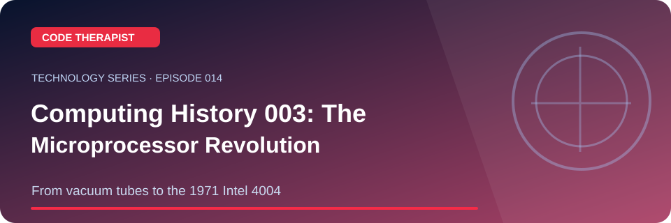

# Computing History 003: From Transistors to Microprocessors

**Code Therapist · 8 November 2026 · Episode 014**

[Series home](./README.md) · [Knowledge Hub](../../../README.md)

> **Overview:** The Intel 4004 released in **1971** was an influential commercial four-bit microprocessor with approximately 2,300 transistors. The historical story also includes earlier multi-chip processor work.

## 01 · Key concepts

The Intel 4004 released in **1971** was an influential commercial four-bit microprocessor with approximately 2,300 transistors. The historical story also includes earlier multi-chip processor work.

**What you should remember:** Understand the key parts, their purposes, common mistakes and how to validate what you learn. This guide is designed for beginner-friendly public education, with the detailed original references below.

## 02 · Visual workflow

## 03 · Guided demonstration

Draw a timeline showing 1947 transistor action, the IC era and the Intel 4004 milestone. Explain why a complete computer also needs RAM, I/O and software.

### Checklist for the video

- [ ] Explain the main term or problem in everyday language.
- [ ] Demonstrate a permitted example or show the documented historical timeline.
- [ ] Point out what the visual workflow actually means.
- [ ] Give viewers one practical question or exercise.
- [ ] Share the complete safe article URL and official sources.

## 04 · YouTube Short script (60–90 seconds)

| Scene | Spoken narration and visual direction |
|---|---|
| **00:00–00:08** | “Today on Code Therapist: Computing History 003: From Transistors to Microprocessors. Here's why it matters.” Show the branded landscape thumbnail. |
| **00:08–00:26** | “The Intel 4004 released in **1971** was an influential commercial four-bit microprocessor with approximately 2,300 transistors. The historical story also includes earlier multi-chip processor work.” Show one concept or a tightly framed source. |
| **00:26–00:55** | Walk viewers through the steps in the **Guided demonstration** above. Screen-record only owned material or the official permitted resource. |
| **00:55–01:12** | Display the diagram and explain the result and one important limitation. |
| **01:12–01:30** | “Find the full notes, original sources and next episode at Code Therapist on GitHub.” |

For a longer tutorial, expand the demonstration into a 4–6-minute walkthrough and show the checklist being completed.

## 05 · Sources and further reading

- [Primary reference 1](https://www.computerhistory.org/siliconengine/microprocessor-integrates-cpu-function-onto-a-single-chip/)
- [Primary reference 2](https://computerhistory.org/blog/who-invented-the-microprocessor/)

## 06 · Responsible-use and accuracy note

Avoid 'one inventor' and misleading absolute first claims; describe the specific milestone.

## 07 · WhatsApp-ready share caption

**📚 CODE THERAPIST · EPISODE 014**

**Computing History 003: From Transistors to Microprocessors**

Read the clear explanation, original references, visual workflow and practical learning exercise:

https://github.com/codetherapistpita-oss/codetherapistpita-oss/blob/main/knowledge-hub/07-SOCIAL-MEDIA/YOUTUBE/2026-11-08-TECHNOLOGY-EDUCATION/EP-014-microprocessor-history.md

> **Publication status:** This is a live GitHub article and recording script—not a claim of a published YouTube video.

---

[← All episodes](./README.md) · [Code Therapist](https://github.com/codetherapistpita-oss)
