

# 📺 Code Therapist — Technology Education Series

### Episodes 004–015 · Published 8 November 2026

**12 detailed articles · 12 original compact landscape visuals · 12 diagrams · Recording scripts and verified reference links**

[Previous Website Discoveries — Parts 001–003](../WEBSITE-YOU-DIDNT-KNOW/README.md) · [Creator Hub](../README.md) · [Knowledge Hub](../../../README.md)

> [!NOTE]
> These are **published GitHub learning guides and YouTube-ready scripts**, not videos uploaded to YouTube. Facts, product announcements, samples and proposed technology are labeled accordingly; screenshots and financial values are not represented as live measurements.

## Browse the 12 new episodes

| # | Landscape visual | Topic | Browse |
|---:|:---:|---|---|
| 004 | [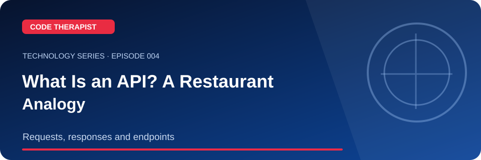](./EP-004-what-is-an-api.md) | **What Is an API? A Restaurant Analogy** | [Read + record](./EP-004-what-is-an-api.md) |
| 005 | [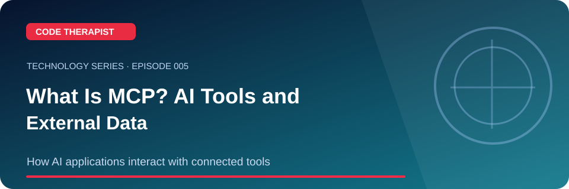](./EP-005-what-is-mcp.md) | **What Is MCP? AI Tools and External Data** | [Read + record](./EP-005-what-is-mcp.md) |
| 006 | [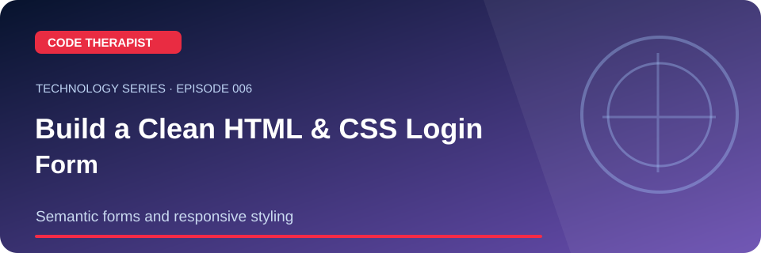](./EP-006-responsive-login-form.md) | **Build a Clean HTML & CSS Login Form** | [Read + record](./EP-006-responsive-login-form.md) |
| 007 | [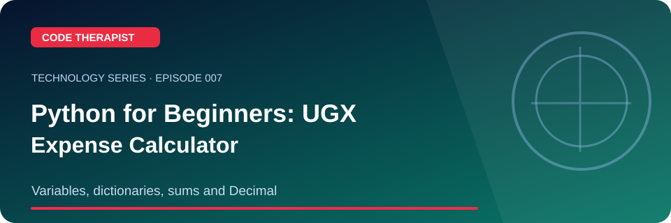](./EP-007-python-expense-calculator.md) | **Python Beginner Project: UGX Expense Calculator** | [Read + record](./EP-007-python-expense-calculator.md) |
| 008 | [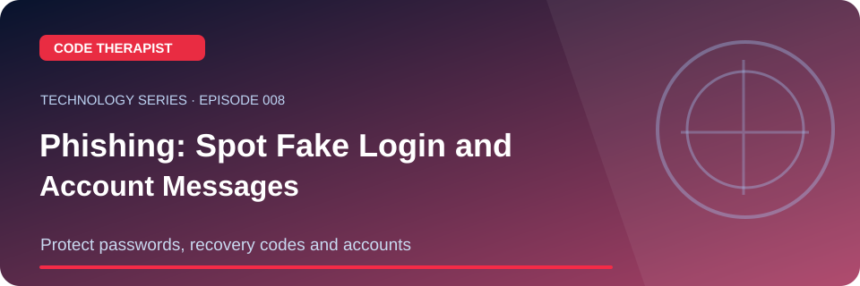](./EP-008-phishing-explained.md) | **Phishing: Spot Fake Login and Account Messages** | [Read + record](./EP-008-phishing-explained.md) |
| 009 | [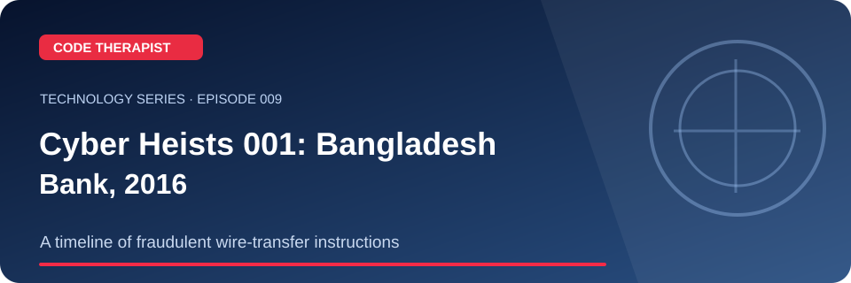](./EP-009-bangladesh-bank-heist-2016.md) | **Cyber Heists 001: Bangladesh Bank, 2016** | [Read + record](./EP-009-bangladesh-bank-heist-2016.md) |
| 010 | [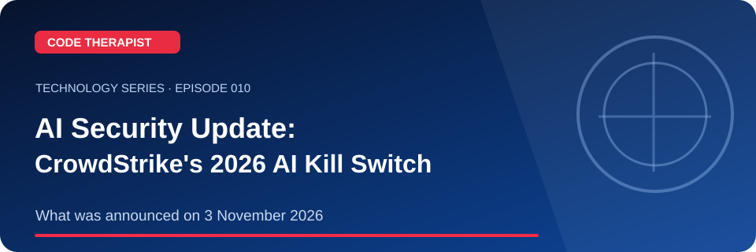](./EP-010-ai-kill-switch-2026.md) | **AI Agent Security: CrowdStrike's November 2026 Announcement** | [Read + record](./EP-010-ai-kill-switch-2026.md) |
| 011 | [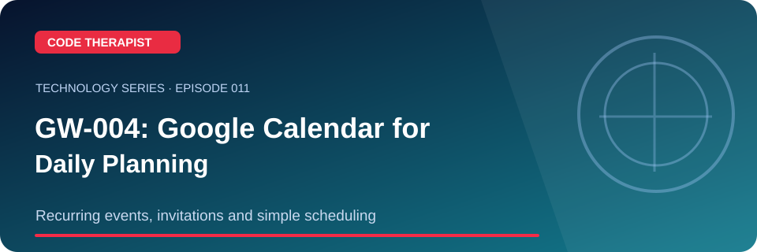](./EP-011-google-calendar-gw004.md) | **Google Workspace GW-004: Calendar Planning** | [Read + record](./EP-011-google-calendar-gw004.md) |
| 012 | [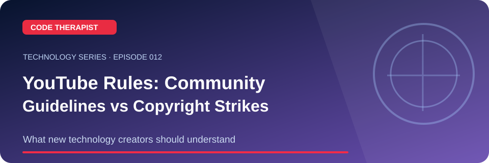](./EP-012-youtube-community-rules.md) | **YouTube Creator Rules: Guidelines vs Copyright** | [Read + record](./EP-012-youtube-community-rules.md) |
| 013 | [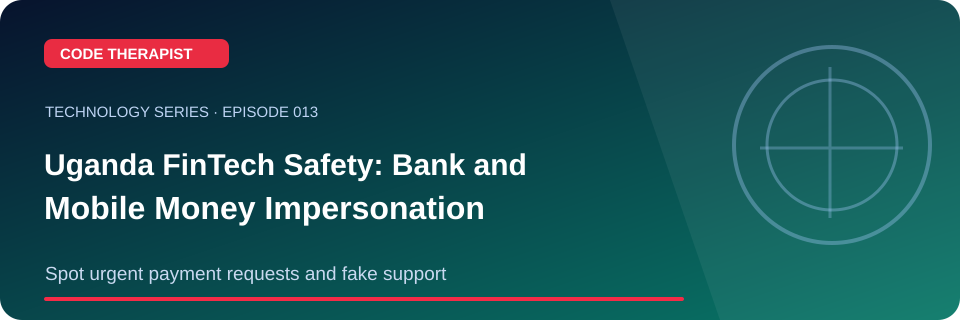](./EP-013-mobile-money-scam-safety.md) | **Bank and Mobile Money Impersonation Safety** | [Read + record](./EP-013-mobile-money-scam-safety.md) |
| 014 | [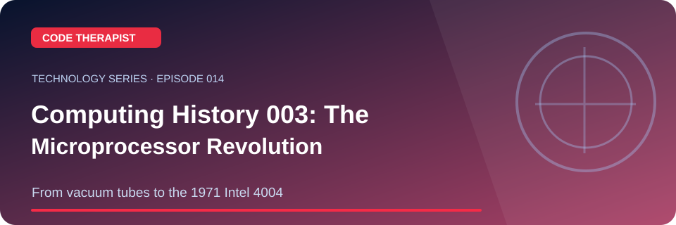](./EP-014-microprocessor-history.md) | **Computing History 003: From Transistors to Microprocessors** | [Read + record](./EP-014-microprocessor-history.md) |
| 015 | [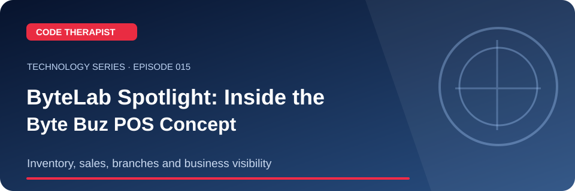](./EP-015-byte-buz-spotlight.md) | **ByteLab Spotlight: Byte Buz POS and Business Operations** | [Read + record](./EP-015-byte-buz-spotlight.md) |

## Standard article design

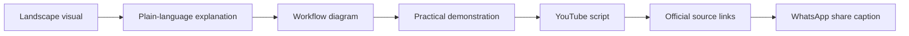

Each post includes a self-contained practical lesson and points to reputable original sources. Original SVG banner assets are stored in [assets](./assets). New work should preserve accessible alt text, titles, date and actual publication status.

## How to publish a video

1. Open the article, review its source links and accuracy/date disclaimer.
2. Record an original screen demo or camera explanation using safe material.
3. Add the relevant visual banner or diagram, plus subtitles and a clear headline.
4. Place the direct article URL and source links in the YouTube description.
5. Mark the article/video as published **only after the actual YouTube upload succeeds**.

[← YouTube Hub](../README.md) · [Code Therapist](https://github.com/codetherapistpita-oss)
