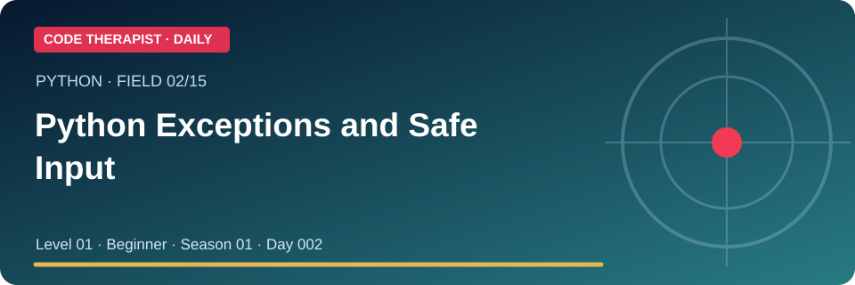
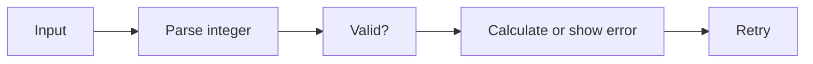

# 02 · Python Exceptions and Safe Input

**Field:** Python · **Level 01 · Beginner** · **Season 01 · Day 002** · **Prepared:** 9 November 2026

[← Today's 15 Fields](./README.md) · [Knowledge Hub](../../../README.md)

> **Learning objective:** try/except handles anticipated runtime errors, while carefully scoped exception blocks keep unexpected failures visible.

## 01 · Lecture and key knowledge

try/except handles anticipated runtime errors, while carefully scoped exception blocks keep unexpected failures visible.

The goal is to understand the concept, identify its use and limitations, and **demonstrate it safely**. A polished example, confident answer or passing design mockup is not proof that software is correctly implemented. Use this lesson as a starting point and read the original documents cited below.

## 02 · How the process works

## 03 · Practical lab — Season 01 · Day 002

Prompt for a fictional product quantity using int(input()). Catch ValueError and let the learner retry; explain why bare except hides bugs.

### Learning procedure

1. Read the two source references below and note the key terms.
2. State the input, expected result and a failure case before beginning.
3. Perform the exercise using a **safe fictional example** or your own permitted lab.
4. Compare what actually happened with the expected result; record any error.
5. Write a short conclusion identifying where this technique is appropriate.

## 04 · Knowledge check

1. Explain the main concept to a new learner in two sentences.
2. Give an example relevant to a Ugandan student, developer or business.
3. Draw the workflow without copying the diagram above.
4. Describe one limitation or security concern and a way to evaluate it.
5. Identify an important statement and open the original source supporting it.

**Class assessment / 10 marks:** terminology (2), example (2), completed practice evidence (3), limitations (2), source verification (1). Results are not claimed to be completed.

## 05 · Ready-to-record YouTube narration

**00:00–00:08 · Hook:** “Code Therapist, Field 02: Python Exceptions and Safe Input. Here's the idea you should understand today.”

**00:08–00:25 · Explanation:** “try/except handles anticipated runtime errors, while carefully scoped exception blocks keep unexpected failures visible.”

**00:25–00:55 · Demonstration:** Show the safe practical lab: Prompt for a fictional product quantity using int(input()). Catch ValueError and let the learner retry; explain why bare except hides bugs.

**00:55–01:15 · Diagram:** Explain the flowchart stage by stage, including the important limitation.

**01:15–01:25 · Closing:** “Read the full lesson and official sources in the Code Therapist Knowledge Hub. Save and share for the next day.”

**Recording checklist:** Capture your own screen or licensed assets; test any code before saying it ran; use subtitles and clearly distinguish real facts from demonstrations.

## 06 · Original sources and reference links

- [Official/primary reference 1](https://docs.python.org/3/tutorial/errors.html)
- [Official/primary reference 2](https://docs.python.org/3/library/exceptions.html)

**Accuracy and safety:** Do not suppress unknown exceptions or leak private logs.

## 07 · WhatsApp / YouTube share caption

**📚 CODE THERAPIST · FIELD 02 · SEASON 01 · DAY 002**

**Python Exceptions and Safe Input**

Learn the key idea with a clean diagram, practical exercise, study questions and official sources.

🔗 https://github.com/codetherapistpita-oss/codetherapistpita-oss/blob/main/knowledge-hub/07-SOCIAL-MEDIA/YOUTUBE/2026-11-09-TECHNOLOGY-DAILY-15/FIELD-02-python-exceptions-and-safe-input.md

> **Publication status:** GitHub article and video script prepared; this is not a claim that a YouTube video has been uploaded.

[← Today's 15 posts](./README.md) · [Code Therapist](https://github.com/codetherapistpita-oss)
