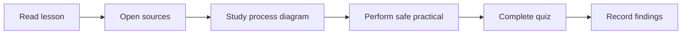

# 🎓 Level 01 — Beginner Technology

**Code Therapist · Daily lesson set · 9 November 2026**

[← Today's 15 topics](./README.md) · [Knowledge Hub](../../../README.md)

## Study order

| Topic | Season / day | Source-based lesson |
|---|---|---|
| Python | S01 · D002 | [Python Exceptions and Safe Input](./FIELD-02-python-exceptions-and-safe-input.md) |
| Data Analytics | S01 · D002 | [Power BI: Turn Sample Data into a Dashboard](./FIELD-09-power-bi-turn-sample-data-into-a-dashboard.md) |
| Accessibility | S01 · D002 | [WCAG 2.2: Make Interfaces More Accessible](./FIELD-11-wcag-2-2-make-interfaces-more-accessible.md) |
| Cryptography | S01 · D002 | [Hashing vs Encryption vs Password Storage](./FIELD-12-hashing-vs-encryption-vs-password-storage.md) |
| Networking | S01 · D002 | [DNS Explained: How a Website Name Finds a Server](./FIELD-14-dns-explained-how-a-website-name-finds-a-server.md) |
| Animation | S01 · D002 | [Blender Keyframes: Animate a Simple Object](./FIELD-15-blender-keyframes-animate-a-simple-object.md) |

## Learning workflow

**Progress rule:** A lesson is published once its GitHub page is available; student completion is separate and requires actual exercise results. Future daily content should continue the relevant field's own sequence and not repeat a topic for the sake of the calendar.

[← All 15 posts](./README.md)
