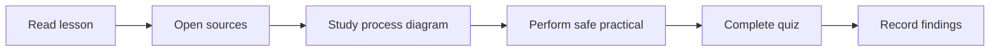

# 🎓 Level 02 — Practical Development

**Code Therapist · Daily lesson set · 9 November 2026**

[← Today's 15 topics](./README.md) · [Knowledge Hub](../../../README.md)

## Study order

| Topic | Season / day | Source-based lesson |
|---|---|---|
| JavaScript | S01 · D002 | [Javascript Promises and async/await](./FIELD-01-javascript-promises-and-async-await.md) |
| SQL | S01 · D002 | [SQL Indexes: Faster Searches and Tradeoffs](./FIELD-03-sql-indexes-faster-searches-and-tradeoffs.md) |
| Security | S01 · D002 | [Role-Based Access Control in a Web App](./FIELD-04-role-based-access-control-in-a-web-app.md) |
| AI | S01 · D002 | [AI Agents: Tools, Actions and Observation](./FIELD-05-ai-agents-tools-actions-and-observation.md) |
| GitHub | S01 · D002 | [GitHub Actions: Your First Continuous Integration Check](./FIELD-06-github-actions-your-first-continuous-integration-check.md) |
| Docker | S01 · D002 | [Docker Containers vs Virtual Machines](./FIELD-07-docker-containers-vs-virtual-machines.md) |
| Mobile | S01 · D002 | [Android App Architecture: UI, State and Data](./FIELD-10-android-app-architecture-ui-state-and-data.md) |

## Learning workflow

**Progress rule:** A lesson is published once its GitHub page is available; student completion is separate and requires actual exercise results. Future daily content should continue the relevant field's own sequence and not repeat a topic for the sake of the calendar.

[← All 15 posts](./README.md)
