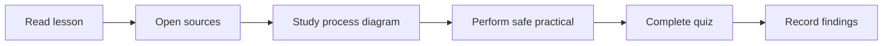

# 🎓 Level 03 — Advanced Technology and Research

**Code Therapist · Daily lesson set · 9 November 2026**

[← Today's 15 topics](./README.md) · [Knowledge Hub](../../../README.md)

## Study order

| Topic | Season / day | Source-based lesson |
|---|---|---|
| Cloud | S02 · D001 | [Google Cloud Architecture: 2026 Well-Architected Updates](./FIELD-08-google-cloud-architecture-2026-well-architected-updates.md) |
| Finance APIs | S02 · D001 | [Payment Idempotency: Prevent Duplicate Charges](./FIELD-13-payment-idempotency-prevent-duplicate-charges.md) |

## Learning workflow

**Progress rule:** A lesson is published once its GitHub page is available; student completion is separate and requires actual exercise results. Future daily content should continue the relevant field's own sequence and not repeat a topic for the sake of the calendar.

[← All 15 posts](./README.md)
