

# 📺 Code Therapist — Daily Technology Research
### 15 fields · Monday, 9 November 2026

**15 structured lessons · 15 original landscape graphics · 15 workflow diagrams · 15 recording scripts**

[Previous daily batch](../2026-11-08-TECHNOLOGY-EDUCATION/README.md) · [Website discoveries](../WEBSITE-YOU-DIDNT-KNOW/README.md) · [YouTube Hub](../README.md)

> **Publication status:** These are published, source-linked **GitHub learning materials**, not uploaded YouTube videos. Examples use fictional data. References are official technical documentation or original sources; current announcements are explicitly dated.

## Choose your level

| Level | Skills | Lessons |
|---|---|---:|
| [Level 01 — Beginners](./LEVEL-01-BEGINNER.md) | Python, dashboards, accessibility, security basics, networking and animation | 6 |
| [Level 02 — Developers / Practical](./LEVEL-02-PRACTICAL.md) | JavaScript, SQL, access control, AI agents, GitHub Actions, Docker and Android | 7 |
| [Level 03 — Advanced / Research](./LEVEL-03-ADVANCED.md) | Cloud architecture research and safe payment API patterns | 2 |

Every article uses **season and day numbers** in its header, so learners can progress progressively. These numbers identify positions in the field-specific learning tracks, not mandatory calendar attendance.

## Today's 15 illustrated topics

| Field | Landscape preview | Full lesson and sources | Season / Day |
|---:|---|---|---|
| 01 | [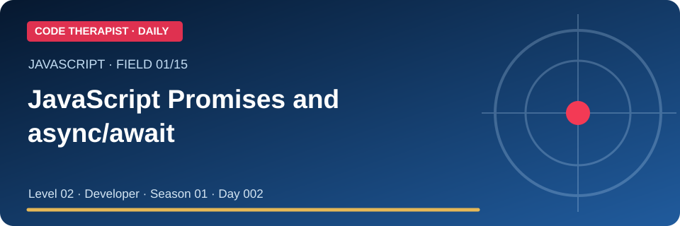](./FIELD-01-javascript-promises-and-async-await.md) | **[Javascript Promises and async/await](./FIELD-01-javascript-promises-and-async-await.md)** | S01 · D002 |
| 02 | [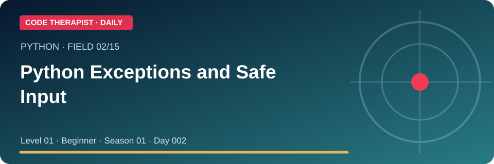](./FIELD-02-python-exceptions-and-safe-input.md) | **[Python Exceptions and Safe Input](./FIELD-02-python-exceptions-and-safe-input.md)** | S01 · D002 |
| 03 | [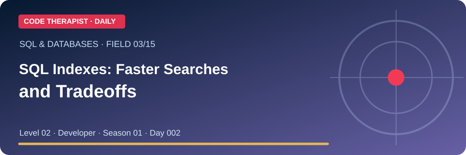](./FIELD-03-sql-indexes-faster-searches-and-tradeoffs.md) | **[SQL Indexes: Faster Searches and Tradeoffs](./FIELD-03-sql-indexes-faster-searches-and-tradeoffs.md)** | S01 · D002 |
| 04 | [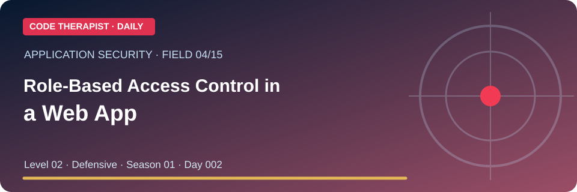](./FIELD-04-role-based-access-control-in-a-web-app.md) | **[Role-Based Access Control in a Web App](./FIELD-04-role-based-access-control-in-a-web-app.md)** | S01 · D002 |
| 05 | [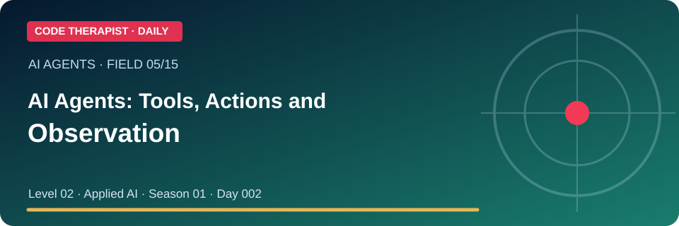](./FIELD-05-ai-agents-tools-actions-and-observation.md) | **[AI Agents: Tools, Actions and Observation](./FIELD-05-ai-agents-tools-actions-and-observation.md)** | S01 · D002 |
| 06 | [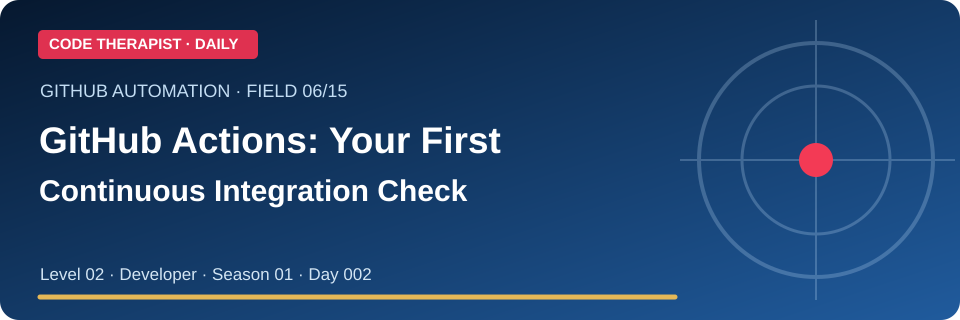](./FIELD-06-github-actions-your-first-continuous-integration-check.md) | **[GitHub Actions: Your First Continuous Integration Check](./FIELD-06-github-actions-your-first-continuous-integration-check.md)** | S01 · D002 |
| 07 | [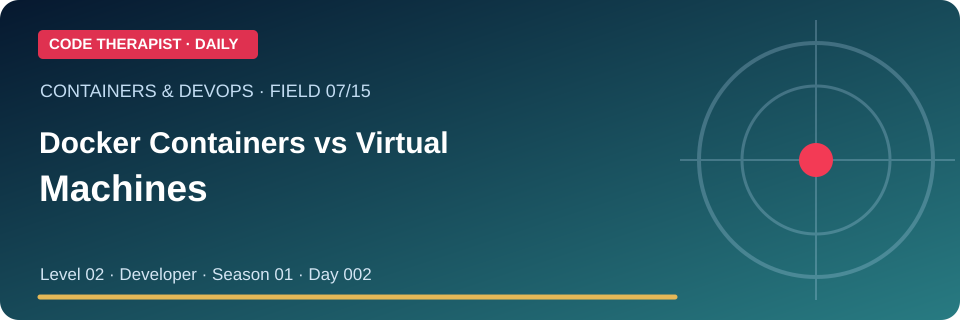](./FIELD-07-docker-containers-vs-virtual-machines.md) | **[Docker Containers vs Virtual Machines](./FIELD-07-docker-containers-vs-virtual-machines.md)** | S01 · D002 |
| 08 | [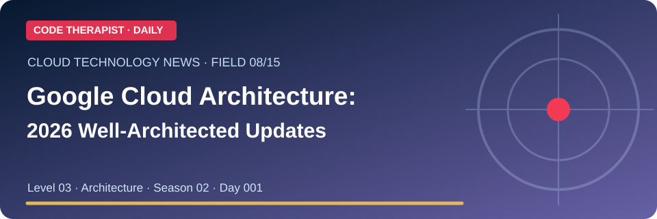](./FIELD-08-google-cloud-architecture-2026-well-architected-updates.md) | **[Google Cloud Architecture: 2026 Well-Architected Updates](./FIELD-08-google-cloud-architecture-2026-well-architected-updates.md)** | S02 · D001 |
| 09 | [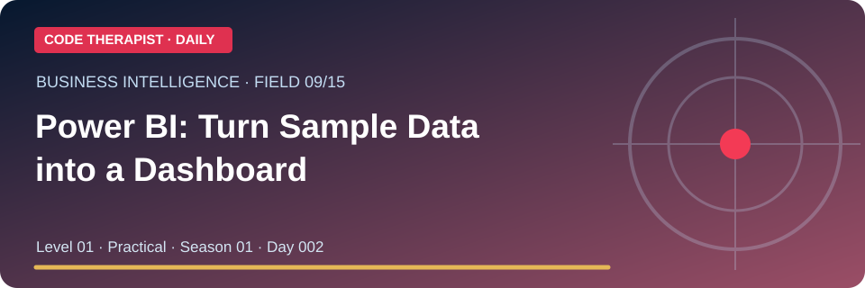](./FIELD-09-power-bi-turn-sample-data-into-a-dashboard.md) | **[Power BI: Turn Sample Data into a Dashboard](./FIELD-09-power-bi-turn-sample-data-into-a-dashboard.md)** | S01 · D002 |
| 10 | [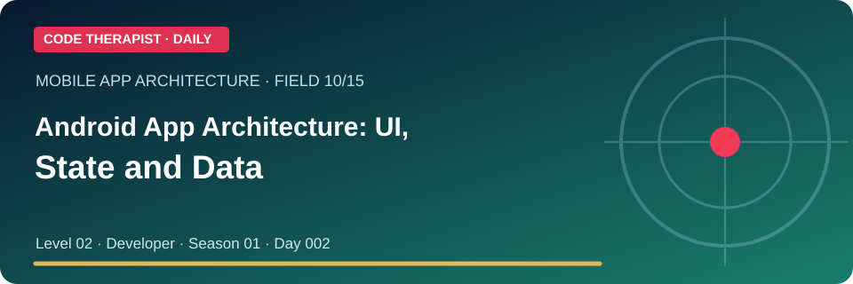](./FIELD-10-android-app-architecture-ui-state-and-data.md) | **[Android App Architecture: UI, State and Data](./FIELD-10-android-app-architecture-ui-state-and-data.md)** | S01 · D002 |
| 11 | [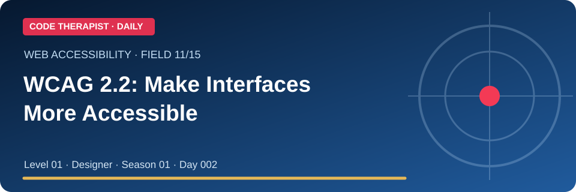](./FIELD-11-wcag-2-2-make-interfaces-more-accessible.md) | **[WCAG 2.2: Make Interfaces More Accessible](./FIELD-11-wcag-2-2-make-interfaces-more-accessible.md)** | S01 · D002 |
| 12 | [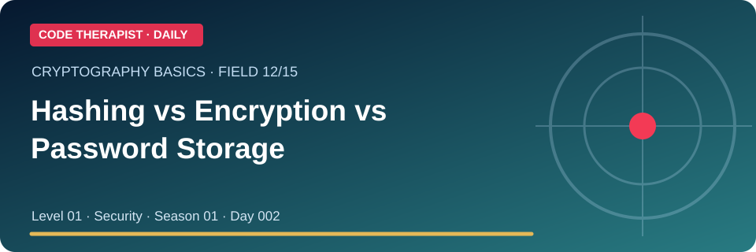](./FIELD-12-hashing-vs-encryption-vs-password-storage.md) | **[Hashing vs Encryption vs Password Storage](./FIELD-12-hashing-vs-encryption-vs-password-storage.md)** | S01 · D002 |
| 13 | [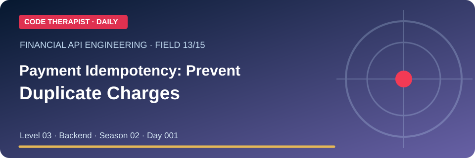](./FIELD-13-payment-idempotency-prevent-duplicate-charges.md) | **[Payment Idempotency: Prevent Duplicate Charges](./FIELD-13-payment-idempotency-prevent-duplicate-charges.md)** | S02 · D001 |
| 14 | [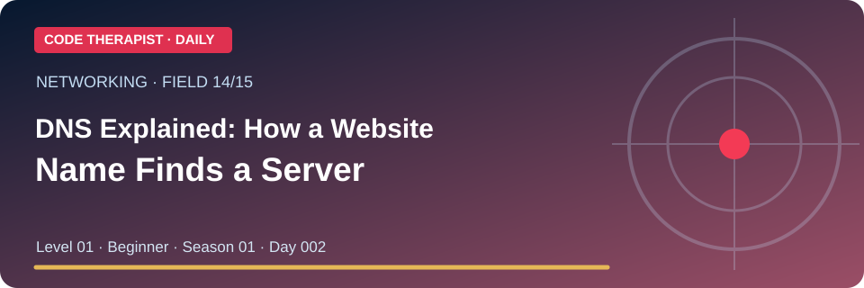](./FIELD-14-dns-explained-how-a-website-name-finds-a-server.md) | **[DNS Explained: How a Website Name Finds a Server](./FIELD-14-dns-explained-how-a-website-name-finds-a-server.md)** | S01 · D002 |
| 15 | [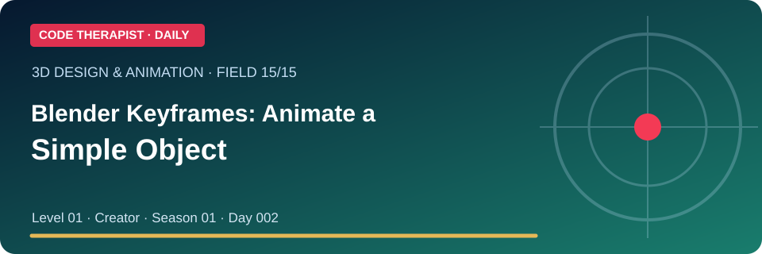](./FIELD-15-blender-keyframes-animate-a-simple-object.md) | **[Blender Keyframes: Animate a Simple Object](./FIELD-15-blender-keyframes-animate-a-simple-object.md)** | S01 · D002 |

## Our publication format

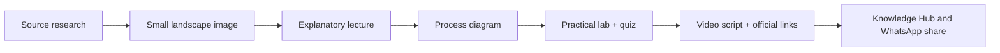

### Daily content rules

1. Compare existing Knowledge Hub resources to avoid repeating the same introductory lessons.
2. Check **official** technical documentation and the date of technology announcements.
3. Keep the image layout compact (landscape 3:1 visual); images are original SVG design assets.
4. Place each post in its field with **Beginner, Practical or Advanced**, plus **Season / Day**.
5. Explain outputs without claiming unrun code, completed tests, real customer figures or product availability.
6. Provide original references and follow safe, authorized exercises.

### One share link for all 15

**https://github.com/codetherapistpita-oss/codetherapistpita-oss/tree/main/knowledge-hub/07-SOCIAL-MEDIA/YOUTUBE/2026-11-09-TECHNOLOGY-DAILY-15**

[← YouTube Publishing Hub](../README.md) · [Code Therapist GitHub](https://github.com/codetherapistpita-oss)
