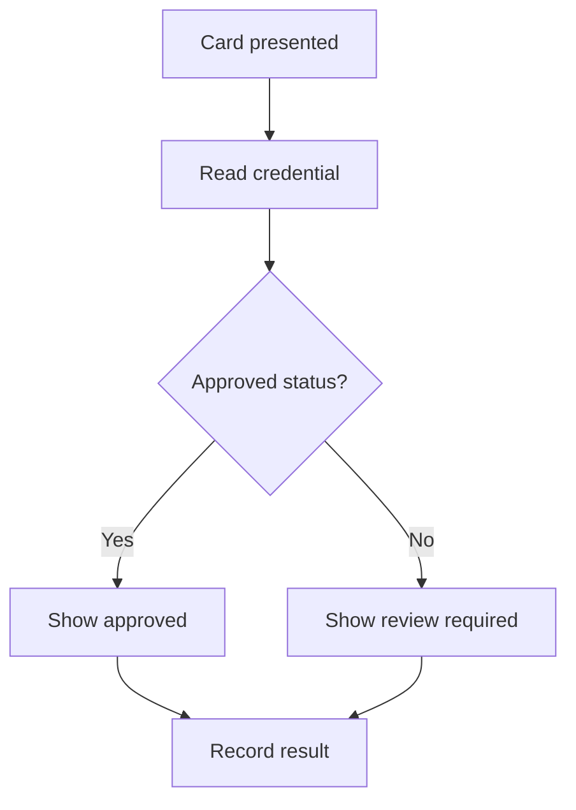

# 🌐 The Website You Didn't Know — Part 001

## Create Professional Diagrams with diagrams.net

**Website:** [app.diagrams.net](https://app.diagrams.net/) · **Topic:** Software Engineering · **Published:** 9 November 2026 · **Level:** Beginner

> 💡 **One-minute answer:** diagrams.net (also known as draw.io) helps people create editable flowcharts, software architectures, network diagrams and many other diagrams. The official documentation explains how to save the editable source and export images. This is useful for assignments, project proposals and developer documentation.

## What will we create?

A simple **student-card verification flowchart**, using an original example relevant to technical project work:

## Hands-on tutorial · about 5–8 minutes

1. Open the official editor at [app.diagrams.net](https://app.diagrams.net/).
2. Choose the storage location offered by your version; use a location you trust and can access later.
3. Start a new blank diagram. Name it **Student Card Verification Flow**.
4. Add **rounded rectangles** for steps and a **diamond** for the decision.
5. Connect the shapes with arrows; label the two decision paths **Yes** and **No**.
6. Check that no connector crosses over labels and that the decision is understandable.
7. Use **File → Save As** to keep an editable copy. For sharing, explore **File → Export As**, selecting PNG or SVG.
8. Open the saved output and check that all text is readable.

**Tip:** Keep an editable diagram copy; an image export is mainly for viewing. Some export choices can embed source data for later editing.

## Ready-to-record YouTube Short · approximately 45–60 seconds

**00:00–00:05 · Hook**  
“Did you know you can create professional system diagrams right inside your browser?”

**00:05–00:14 · Site reveal**  
“This is diagrams.net. It helps you draw flowcharts, database relationships, network layouts and software architecture.”

**00:14–00:38 · Demo**  
“Create a blank canvas, add two process boxes, put a decision diamond in the middle and connect everything with arrows. Now label your Yes and No paths.”

**00:38–00:50 · Export**  
“Save the editable diagram, then export a PNG or SVG to add to your project proposal or GitHub README.”

**00:50–00:60 · Closing**  
“That's Part 001 of The Website You Didn't Know. The official link and written steps are below. Follow Code Therapist for Part 002.”

## Longer recording shot list

| Shot | Screen content | Voiceover point |
|---|---|---|
| 1 | Browser opens official site | What diagrams.net does |
| 2 | New blank diagram | Explain purpose and name |
| 3 | Shapes and connectors | Demonstrate decision flow |
| 4 | Style and alignment | Avoid overlapping labels |
| 5 | Save/export menu | Editable file vs display export |
| 6 | Finished diagram | Link to tutorial and next episode |

## Responsible-use notes

- Do not place unapproved passwords, access keys, student records or private network designs in public diagrams.
- Save only to an authorized storage destination.
- Diagram content is only a design illustration, not proof that the system has been built.

## Official references

- [diagrams.net editor](https://app.diagrams.net/)
- [draw.io — Save and export diagrams](https://www.drawio.com/docs/getting-started/save-diagram-files/)
- [draw.io — Export formats](https://www.drawio.com/docs/manual/export/export-diagram/)

## Ready-to-share caption

**🌐 The Website You Didn't Know — Part 001**  
Want cleaner flowcharts, system architecture and project diagrams? Explore **diagrams.net** and follow this practical beginner guide.

[← Series home](./README.md) · [Part 002 →](./PART-002-PHOTOPEA.md)
