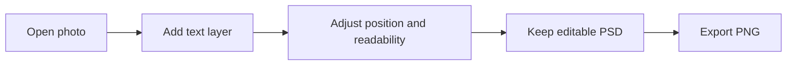

# 🌐 The Website You Didn't Know — Part 002

## Edit Photos and Designs in Your Browser with Photopea

**Official website:** [photopea.com](https://www.photopea.com/) · **Topic:** Digital Graphics · **Published:** 9 November 2026 · **Level:** Beginner

> 💡 **One-minute answer:** Photopea is a browser-based editor for image work, including layers. Its official documentation covers loading files, arranging layers, saving editable PSD documents and exporting PNG or JPG files.

## Practical demonstration: design a simple social post

Use a photo you own or are authorized to edit, and add a title:

### Step-by-step tutorial · about 6–10 minutes

1. Open [Photopea](https://www.photopea.com/).
2. Select **File → Open** and load your own image.
3. Use the text tool to write **TECH TIP OF THE DAY** on a separate layer.
4. Open the **Layers** panel and move the text layer above the photo.
5. Adjust text size, alignment and contrast without hiding the main subject.
6. Save an editable copy using **File → Save as PSD**.
7. Choose **File → Export As → PNG** to create the shareable image.
8. Reopen the PNG and confirm it is sharp, readable and correctly framed.

### Why layers matter

| Layer | Example | Editable independently? |
|---|---|---|
| Top | Text headline | Yes |
| Middle | Optional decorative border | Yes |
| Bottom | Photo / background | Yes |

**Do not overwrite the only copy of a valuable image.** Save working files separately.

## Ready-to-record YouTube Short · approximately 45–60 seconds

**00:00–00:05 · Hook**  
“What if you could edit photos and create graphics without installing a desktop editor?”

**00:05–00:15 · Site reveal**  
“This is Photopea, a powerful editor you can open in a web browser.”

**00:15–00:38 · Demo**  
“Open a photo, choose the text tool, add a headline, and arrange your design using layers. You can change the text without changing the photograph underneath.”

**00:38–00:50 · Save**  
“Keep your project editable as a PSD, then export a PNG to share online.”

**00:50–01:00 · Closing**  
“That's Part 002 of The Website You Didn't Know. Find the official link and written tutorial below. Next time, we build an AI model.”

## Shot list

| Shot | What to show |
|---|---|
| 1 | Homepage/editor on the official domain |
| 2 | Opening an authorized sample image |
| 3 | Text and Layers panel |
| 4 | Small before-and-after comparison |
| 5 | PSD saving and PNG export |
| 6 | Final visual and Code Therapist series title |

## Safety, privacy and copyright

Photopea says it performs the image-editing work locally in the browser and describes offline use after loading the site. That does **not** remove the need to protect private documents, consider browser extensions, or obey image copyright and consent requirements. Avoid uploading or publicizing someone else's private material.

## Official references

- [Photopea](https://www.photopea.com/)
- [Photopea — Introduction and use](https://www.photopea.com/learn/)
- [Photopea — Open and save](https://www.photopea.com/learn/opening-saving)
- [Photopea — Layers](https://www.photopea.com/learn/layers)

## Ready-to-share caption

**🎨 The Website You Didn't Know — Part 002**  
Create better social posts and edit images directly in your browser. Try Photopea with this beginner-friendly tutorial.

[← Part 001](./PART-001-DIAGRAMS-NET.md) · [Series home](./README.md) · [Part 003 →](./PART-003-TEACHABLE-MACHINE.md)
