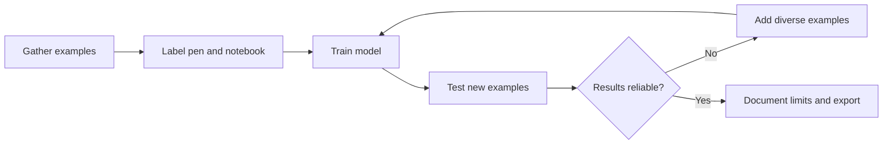

# 🌐 The Website You Didn't Know — Part 003

## Train an AI Image Classifier Without Coding

**Official website:** [Teachable Machine by Google](https://teachablemachine.withgoogle.com/) · **Topic:** AI & Machine Learning · **Published:** 9 November 2026 · **Level:** Beginner

> 💡 **One-minute answer:** Teachable Machine helps you gather labeled image, audio or pose examples, train a simple machine-learning model, test new inputs and export a model for supported projects. It is an educational tool, not a guarantee of production AI accuracy.

## Demo: recognize two everyday objects

Try identifying a **pen** versus a **notebook** using images you create yourself.

### Hands-on tutorial · about 8–12 minutes

1. Go to [Teachable Machine](https://teachablemachine.withgoogle.com/) and choose **Get Started**.
2. Select an **Image Project** and the appropriate image model option.
3. Create two categories: **Pen** and **Notebook**.
4. Add multiple examples of each item from varied angles and lighting, using only images you are authorized to use.
5. Select **Train Model**. Keep your browser open as training runs.
6. Test with **new** examples that were not used for training.
7. Try different backgrounds; see where predictions become unreliable.
8. Explore **Export Model** if you want to learn about using the model with other compatible tools.

## Mini evaluation table

| Test object | Predicted label | Correct? | What changed? |
|---|---|---|---|
| Pen, new background | _Record after demo_ | _Pending_ | Background |
| Notebook, tilted | _Record after demo_ | _Pending_ | Angle |
| Other unrelated object | _Record after demo_ | _Pending_ | Unknown example |

Do **not** fill this chart with fabricated accuracies. The example shows how to gather your own evidence.

## Ready-to-record YouTube Short · approximately 50–65 seconds

**00:00–00:06 · Hook**  
“Did you know you can teach a computer to recognize objects without writing any code?”

**00:06–00:16 · Site reveal**  
“Google's Teachable Machine lets you build a simple model using your own examples.”

**00:16–00:40 · Demo**  
“Create one class for a pen and another for a notebook. Add examples, press Train, and then hold up a new object to test the model.”

**00:40–00:54 · Limitations**  
“Now change the lighting or background. Notice how results may change—AI learns patterns from examples and can make mistakes.”

**00:54–01:05 · Closing**  
“That's Part 003 of The Website You Didn't Know. Full steps and the official link are in the Code Therapist Knowledge Hub.”

## Suggested recording shots

| Shot | Visual |
|---|---|
| 1 | Official website and project choices |
| 2 | Named Pen / Notebook classes |
| 3 | Collecting example images |
| 4 | Training indicator |
| 5 | New-object testing and unexpected results |
| 6 | Export Model option, sources and caution |

## Privacy and responsible use

- Avoid collecting faces, voiceprints, children's images, confidential property images or other sensitive content without appropriate authorization.
- The website describes options for performing the work on-device; check your actual export and hosting selections before making privacy claims.
- A two-class demonstration is **not** a safety-critical or commercial identification system.
- Always test with novel samples and document model uncertainty.

## Official reference

- [Google Teachable Machine](https://teachablemachine.withgoogle.com/)
- [Start a Teachable Machine project](https://teachablemachine.withgoogle.com/train)

## Ready-to-share caption

**🤖 The Website You Didn't Know — Part 003**  
Learn how to train a basic AI image classifier without coding using Google's Teachable Machine. Follow the beginner tutorial and test it yourself.

[← Part 002](./PART-002-PHOTOPEA.md) · [Series home](./README.md)
