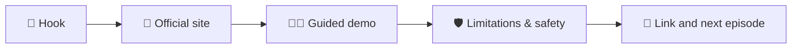

# 🌐 The Website You Didn't Know — Code Therapist

**Series launch:** 9 November 2026 · **Language:** English · **Audience:** students, creators and developers

> The goal is to demonstrate genuinely useful technology websites—not to promote suspicious downloads, cracks or sites that harvest accounts. Every episode has an official link, practical tutorial, responsible-use note, and a ready-to-record script. **Written guides are published; videos are production scripts, not uploaded YouTube videos.**

## Episodes

| Episode | Website | Benefit | Guide + script |
|---|---|---|---|
| **001** | [diagrams.net](https://app.diagrams.net/) | Draw system architecture, flowcharts and ER diagrams | **[Part 001 — Diagramming](./PART-001-DIAGRAMS-NET.md)** |
| **002** | [Photopea](https://www.photopea.com/) | Edit photographs and layer-based graphics in a browser | **[Part 002 — Photo editing](./PART-002-PHOTOPEA.md)** |
| **003** | [Teachable Machine](https://teachablemachine.withgoogle.com/) | Train a simple image classifier without writing code | **[Part 003 — Machine learning](./PART-003-TEACHABLE-MACHINE.md)** |

## Standard episode format

Each article has a short-form narration, a longer tutorial script, a recording shot list, sample screen activity, verified official links and share captions. Prices, features and interface labels may change after the article's research date.

### Publication and credit

**Code Therapist** · [GitHub](https://github.com/codetherapistpita-oss) · [Portfolio](https://codetherapist.netlify.app/) · [ByteLab Uganda](https://bytelabug.com/)

Independent editorial series. Site names and trademarks belong to their respective owners; inclusion does not imply endorsement or affiliation.
