# Code Therapist — Learning Seasons & Topic Showcase

**Launch collection:** 11 November 2026 · **15 illustrated lessons · 4 learning seasons**

Explore the Knowledge Hub like an educational campaign: select a season, view the topic advertisement, open the lesson, then complete the exercise. These are curated learning pathways, not claims that full multi-week courses have been completed.

**Learning workflow:** Discover → Read → Practice → Reflect → Continue to next topic.

## SEASON 01 — BUILD & CODE

**Workflow:** Learn logic → build a working tool → debug → document.

### 01. JavaScript conditional logic

[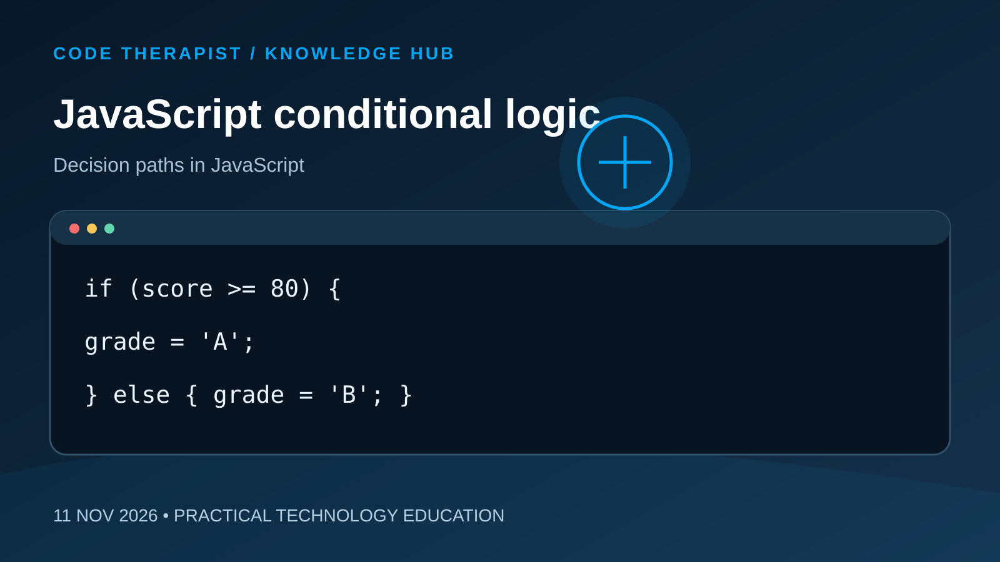](../01-DEVELOPER-ACADEMY/2026-11-11-JAVASCRIPT-CONDITIONAL-LOGIC.md)

**[Open lesson and exercise](../01-DEVELOPER-ACADEMY/2026-11-11-JAVASCRIPT-CONDITIONAL-LOGIC.md)** · DEVELOPER ACADEMY

### 02. Python command-line task tracker

[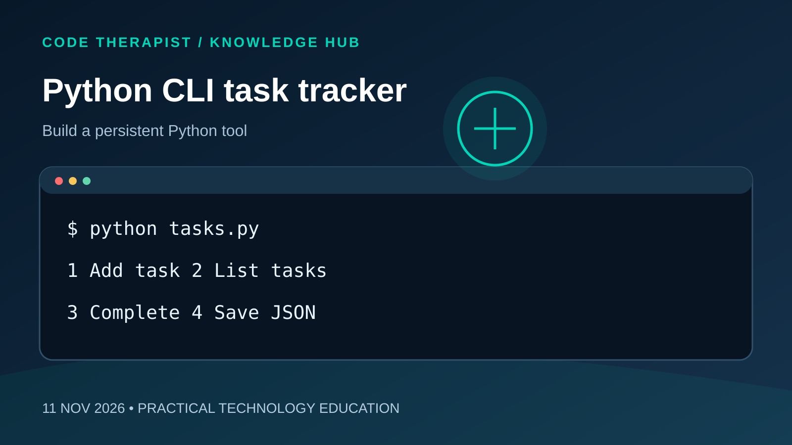](../02-FREE-SOURCE-CODE/2026-11-11-PYTHON-COMMAND-LINE-TASK-TRACKER.md)

**[Open lesson and exercise](../02-FREE-SOURCE-CODE/2026-11-11-PYTHON-COMMAND-LINE-TASK-TRACKER.md)** · FREE SOURCE CODE

### 03. VS Code debugging

[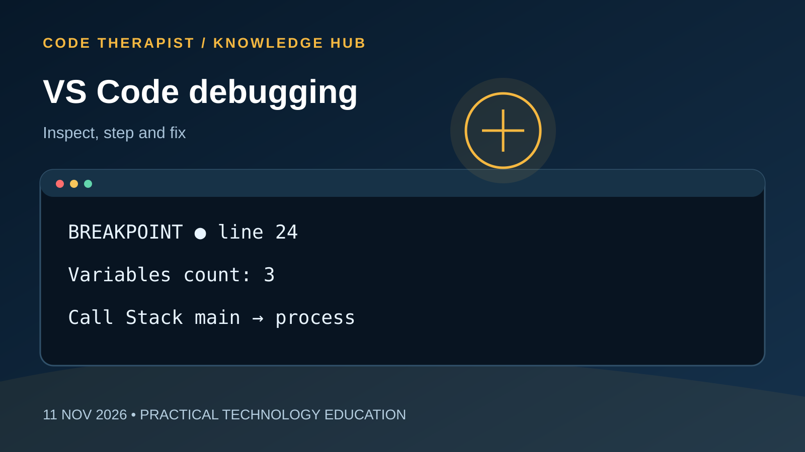](../03-SOFTWARE-AND-TOOLS/2026-11-11-VS-CODE-DEBUGGING-ESSENTIALS.md)

**[Open lesson and exercise](../03-SOFTWARE-AND-TOOLS/2026-11-11-VS-CODE-DEBUGGING-ESSENTIALS.md)** · SOFTWARE AND TOOLS

### 04. Reproducible READMEs

[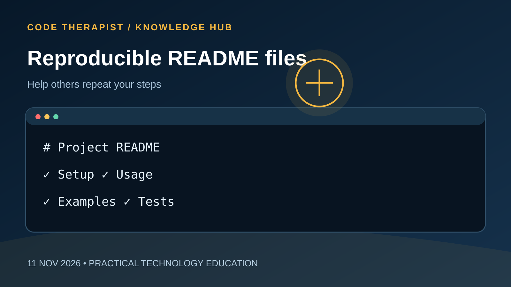](../08-DOCUMENTATION/2026-11-11-WRITING-REPRODUCIBLE-READMES.md)

**[Open lesson and exercise](../08-DOCUMENTATION/2026-11-11-WRITING-REPRODUCIBLE-READMES.md)** · DOCUMENTATION

## SEASON 02 — PROTECT & OPERATE

**Workflow:** Protect accounts → respond to incidents → process events safely → test recovery.

### 01. Password hashing and salting

[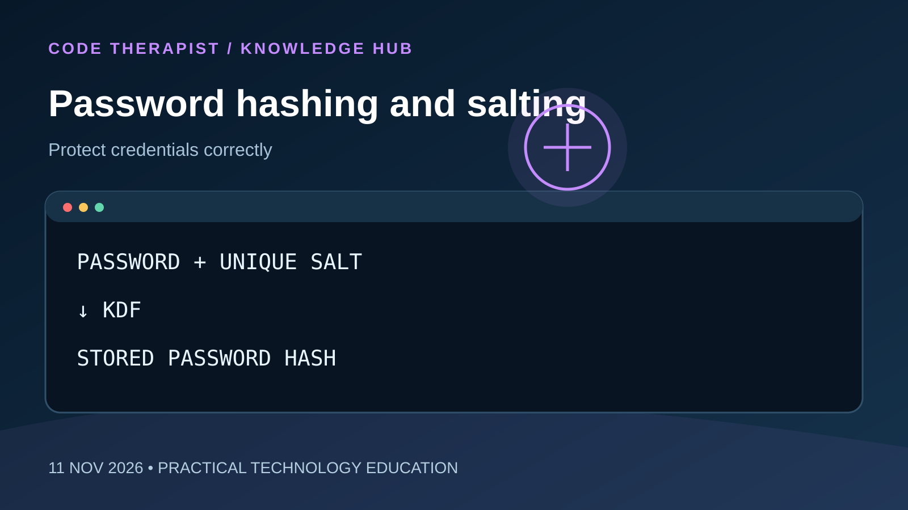](../04-CYBERSECURITY/2026-11-11-PASSWORD-HASHING-AND-SALTING.md)

**[Open lesson and exercise](../04-CYBERSECURITY/2026-11-11-PASSWORD-HASHING-AND-SALTING.md)** · CYBERSECURITY

### 02. Incident response timeline

[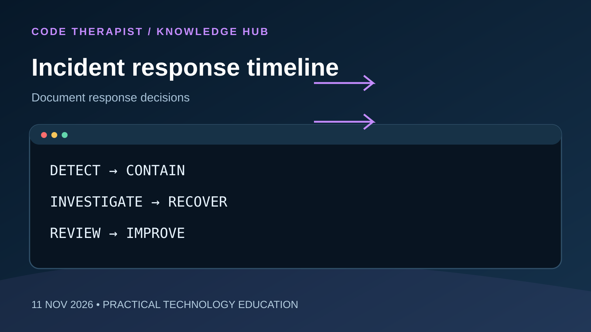](../10-CYBER-INCIDENTS-AND-LAW/2026-11-11-INCIDENT-RESPONSE-TIMELINE-BASICS.md)

**[Open lesson and exercise](../10-CYBER-INCIDENTS-AND-LAW/2026-11-11-INCIDENT-RESPONSE-TIMELINE-BASICS.md)** · CYBER INCIDENTS AND LAW

### 03. Payment webhook idempotency

[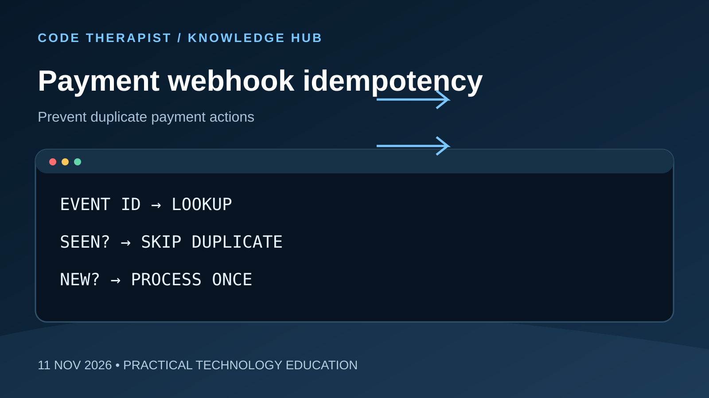](../11-FINTECH-AND-BANKING/2026-11-11-PAYMENT-WEBHOOK-IDEMPOTENCY.md)

**[Open lesson and exercise](../11-FINTECH-AND-BANKING/2026-11-11-PAYMENT-WEBHOOK-IDEMPOTENCY.md)** · FINTECH AND BANKING

### 04. Database backups and restores

[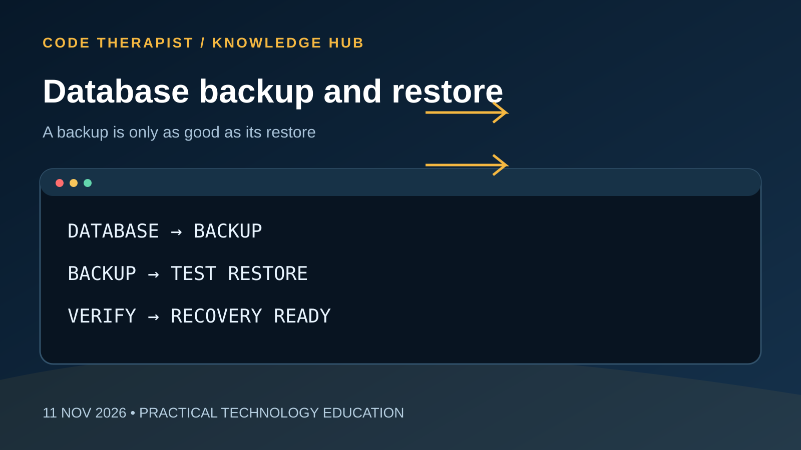](../14-DATABASES-CLOUD-DEVOPS/2026-11-11-DATABASE-BACKUPS-AND-RESTORE-TESTS.md)

**[Open lesson and exercise](../14-DATABASES-CLOUD-DEVOPS/2026-11-11-DATABASE-BACKUPS-AND-RESTORE-TESTS.md)** · DATABASES CLOUD DEVOPS

## SEASON 03 — AI, DATA & KNOWLEDGE

**Workflow:** Retrieve evidence → evaluate fairly → verify claims → explain clearly.

### 01. Retrieval-augmented generation

[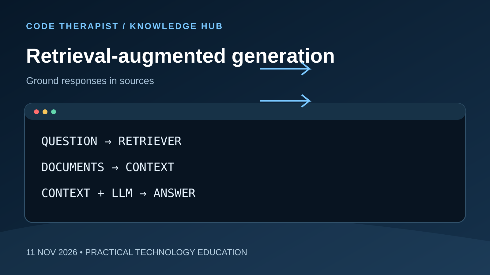](../05-AI-AND-LLMS/2026-11-11-RETRIEVAL-AUGMENTED-GENERATION.md)

**[Open lesson and exercise](../05-AI-AND-LLMS/2026-11-11-RETRIEVAL-AUGMENTED-GENERATION.md)** · AI AND LLMS

### 02. Avoiding data leakage

[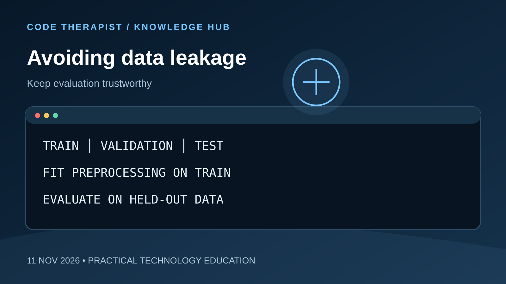](../16-MACHINE-LEARNING-DATA/2026-11-11-AVOIDING-DATA-LEAKAGE.md)

**[Open lesson and exercise](../16-MACHINE-LEARNING-DATA/2026-11-11-AVOIDING-DATA-LEAKAGE.md)** · MACHINE LEARNING DATA

### 03. Verify technology news

**[Open lesson and exercise](../06-TECH-NEWS/2026-11-11-HOW-TO-VERIFY-TECHNOLOGY-NEWS.md)** · TECH NEWS

### 04. Clear technology explainers

[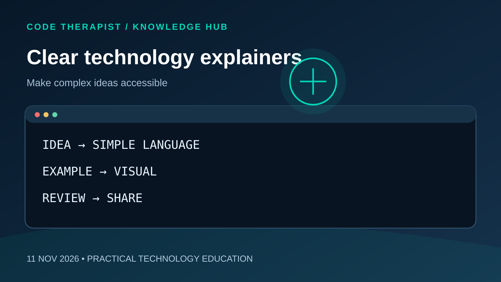](../07-SOCIAL-MEDIA/2026-11-11-WRITING-CLEAR-TECHNOLOGY-EXPLAINERS.md)

**[Open lesson and exercise](../07-SOCIAL-MEDIA/2026-11-11-WRITING-CLEAR-TECHNOLOGY-EXPLAINERS.md)** · SOCIAL MEDIA

## SEASON 04 — COMPUTING & VISUAL DESIGN

**Workflow:** Understand computing history → identify hardware → communicate visually.

### 01. Vacuum tubes to transistors

[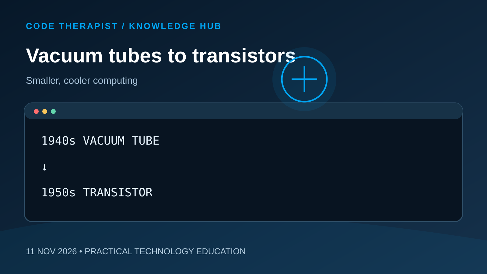](../12-COMPUTER-HISTORY/2026-11-11-FROM-VACUUM-TUBES-TO-TRANSISTORS.md)

**[Open lesson and exercise](../12-COMPUTER-HISTORY/2026-11-11-FROM-VACUUM-TUBES-TO-TRANSISTORS.md)** · COMPUTER HISTORY

### 02. CPU, RAM and SSD

[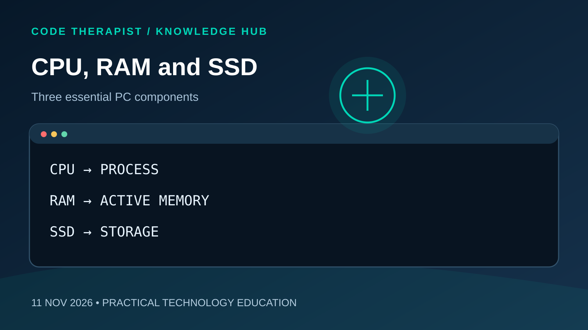](../13-HARDWARE-AND-SYSTEMS/2026-11-11-UNDERSTANDING-CPU-RAM-AND-SSD.md)

**[Open lesson and exercise](../13-HARDWARE-AND-SYSTEMS/2026-11-11-UNDERSTANDING-CPU-RAM-AND-SSD.md)** · HARDWARE AND SYSTEMS

### 03. Image aspect ratios and cropping

[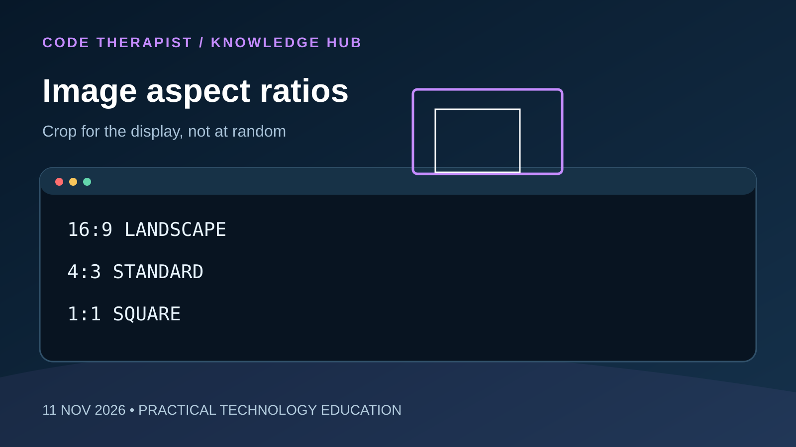](../15-DESIGN-ANIMATION-GRAPHICS/2026-11-11-IMAGE-ASPECT-RATIOS-AND-CROPPING.md)

**[Open lesson and exercise](../15-DESIGN-ANIMATION-GRAPHICS/2026-11-11-IMAGE-ASPECT-RATIOS-AND-CROPPING.md)** · DESIGN ANIMATION GRAPHICS

---

*Artwork: original SVG educational graphics, 1600 × 900. Each graphic is linked to its article; the article contains the same image. This series is a first release and can be expanded into deeper lessons.*
