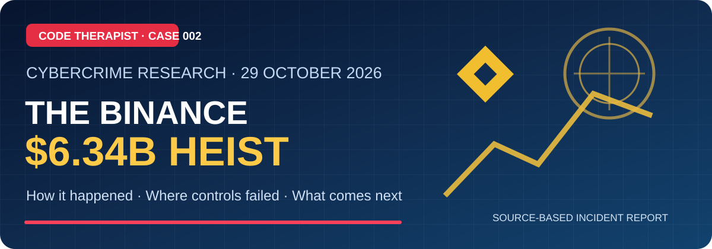
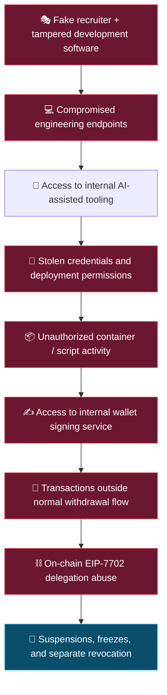
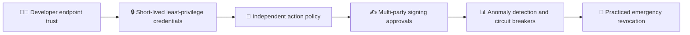

# 🔐 The $6.34 Billion Binance Hack: How It Happened and What Comes Next

### Cybercrime Case Study 002 · 29 October 2026 incident

**Code Therapist Knowledge Hub · Published 9 November 2026 · Cryptocurrency / Cybersecurity / Incident Response**

[▶️ **Watch the Financial News Network discussion**](https://youtu.be/dCXlcZmtTbw) · [📑 Official Binance incident report](https://www.binance.com/en-NG/blog/community/3229153443759566763) · [📰 Reuters coverage](https://www.reuters.com/world/binance-says-hackers-used-fake-job-interview-compromise-computer-before-63-2026-11-03/)

> [!IMPORTANT]
> **Evidence and attribution:** Binance's **3 November 2026 initial findings** independently confirm a severe **29 October 2026** incident affecting approximately **US$6.34 billion** in digital assets. This report carefully distinguishes **Binance's own statements**, **independent reporting**, **the supplied panel transcript**, and **our defensive analysis**. The investigation and third-party review were still ongoing at the time of those reports. Asset values and recovery figures are *as-of-date snapshots*, not final audited totals.

## 🧭 Executive briefing

On **29 October 2026**, attackers exploited unauthorized access to Binance's internal **wallet-signing service** and initiated transfers that bypassed its ordinary withdrawal flow. Binance says the campaign included earlier compromises of engineering workstations, a forged recruitment process, malicious developer software and misuse of an internal AI tool. Some unauthorized transfers continued after withdrawals were suspended because malicious **on-chain EIP-7702 delegations** required separate revocation procedures.

The central lesson is not simply “an engineer clicked a bad link.” The case illustrates how compromises of developer endpoints can become devastating when **identity, deployment permissions, signing authority and transaction policy are insufficiently separated**. [1][2][3]

## 📊 Incident snapshot

| Detail | Reported status and evidence |
|---|---|
| **Incident date** | **29 October 2026**; specific reported transfer sequence began **20:05 UTC** [1] |
| **Amount affected** | Approximately **US$6.34 billion** in digital assets [1] |
| **Frozen / intercepted** | Approximately **US$2.85 billion** as stated on **3 November**; subject to reconciliation and market price movements [1] |
| **Customer restitution** | Binance said it had reserved more than 100% of the amount required and had **replenished 98% of impacted token assets by 31 October**; this is its company-reported reserve status, not independent proof every claim had settled [1] |
| **Reported attack path** | Malicious software → compromised engineers → internal tool access → stolen credentials / container permissions → wallet signing [1] |
| **Attribution** | Binance referred to an FBI assessment assigning responsibility to **North Korea**; North Korea denied the allegation in reporting. Attribution is not a criminal conviction [1][2][3] |
| **Review status** | Initial Binance report; independent cybersecurity review announced, final findings not yet established in cited sources [1] |

## ⏱️ How the attack developed

| Time | Event | Source and qualification |
|---|---|---|
| **June 2026** | A wallet DevOps engineer downloaded a tampered Homebrew installation when attempting to set up an AI coding tool. Binance says it detected this, replaced the device and rotated credentials, but sensitive context about the engineer's role and colleagues had been exposed. | Binance initial report [1] |
| **September 2026** | Another engineer was contacted through an apparently legitimate employment platform by a fake recruiter. After staged interviews, a coding assignment delivered malicious code to a work device. | Binance initial report [1] |
| **20 October 2026** | Binance says attackers used compromised access and an internal AI tool to gain control of other engineers' environments, and discovered container deployment permissions. | Binance initial report [1] |
| **29 October, 17:15–19:56 UTC** | Attackers reportedly used a compromised engineer workstation and stolen deployment credentials to stage malicious activity. | Binance initial report [1] |
| **29 October, 20:05–20:09 UTC** | Five hot wallets sent **233.46 million XRP** to an attacker-controlled address. Further unauthorized movements involved SOL, OP, BTC and other assets. | Binance initial report [1] |
| **Later 29 October** | Withdrawal suspension and token freezes did not invalidate EIP-7702 on-chain delegations. Revocation required a separate process. The final unauthorized transfer reported by Binance finalized at **23:56 UTC**. | Binance initial report [1] |
| **30 October, 00:10 UTC** | Binance reported clearing the malicious EIP-7702 delegation by sending a new authorization to the zero address. | Binance initial report [1] |
| **3 November 2026** | Binance published initial findings and remediation measures, including device and credential replacement, rebuilt systems and third-party review plans. | Binance initial report [1] |

## 🧩 The attack chain — conceptual overview

This is a **defensive abstraction** of Binance's published description, not a technical intrusion guide or a full forensic reconstruction.

## ⚠️ Where the defenses fell short

### 1. Endpoint security and deceptive recruitment

Binance reports that malware used sophisticated evasion techniques, including replacement of a legitimate development-tool component. The fake hiring process made a coding exercise look credible. One early infection was detected, yet the information exposed helped later targeting.

**Lesson:** use trusted distribution channels, verified job contacts, isolated assessment environments and strict controls for software executed on sensitive engineering workstations.

### 2. Credential reach exceeded the intended task

The attackers reportedly moved from endpoint access to valuable deployment permissions, and ultimately to a wallet-signing path. **Who is logged in** and **what action that identity is allowed to perform** are different security questions.

**Lesson:** protect deployment credentials, separate duties, use just-in-time privileges and enforce transaction-specific policies at the signing boundary.

### 3. Withdrawal shutdown was not sufficient

Binance reported that **EIP-7702 delegation authorizations** existed on-chain independently of ordinary withdrawal services. Stopping a web-facing withdrawal flow could therefore not revoke already established delegated authority. Multi-party-computation signing architecture also complicated emergency revocation.

**Lesson:** test emergency revocation of each authorization type, including smart-contract or on-chain delegations, *before* an incident.

### 4. High-value transaction controls needed more independence

Hannah Arnold, speaking in the supplied FNN panel transcript, argued for independent limits on **transaction types**, multi-person approval and rapid revocation. These are **expert observations in the video**, not independently established proof of each control Binance actually configured.

**Lesson:** implement deny-by-default signing policies, allowlists, value and velocity limits, separation of approving authorities and rehearsed incident response.

## 🎙️ Financial News Network discussion: What Happened · Social Commentary · Fallout

<figure>

<figcaption><strong>Watch the original discussion:</strong> <a href="https://youtu.be/dCXlcZmtTbw">The $6.3 Billion Binance Hack: How It Happened and What Comes Next</a>. Video and panel content credited to the original publisher. Preview is retrieved from YouTube.</figcaption>
</figure>

The supplied video transcript is a **panel discussion**, not a complete forensic incident report. It identifies **Frank Chaparro** as host, **Hannah Arnold** of Turnkey, **Jonathan Aad** of Base Layer and **Amethyst Martinez** as a reporter. The transcript is summarized here with attribution rather than reproduced in full.

| Panel segment | What the discussion emphasizes | Evidence status |
|---|---|---|
| **What Happened** | Fake recruitment, compromised developer workstations, signing permissions and the difficulty revoking delegated authority. | Broad sequence agrees with Binance's preliminary report [1]; some panel observations remain opinions. |
| **Social Commentary** | The influence of former Binance CEO **Changpeng Zhao (CZ)** on public communications, centralized custody and confidence in exchanges. | Panel interpretation, **not** a measured public-opinion result. |
| **The Fallout** | Reserve coverage, customer communications, defense-in-depth, greater scrutiny of AI-assisted fraud and future industry cooperation. | Mix of company statements and panel predictions; future outcomes are uncertain. |

**Direct video:** [▶️ Watch the discussion on YouTube](https://youtu.be/dCXlcZmtTbw)

### Three original screenshots supplied by the research contributor

The following are **owner-supplied screenshots from the FNN video**, referenced to document the coverage and its three themes. They are not a substitute for the video or the official investigation. **Binary image files are pending GitHub upload**; see [image manifest](./assets/SCREENSHOT-UPLOAD.md). The original screens are kept unmodified in the accompanying downloadable asset package.

📸 View original screenshots (will display after image upload)

<table>
<tr><td></td><td></td></tr>
<tr><td colspan="2" align="center"></td></tr>
</table>

## 💬 Social commentary and responsibility

The panel's debate about *custodial* versus *self-custody* is a useful framework, but it is not settled by this incident alone. Centralized custody can provide coordinated freezes and reserve support while creating concentrated targets. Self-custody avoids one centralized exchange custodian but shifts key-management, phishing and recovery risks to users. Controls, operational capability and legal protections differ.

**ByteLab research conclusion:** neither “all exchanges are unsafe” nor “all users are safe” follows from this incident. Evaluate specific custody architecture, published controls, incident handling and the status of independent reviews.

## 🛡️ Security improvements worth adopting

- **For software engineering organizations:** verify developer packages; isolate high-risk code; monitor secrets and delegated sessions; enforce device health and approval policies.
- **For custodians and financial services:** restrict signing by transaction type and destination; test all delegation-revocation procedures; maintain separate monitoring and incident command channels.
- **For individuals:** independently verify unexpected recruitment and media contacts; avoid running untrusted interview assignments on sensitive machines; protect recovery phrases and account access.

## ❓ Open questions as of 9 November 2026

1. What will independent investigators confirm, revise or add to Binance's initial findings?
2. Which policy or implementation failures allowed the signing service to be used for inappropriate transactions?
3. What amount will ultimately remain unrecovered after frozen assets are reconciled and returned?
4. What evidence will support the final attribution and any subsequent legal actions?
5. Which new controls will demonstrably prevent a similar multi-endpoint compromise from becoming a wallet compromise?

## 🔗 Source and verification register

| Ref | Source | Date / type |
|---|---|---|
| **[1]** | [Binance — Initial Findings and Response Update](https://www.binance.com/en-NG/blog/community/3229153443759566763) | **3 Nov 2026**, primary company statement; preliminary |
| **[2]** | [Reuters — hackers used fake interviews in record theft](https://www.reuters.com/world/binance-says-hackers-used-fake-job-interview-compromise-computer-before-63-2026-11-03/) | **3 Nov 2026**, independent reporting |
| **[3]** | [WIRED — Binance's description of the campaign](https://www.wired.com/story/binance-says-hackers-used-well-known-tricks-to-carry-out-a-dollar634-billion-heist/) | **3 Nov 2026**, independent security journalism |
| **[4]** | [FNN original panel discussion](https://youtu.be/dCXlcZmtTbw) | Secondary commentary; transcript and screenshots supplied by contributor |

**Attribution and copyright:** This article is an original Code Therapist editorial synthesis based on cited sources. The supplied FNN screenshots and link identify the original broadcast; the broadcast's graphics, participants and video are not owned by Code Therapist. The screenshots should be used only as limited attributed excerpts for research/commentary subject to applicable rights and platform policies.

---

### Continue exploring

📚 [Earlier cyber-heist lesson: Bangladesh Bank, 2016](../../../07-SOCIAL-MEDIA/YOUTUBE/2026-11-08-TECHNOLOGY-EDUCATION/EP-009-bangladesh-bank-heist-2016.md) · [Cybercrime library](../../README.md) · [Crypto-heist index](../README.md) · [Knowledge Hub](../../../README.md)

**[▶️ Watch the full FNN panel on YouTube](https://youtu.be/dCXlcZmtTbw)**

Code Therapist / ByteLab Uganda Ltd · Incident analysis and security education, not investment or legal advice. Last reviewed: 9 November 2026.
