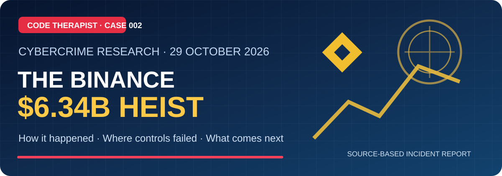

# 🪙 Crypto and Exchange Cyber Heists

[← Cybercrime Research Library](../README.md) · [← Knowledge Hub](../../README.md)

Case studies of cryptocurrency exchange attacks, digital-asset theft, wallet failures and security incidents. Every case distinguishes **the date of the incident**, **the date of disclosure**, **primary evidence**, **outside reporting** and **unanswered questions**.

## Featured case studies

### 🔐 Binance — October 29, 2026: The $6.34 Billion Cyber Heist

**[Read the researched full case study →](./BINANCE-2026-10-29/README.md)**

Reported incident involving engineering-device malware, fake recruitment, internal AI-tool abuse, compromised signing permissions and on-chain delegations. Includes a detailed timeline, defense-focused flowcharts, financial-amount distinctions, editorial commentary and official sources.

**[▶️ Watch Financial News Network's full discussion](https://youtu.be/dCXlcZmtTbw)**

| Date | Case | Supporting source |
|---|---|---|
| 29 Oct 2026 | [Binance: US$6.34bn affected](./BINANCE-2026-10-29/README.md) | [Binance's 3 Nov initial report](https://www.binance.com/en-NG/blog/community/3229153443759566763) |

### Related historic cases

[Bangladesh Bank 2016 — Cyber Heists 001](../../07-SOCIAL-MEDIA/YOUTUBE/2026-11-08-TECHNOLOGY-EDUCATION/EP-009-bangladesh-bank-heist-2016.md) (financial cyber heist, not a cryptocurrency exchange attack).

## Editorial policy

- Keep attempted, stolen, frozen and reimbursed amounts **separate**, with dates.
- Name allegations as allegations; do not treat government attribution alone as a conviction.
- Reconcile factual claims with official source documents and independent reporting.
- Include landscape presentation artwork and security diagrams without republishing attack tooling.
- Credit video presenters and screenshots; obtain appropriate rights for reuse.
