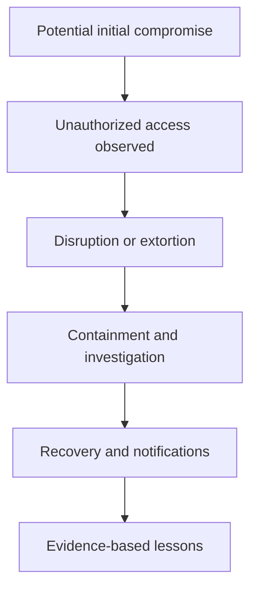

# 🔎 How to Study a Ransomware Incident Responsibly

> **Code Therapist Cyber Incident Library** · **7 November 2026** · Beginner / Public awareness  
> This is a **general incident-analysis guide**, not an account of a particular alleged crime.

## What is ransomware?

Ransomware is malicious software or an attack technique that can encrypt files, disrupt operations or support extortion. A real incident often includes both a technical investigation and legal or regulatory questions.

## Incident timeline framework

The events above are **possible stages**, not a claim that every ransomware incident follows the same order.

## What researchers should record

| Field | Example of acceptable evidence |
|---|---|
| Incident date | Confirmed timestamp from victim or agency |
| Discovery date | Organization's own statement |
| Public disclosure date | Dated press release or regulatory filing |
| Attack description | Published technical findings |
| Impact | Affected systems and verified service disruptions |
| Legal outcome | Actual court records and relevant jurisdiction |
| Recovery | Confirmed remediation and restoration milestones |

## Protective practices

- Maintain tested offline or protected backups.
- Apply access controls and multifactor authentication.
- Reduce unnecessary remote access.
- Log key events and rehearse incident response.
- Work with qualified responders and relevant authorities.

Avoid sharing victims' private data, unverified accusations or attacker-created stolen datasets.

## How to research an actual case

Use the [Cyber Incident Case Study template](../INCIDENT_REPORT_TEMPLATE.md). Separate **confirmed facts**, **reported allegations**, and **unknowns**. Identify the country's applicable law **as it existed when the conduct occurred**, not merely the law in force today.

## Sources

- [CISA — StopRansomware resources](https://www.cisa.gov/stopransomware)
- [NIST — Computer Security Incident Handling Guide](https://csrc.nist.gov/pubs/sp/800/61/r2/final)

---

[← Ransomware and Fraud](./README.md) · [← Knowledge Hub](../../README.md)
