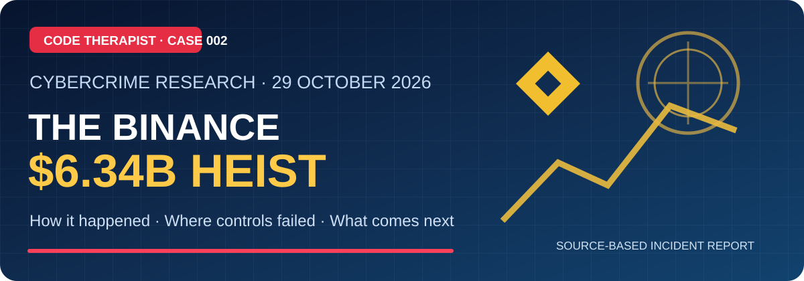

# Cyber Incidents, Heists & Law

Case-study library for major cybercrime events, fraud, breaches, investigations and applicable law.

[← Knowledge Hub](../README.md) · [Code Therapist](https://github.com/codetherapistpita-oss) · [Portfolio](https://codetherapist.netlify.app/)

## Browse topics

| Section | Focus |
| --- | --- |
| [INCIDENT TIMELINE](./INCIDENT-TIMELINE/README.md) | Guides, documented research and verified resources |
| [BANKING AND FINANCIAL HEISTS](./BANKING-AND-FINANCIAL-HEISTS/README.md) | Guides, documented research and verified resources |
| **[CRYPTO & EXCHANGE HEISTS](./CRYPTO-AND-EXCHANGE-HEISTS/README.md)** | Exchange breaches, digital-asset custody and blockchain incident investigations |
| [DATA BREACHES](./DATA-BREACHES/README.md) | Guides, documented research and verified resources |
| [RANSOMWARE AND FRAUD](./RANSOMWARE-AND-FRAUD/README.md) | Guides, documented research and verified resources |
| [CYBER LAW AND REGULATION](./CYBER-LAW-AND-REGULATION/README.md) | Guides, documented research and verified resources |

## How cases are documented

Use the [Cyber Incident Case Study template](./INCIDENT_REPORT_TEMPLATE.md). It separates incident dates, reporting dates, jurisdiction, documented evidence, legal action and security lessons.

## 🔐 Featured investigation — Binance, 29 October 2026

**[Read the $6.34 billion Binance heist investigation](./CRYPTO-AND-EXCHANGE-HEISTS/BINANCE-2026-10-29/README.md)** · **[▶️ Watch the source panel](https://youtu.be/dCXlcZmtTbw)**

The sourced study includes an incident timeline, attack-chain diagrams, explanation of transaction-control failures and direct citations. Figures are tied to the 3 November 2026 initial Binance report.

### Earlier published cyber-heist research

**[Cyber Heists 001 — Bangladesh Bank, 2016](../07-SOCIAL-MEDIA/YOUTUBE/2026-11-08-TECHNOLOGY-EDUCATION/EP-009-bangladesh-bank-heist-2016.md)** — earlier financial-heist lesson with references and diagrams.

All future reports will distinguish primary records, reporting, analysis and unresolved claims. Dates, relevant jurisdictions and source links must be documented; no unverified allegations will be presented as fact.
