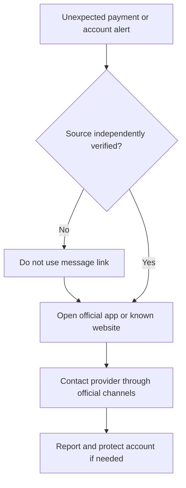

# 💳 Protect Your Money: Bank and Mobile Money Impersonation Scams

> **Code Therapist Financial Technology Library** · **7 November 2026** · Consumer awareness  
> Educational guidance; exact reporting channels vary by provider and country.

## The danger

Scammers may pretend to be banks, payment providers, mobile money operators or customer service agents. They can use urgent messages, fake websites, spoofed numbers or requests to disclose PINs and one-time codes.

## Warning signs and better responses

| Suspicious claim | Safer action |
|---|---|
| "Your account is blocked — send your OTP" | Never share an OTP with a caller or chat |
| "Pay a fee to release your transfer" | Verify through official account channels |
| "Install a remote support app now" | Do not grant unknown parties device access |
| "Click this short link to restore access" | Navigate directly to the provider's known website |

## If you suspect fraud

1. Stop interacting with the suspicious contact.
2. Open the provider's official app or call a verified support number.
3. Change credentials if the account may be compromised.
4. Report the event promptly and preserve transaction references.
5. Review linked accounts and further transactions.

Do not post account numbers, IDs, screenshots of OTPs or full transaction details publicly.

## A note for Uganda

Banks and mobile-money providers may have different fraud reporting procedures. Check the bank or operator's current official contact information rather than trusting a number in a forwarded message.

## Sources

- [US FTC — Scams and Your Small Business / impersonation advice](https://consumer.ftc.gov/scams)
- [Bank of Uganda — official website](https://www.bou.or.ug/)

---

[← Financial Cybersecurity](./README.md) · [← Knowledge Hub](../../README.md)
