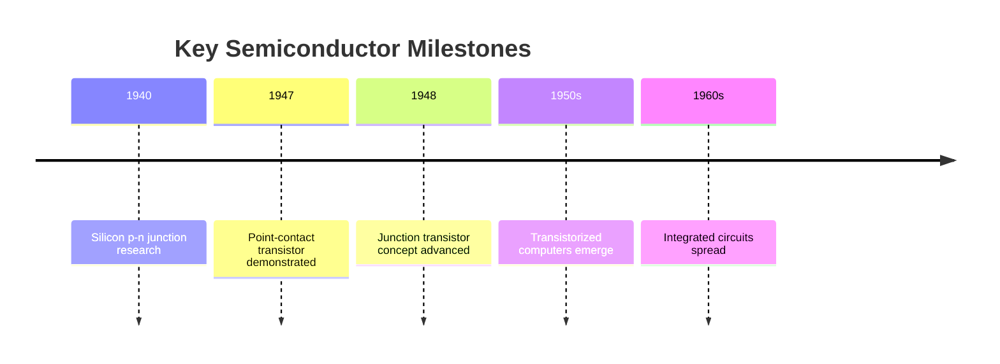

# 🕰️ Computer History 02 — The Transistor Revolution

> **Code Therapist Computing History** · **7 November 2026** · Historical overview  
> Source: Computer History Museum.

## The breakthrough

Early electronic computers relied heavily on vacuum tubes. The invention of the point-contact transistor in **1947** opened a route toward smaller and more power-efficient electronic circuits, although the transition to transistorized computers took years.

## What changed?

| Engineering problem | Earlier vacuum-tube systems | Semiconductor direction |
|---|---|---|
| Physical size | Large components and assemblies | Increasing miniaturization |
| Reliability | Many tubes required maintenance | New device and manufacturing approaches |
| Power and heat | Significant demands | Potentially lower per switching element |
| Scale | Harder to pack complex circuits | Path toward denser integrated systems |

The move was gradual: early transistor technology had its own manufacturing and reliability challenges.

## People worth studying

John Bardeen and Walter Brattain demonstrated transistor action in December 1947; William Shockley's contributions to subsequent transistor theory and device design were also important. These histories are collaborative and should not be reduced to one inventor.

## Reading question

Why was the invention of a transistor not enough, by itself, to produce a modern smartphone? Consider integrated circuits, manufacturing, memory, software, networking and decades of later innovation.

## Original sources

- [Computer History Museum — Silicon Engine timeline](https://www.computerhistory.org/siliconengine/timeline/)
- [Computer History Museum — Computers timeline](https://www.computerhistory.org/timeline/computers/)

---

[← Computer Generations](./README.md) · [← History of Computing](../README.md) · [← Knowledge Hub](../../README.md)
