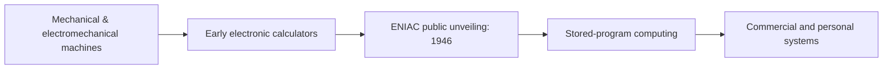

# 🕰️ Computer History 01 — ENIAC & the Rise of Electronic Computing

> **Code Therapist · Published 7 November 2026 · Historical overview**  
> Original historical reference: Computer History Museum. This is part of an ongoing computer-history reading series.

## Why early electronic computers matter

Modern laptops and smartphones descend from decades of work in calculation, switching, memory and programmability. ENIAC became one of the most famous early large-scale electronic computing systems, but calling it simply "the first computer" ignores earlier mechanical, electromechanical and electronic developments.

## Compact timeline

| Year | Event | Why it mattered |
|---|---|---|
| 1939–1942 | Atanasoff–Berry Computer developed | Important early electronic digital computing concepts |
| 1943 | ENIAC construction began | Large electronic computing project at the University of Pennsylvania |
| 1945 | Von Neumann's EDVAC report | Influential explanation of stored-program architecture |
| 1946 | Public unveiling of ENIAC | Major public demonstration of electronic computation |
| 1949 | EDSAC completed | Early practical stored-program computing |

## Visual: historical progression

## How ENIAC worked

ENIAC used **vacuum tubes**, electronic circuits, controls, switches and cabling. According to the Computer History Museum, it occupied a very large physical space and contained roughly **18,000 vacuum tubes**. Unlike a modern laptop, changing its work involved substantial manual reconfiguration.

### Three concepts to remember

1. **Electronic switching** made high-speed arithmetic possible.
2. **Programming method** mattered nearly as much as hardware speed.
3. **Stored-program ideas** helped pave the way for more flexible computers.

## What comes next?

The next chapter in this planned series covers transistors, integrated circuits, and the shift toward smaller, more reliable computers.

## Historical sources

- [Computer History Museum — 1946 timeline](https://www.computerhistory.org/timeline/1946/)
- [Computer History Museum — Computers timeline](https://www.computerhistory.org/timeline/computers/)
- [Computer History Museum — ENIAC collection](https://www.computerhistory.org/chess/stl-42fa8835902f1/)

---

[← Early Computing](./README.md) · [← Computing History](../README.md) · [← Knowledge Hub](../../README.md)
