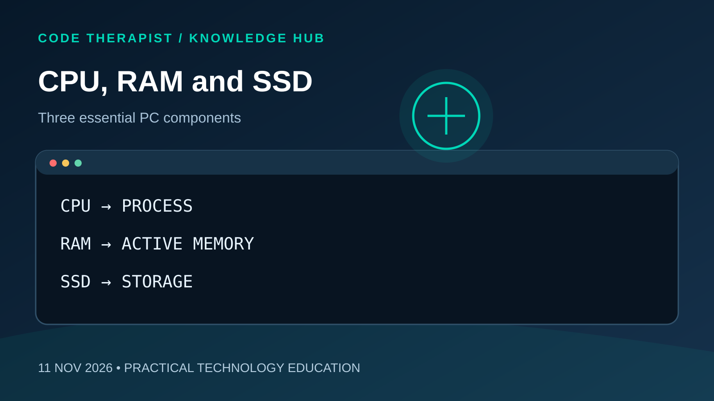

# Understanding CPU, RAM and SSD

**Published:** 11 November 2026  
**Series:** Code Therapist Knowledge Hub — Daily Concepts  
**Concept:** 12 of 15

## Core concept

CPU executes instructions, RAM holds active working data, and SSD provides persistent storage; balanced specifications matter.

## Why it matters

Understanding this concept helps developers and learners make more reliable technical decisions. Start with the underlying principle, test it on a small example, and document the outcome before applying it in a larger project.

## Practical exercise

Compare two development laptops by workloads rather than labels.

## Questions for reflection

1. What problem does this concept solve?
2. What could go wrong if it is applied incorrectly?
3. How would you demonstrate the concept in a small project?

## Further learning

Consult **Intel technical learning resources** for authoritative background and current implementation details. Check source dates and versions before relying on a specific instruction.

---
*Code Therapist | Beyond Code | Educational concept, not breaking news.*
