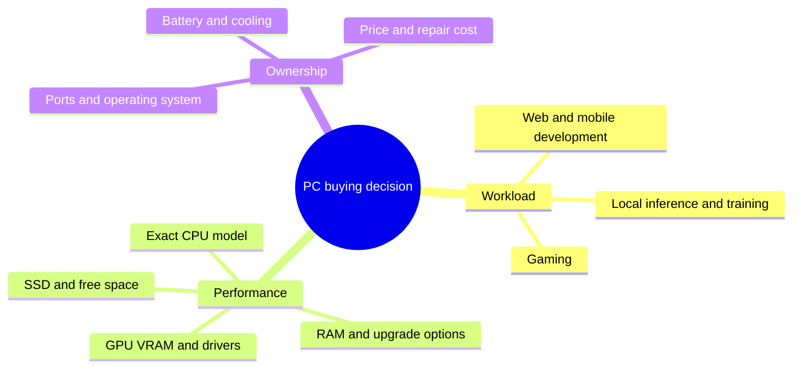
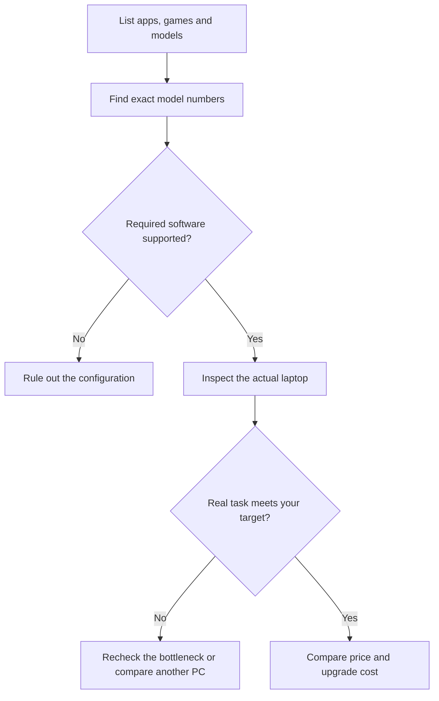

# Season 01 · Day 001 — How to Read PC Specs Before You Buy

> **21 November 2026 · Beginner · Code Therapist Gadgets**

[← Gadgets](../README.md) · [Next · Compare two laptops](./DAY-002-HP-ELITEBOOK-VS-ASUS-ZENBOOK.md)

Start by writing down the heaviest workload you expect to run and what else will be open at the same time. For example, developing Byte Soma might mean running a browser, editor, frontend server and database together. Flutter with an Android emulator adds another substantial workload. That list tells you which specs to compare.

## Five parts to read on the listing

| Part | What to ask for | What the answer tells you |
| --- | --- | --- |
| **CPU** | Full model, generation, suffix, physical cores and threads | Affects builds, multitasking and CPU inference. Compare actual chips. Core i7 is a tier name, and peak GHz alone is a poor cross-generation comparison. |
| **RAM** | Installed capacity, memory layout and upgrade limit | Determines how much can stay open. Heavy swapping can slow the machine. Verify whether modules are replaceable. |
| **Storage** | SATA or NVMe SSD, total capacity and free space on the relevant volume | A 256 GB drive can still leave too little usable space for SDKs, container images, models or games. An SSD upgrade also needs a compatible slot and form factor. |
| **GPU** | Exact GPU model, dedicated VRAM, driver and software support | Affects 3D gaming and supported AI acceleration. Shared graphics memory draws from system RAM. Check the framework and game against the exact GPU and OS. |
| **Condition and compatibility** | Battery health, cooling, display, charger, ports, OS and virtualization | A used laptop can throttle, have a weak battery or fail a required emulator setup even when the listing looks good. |

## From a listing to a shortlist

1. **Set a target.** Name a real task and define what acceptable performance means to you, such as completing a build before a meeting or running a game at a comfortable frame rate.
2. **Ask for the exact configuration.** On Windows, compare Task Manager’s Performance tabs and the disk volumes. On Linux, use `lscpu`, `free -h`, `lsblk`, `df -h` and `lspci`. Ask which GPU is active under load where the laptop has two.
3. **Check the published requirements.** Look up your emulator, game, or AI framework. Pay attention to OS, GPU architecture, driver and virtualization requirements as well as memory.
4. **Test the heaviest task and inspect the laptop.** Use the workload you named, then check charger, ports, display, battery health and temperatures.
5. **Compare the total cost.** Include any immediate RAM, SSD, battery or charger replacement.

### Practice

Two ads both say “Core i7, 256 GB SSD”. One lists an i7-8650U and 16 GB RAM. The other lists an i7-4500U and 8 GB RAM. Which would you inspect first for an editor, dev server and database running together? The first is the stronger starting candidate because it has four CPU cores and more memory. Ask how much disk space is free and run the same project before deciding.

## Further reading

- [Hardware & Systems · CPU, RAM, SSD and GPU explained](../../PC-COMPONENTS/2026-11-07-cpu-ram-ssd-gpu-explained.md)
- [Android Studio installation and system requirements](https://developer.android.com/studio/install.html)
