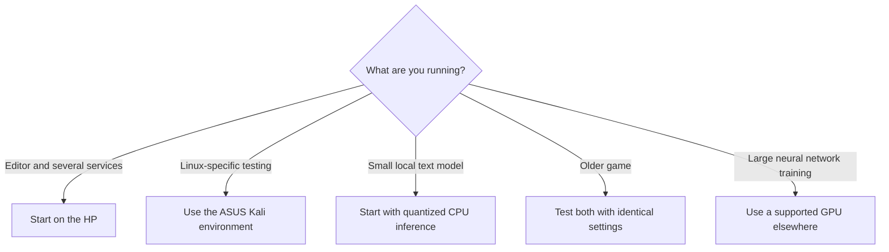

# Season 01 · Day 002 — HP EliteBook x360 vs ASUS Zenbook

> **21 November 2026 · Practical comparison · Code Therapist Gadgets**

[← Read the specs](./DAY-001-READ-PC-SPECS.md) · [Gadgets](../README.md) · [Next · Test and decide](./DAY-003-TEST-AND-DECIDE.md)

The HP EliteBook x360 1030 G3 is the stronger choice for my development and small local AI workloads. The ASUS Zenbook UX302LG remains useful for Linux testing, and its GeForce may help with some older games if the game uses the discrete GPU and the graphics driver supports it.

## The configurations in the reports

| Specification | HP EliteBook x360 1030 G3 | ASUS Zenbook UX302LG |
| --- | --- | --- |
| CPU | Intel Core i7-8650U, 8th generation, 4 cores / 8 threads | Intel Core i7-4500U, 4th generation, 2 cores / 4 threads |
| RAM | 16 GB dual channel at 2133 MHz | 8 GB DDR3L-1600, 4 GB soldered plus one replaceable 4 GB module. Reported maximum is 12 GB. |
| Graphics | Intel UHD 620 integrated graphics drawing from system RAM | Intel HD 4400 plus GeForce GT 730M with 2 GB DDR3, using the nouveau driver at capture |
| Storage | 256 GB-class SATA SSD, around 38 GB free on C: at capture | 256 GB-class SATA SSD, around 15 GB free on the Kali system partition at capture |
| Display | About 13.3 inches, 1920 × 1080 at 60 Hz, touch and pen | 13.3 inches, 1920 × 1080 at 60 Hz, touch |
| Installed OS | Windows 11 Pro | Kali Linux |

Source for installed configurations: two local hardware inventory reports dated 21 November 2026. Free space, driver and memory-use readings describe the capture date. The reports provide specifications and system readings. The workload judgments below are estimates without direct benchmarks.

## What each laptop can handle

| Workload | HP EliteBook | ASUS Zenbook |
| --- | --- | --- |
| **Mobile development** | Prefer for Flutter or Android Studio builds. A physical Android device leaves more RAM available than running an emulator alongside the IDE. | Use a physical phone for testing. Keep projects and background services modest. |
| **Web development** | Better for Byte Soma with an editor, browser, Node server, and a local database or a small set of containers. | Suitable for a lightweight Vite or Python setup. The report captured about 2.9 GB of swap in use, a useful prompt to measure memory pressure during real work. |
| **Local AI inference** | Try a 1.5B–3B quantized text model on CPU first. A 7B four-bit model is a slower experiment with a short context. | Begin with a 1B–1.5B quantized CPU model. A 3B model is an experiment with other apps closed. |
| **Neural-network training** | Prefer for introductory CPU exercises, such as a small MNIST classifier. Schedule meaningful GPU training or LLM fine-tuning on a supported GPU. | Suitable for smaller CPU exercises. The GT 730M belongs to the Kepler generation, for which support was removed in CUDA 12. |
| **Gaming** | Start with light or older games on Windows using reduced settings. | Try older 3D games at reduced settings and confirm the game actually selects the GeForce. Measure the same game before declaring a winner. |

**Inference** runs a model that has already learned its parameters. **Training** updates those parameters and can require substantially more memory and compute. A 7B four-bit text model can have a roughly 4.4 GB weight file while still needing additional memory at run time for context and buffers. The HP’s shared graphics memory and ASUS’s 2 GB of dedicated VRAM describe different memory arrangements. Neither configuration is a practical modern CUDA training machine.

## References

- [Android Studio requirements](https://developer.android.com/studio/install.html)
- [NVIDIA CUDA 12 release notes and Kepler support](https://docs.nvidia.com/cuda/archive/12.0.1/cuda-toolkit-release-notes/)
- [Qwen2.5-Coder-7B-Instruct GGUF file-size examples](https://huggingface.co/tensorblock/Qwen2.5-Coder-7B-Instruct-GGUF)
