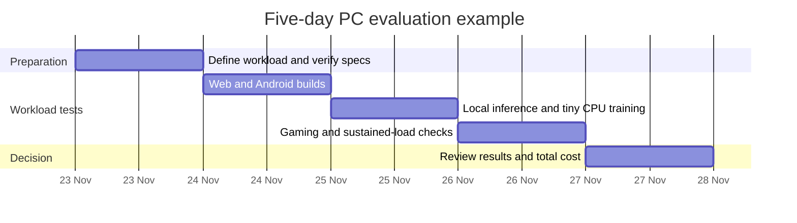

# Season 01 · Day 003 — Test the PC and Make a Decision

> **21 November 2026 · Hands-on exercise · Code Therapist Gadgets**

[← Compare the laptops](./DAY-002-HP-ELITEBOOK-VS-ASUS-ZENBOOK.md) · [Gadgets](../README.md)

## Five-day Gantt plan

The dates illustrate a test schedule. Adjust them for your access to the devices. A brief seller demo can focus on the two workloads you use most.

## What to measure

Run the same project or input, record versions and settings, and plug both laptops in for performance tests. Repeat where possible and record the median. The existing operating systems and drivers are part of the comparison. Keep those differences visible when interpreting results.

| Test | Keep the same | Record |
| --- | --- | --- |
| Web build | Project revision, Node version and clean or cached build state | Build seconds, peak RAM and swap |
| Mobile build | Flutter or Gradle version, project revision and build mode | APK build seconds and success. Use the same physical phone to check app behavior. |
| Local model | Model file, quantization, runner version, prompt, context and output limit | Time to first token, tokens per second and peak RAM |
| Tiny training run | Framework, device set to CPU, model, dataset, batch size and epochs | Seconds per epoch, peak RAM and whether the run completes |
| Gaming | Game version, resolution, preset and repeatable scene | Average FPS, 1% low FPS if the tool reports it, active GPU and visible stutter |
| Used-device condition | Screen brightness and workload for battery comparison | Battery health, fan noise, heat, ports, keyboard and charger condition |

## Decision record

| Record | Your evidence |
| --- | --- |
| Main workload and acceptable result | |
| Slowest or incompatible task | |
| Price including immediate upgrades | |
| Machine selected and why | |

If both machines pass the workloads you require, weigh price and condition. If a required task fails, find which component or software requirement caused the failure before spending on upgrades.
