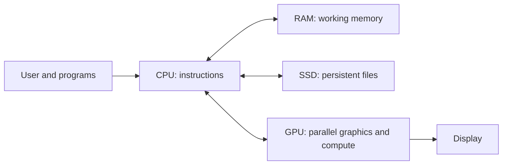

# 🖥️ Computer Hardware Explained — CPU, RAM, SSD and GPU

> **Code Therapist Hardware Guide** · **7 November 2026** · Beginner

## A useful mental model

Think of a computer as a team of specialized components. Each plays a different role, and faster specifications in one part cannot fix every bottleneck.

## The components

| Part | Primary job | Typical symptom when constrained |
|---|---|---|
| CPU | Executes instructions and coordinates work | Slow compute-heavy tasks |
| RAM | Holds active data and programs temporarily | Heavy swapping and sluggish multitasking |
| SSD | Stores files and programs persistently | Slow file and application loading |
| GPU | Accelerates graphics and suitable parallel workloads | Poor graphics or compatible ML/render performance |

**Important:** A dedicated GPU is helpful for some workloads, but not every AI application requires one; memory capacity, software support and workload type matter.

## Buying or upgrading wisely

1. Identify your workload: browser, coding, CAD, video editing, gaming, ML or servers.
2. Check current CPU/RAM/SSD/GPU utilization while doing the task.
3. Confirm component and operating-system compatibility.
4. Prefer enough memory and storage for the actual projects you run.
5. Consider power supply, cooling, reliability and support—not just peak speed.

## Example: developer desktop checklist

- Enough RAM to run editor, browser, database and local services together.
- SSD with room for operating system, projects and backups.
- CPU appropriate for compilation and multitasking.
- GPU chosen only when workload benefits from the supported acceleration.
- Regular, tested backups independent of the main drive.

## Further learning

- [Intel — What is a CPU?](https://www.intel.com/content/www/us/en/gaming/resources/what-is-a-cpu.html)
- [Computer History Museum — Computers](https://www.computerhistory.org/timeline/computers/)

---

[← PC Components](./README.md) · [← Knowledge Hub](../../README.md)
