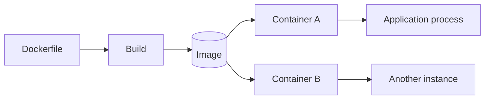

# 📦 Docker Images vs Containers: What's the Difference?

> **Code Therapist Systems Guide** · **7 November 2026** · Beginner  
> Primary reference: Docker official documentation.

## Two names, two jobs

An **image** is a packaged, read-only template describing an application environment. A **container** is an instance created from an image that can run processes. This helps teams make development and deployment environments more repeatable.



## A minimal local demonstration

After installing Docker from an official source, you can examine its version:

```bash
docker --version
docker image ls
docker container ls -a
```

To run the Docker tutorial image where available:

```bash
docker run --rm hello-world
```

The `--rm` option removes that stopped container after it exits. Images may remain until explicitly removed.

## Container versus virtual machine

| Characteristic | Container | Typical virtual machine |
|---|---|---|
| Runtime | Isolated application processes | Guest operating system |
| Kernel | Normally shares host kernel | Typically runs its own guest kernel |
| Startup | Usually lightweight | Often heavier |
| Primary use | Packaging apps and services | Operating-system isolation/testing |

Containers are **not automatically secure**. Limit privileges, keep images patched, use trusted base images, and avoid putting secrets in image layers.

## Verify your learning

Explain why building an image is different from starting a container. Then run the `hello-world` image and inspect Docker's container listing.

## References

- [Docker — What is a container?](https://docs.docker.com/get-started/docker-concepts/the-basics/what-is-a-container/)
- [Docker overview](https://docs.docker.com/get-started/docker-overview/)

---

[← Containers](./README.md) · [← Knowledge Hub](../../README.md)
