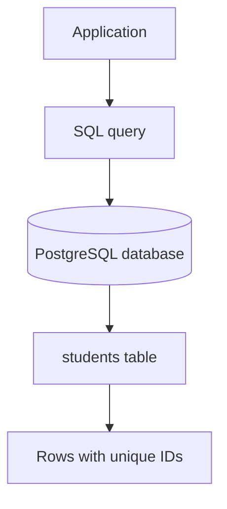

# 🗄️ PostgreSQL Basics: Your First Database Table

> **Code Therapist Developer Academy** · **7 November 2026** · Beginner  
> Scope: learning SQL syntax locally; not a production security or backup plan.

## What is a relational database?

A relational database stores structured records in tables with columns and rows. PostgreSQL supports standard SQL and powerful data constraints. Try the following in a disposable learning database, not a production environment.



## Practical exercise

Create a table:

```sql
CREATE TABLE students (
    student_id BIGINT GENERATED ALWAYS AS IDENTITY PRIMARY KEY,
    full_name TEXT NOT NULL,
    email TEXT UNIQUE NOT NULL,
    enrolled_on DATE NOT NULL DEFAULT CURRENT_DATE
);
```

Insert a sample:

```sql
INSERT INTO students (full_name, email)
VALUES ('Amina Example', 'amina@example.test');
```

Query it:

```sql
SELECT student_id, full_name, enrolled_on
FROM students
ORDER BY student_id;
```

The `PRIMARY KEY` ensures a unique row identifier, `NOT NULL` prevents missing required values, and `UNIQUE` rejects duplicate email values in this table.

## Learning checkpoints

| Concept | Question |
|---|---|
| Table | What entity does it represent? |
| Data type | What kinds of values can this column hold? |
| Constraint | What invalid state does it prevent? |
| Query | Which columns and rows do you need? |
| Backups | How would you restore deleted data? |

## What comes next?

Try `UPDATE`, `DELETE`, joins, indexes, transactions and database roles in a test environment. Never use an administrative database account for every application request.

## References

- [PostgreSQL official tutorial](https://www.postgresql.org/docs/current/tutorial.html)
- [PostgreSQL SQL language documentation](https://www.postgresql.org/docs/current/sql.html)

---

[← SQL & NoSQL](./README.md) · [← Knowledge Hub](../../../README.md)
