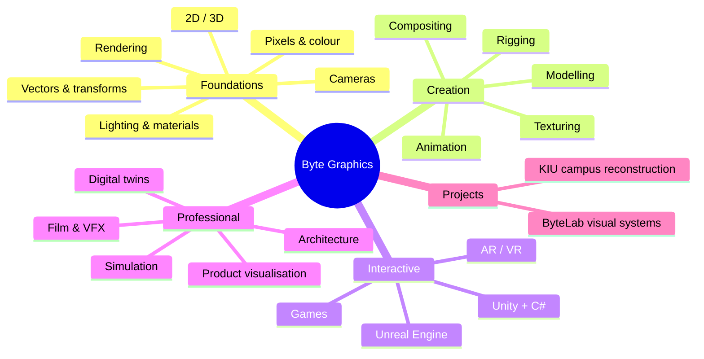

# 🎨 Byte Graphics
### Computer Graphics · 3D · Animation · Gaming · Visualisation

**ByteLab Uganda Ltd · Code Therapist Knowledge Hub**

[Season 01](./SEASON-01-GRAPHICS-FOUNDATIONS.md) · [Season 02](./SEASON-02-GAMING-AND-GAME-DEVELOPMENT.md) · [Season 03](./SEASON-03-KIU-CAMPUS-BLENDER-PROJECT.md) · [Resources](./RESOURCES.md)

> [!IMPORTANT]
> Byte Graphics is a learning, research and creator-project family. Product versions, operating-system support and game popularity change over time; dated claims use linked primary sources. The KIU campus project is described from the creator's supplied account; public evidence links will be added when supplied.

## Why this family exists

Computer graphics is the field of creating, processing and displaying visual information with computers. It connects mathematics, design and software engineering with practical work in film, animation, games, architecture, simulation, UI/UX, scientific visualisation, advertising, education, AR/VR and digital twins.

## Three-season learning path

| Season | Theme | Outcome |
|---|---|---|
| **01** | [Graphics Foundations & Creative Software](./SEASON-01-GRAPHICS-FOUNDATIONS.md) | A beginner understands what graphics is, where it is used, major tools, films, books and a complete 3D pipeline |
| **02** | [Gaming, Game Development & Workstations](./SEASON-02-GAMING-AND-GAME-DEVELOPMENT.md) | Understand game engines, Unity/C#, current gaming examples, GPUs and realistic PC specifications |
| **03** | [KIU Main Campus Blender Reconstruction](./SEASON-03-KIU-CAMPUS-BLENDER-PROJECT.md) | Follow a professional real-world survey → reference → modelling → texture → lighting → render workflow |

## Core production pipeline

## Existing Knowledge Hub material reused

- [Computer Graphics index](../COMPUTER-GRAPHICS/README.md)
- [2D and 3D index](../2D-AND-3D/README.md)
- [Creative Tools index](../CREATIVE-TOOLS/README.md)
- [Blender Keyframes lesson](../../07-SOCIAL-MEDIA/YOUTUBE/2026-11-09-TECHNOLOGY-DAILY-15/FIELD-15-blender-keyframes-animate-a-simple-object.md)
- [PC specifications learning path](../../13-HARDWARE-AND-SYSTEMS/GADGETS/README.md)

[← Design, Animation & Graphics](../README.md) · [← Knowledge Hub](../../README.md)
