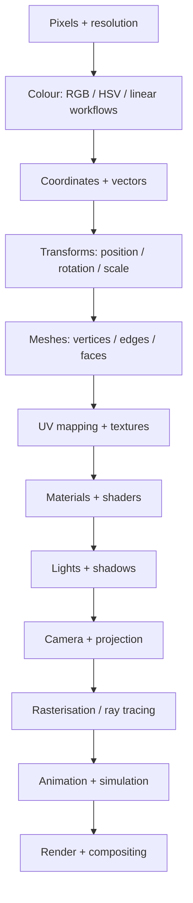

# Season 01 — Computer Graphics Foundations & Creative Software

[← Byte Graphics](./README.md) · [Season 02 →](./SEASON-02-GAMING-AND-GAME-DEVELOPMENT.md)

## Part 01 · What computer graphics means

Computer graphics is more than drawing. It includes the algorithms, hardware, software and artistic decisions used to represent shapes, colour, light, motion and space on a display or in a rendered image.

### Major fields

| Field | Typical work |
|---|---|
| 2D graphics | Illustration, logos, UI, posters, digital painting |
| 3D modelling | Characters, buildings, products, vehicles, environments |
| Animation | Character motion, cameras, simulations, motion graphics |
| Rendering | Converting scene data into final images or frames |
| VFX | Integrating CG, particles, simulations and live-action footage |
| Game graphics | Real-time rendering, shaders, levels, characters and effects |
| Architecture | Interior/exterior visualisation, walkthroughs, planning |
| Scientific graphics | Simulations, medical images, engineering and data visualisation |
| AR/VR | Immersive interactive environments |
| Digital twins | Virtual representations of physical places, systems or equipment |

## Part 02 · The concepts a beginner must learn

## Part 03 · Eight important graphics tools

**Platform status checked 23 November 2026 against official vendor/project documentation.**

| Software | Main strength | Windows | Linux | macOS |
|---|---|:---:|:---:|:---:|
| **Blender** | Modelling, sculpting, animation, rendering, compositing, VFX | ✅ | ✅ | ✅ |
| **Autodesk Maya** | Professional 3D animation, rigging, modelling and VFX pipelines | ✅ | ✅* | ✅ |
| **Unity 6** | Real-time 2D/3D game and interactive development, commonly with C# | ✅ | ✅ Ubuntu* | ✅ |
| **Unreal Engine 5** | High-end real-time games, virtual production and visualisation | ✅ | ✅* | ✅* |
| **Adobe Substance 3D Painter** | PBR texturing and material painting | ✅ | ✅* | ✅ |
| **Krita** | Digital painting, concept art and 2D illustration | ✅ | ✅ | ✅ |
| **GIMP** | Raster image editing and compositing | ✅ | ✅ | ✅ |
| **DaVinci Resolve 21** | Editing, colour, Fusion VFX, motion graphics and audio | ✅ | ✅* | ✅ |

`*` Linux/macOS support can have specific distribution, hardware, driver or version requirements; check the linked official page before installation.

### What should a beginner start with?

- **Blender** for broad 3D learning because one application covers modelling, materials, animation, rendering and compositing.
- **Krita or GIMP** for 2D image preparation and textures.
- **DaVinci Resolve** for final video edit, colour and presentation.
- **Unity + C#** when the goal becomes interactive/game development.
- **Maya / Substance / Unreal** when moving deeper into specialist studio pipelines.

## Part 04 · Six films to study for computer-graphics thinking

These are **study examples**, not claims that one software package created an entire film.

| Film | Why a graphics learner should study it | Legitimate reference |
|---|---|---|
| **Toy Story (1995)** | Landmark computer animation; Pixar describes it as the world's first computer-animated feature film | https://www.pixar.com/toy-story |
| **Avatar (2009)** | Performance capture, digital environments and large-scale VFX | https://www.avatar.com/movies/avatar/ |
| **Avatar: The Way of Water (2022)** | Advanced digital characters, water environments and performance capture | https://www.avatar.com/movies/avatar-the-way-of-water |
| **The Lion King (2019)** | Photorealistic digital environments and virtual-production style filmmaking | https://movies.disney.com/The-Lion-King-2019 |
| **Avengers: Endgame (2019)** | Large-scale VFX and CG character/environment integration | https://www.marvel.com/movies/avengers-endgame |
| **Jurassic Park (1993)** | Classic study in combining computer-generated creatures with live-action filmmaking | Official/licensed viewing availability varies by region |

> Use official studio or licensed streaming pages. This hub does not provide copied films, pirated streams or full copyrighted scripts.

## Part 05 · From reference image to 3D scene

```mermaid
flowchart LR
  PHOTO["Reference photo"] --> OBS["Observe proportions"]
  OBS --> BLOCK["Blockout big forms"]
  BLOCK --> DETAIL["Model details"]
  DETAIL --> MAT["Materials / textures"]
  MAT --> LIGHT["Match light"]
  LIGHT --> CAM["Match camera"]
  CAM --> RENDER["Render comparison"]
  RENDER --> FIX["Correct errors"]
  FIX --> RENDER
```

A professional artist does not simply “copy a picture.” The job is to infer shape, scale, material, light and camera perspective from incomplete evidence.

## Part 06 · Season 01 exercises

1. Model one everyday object from three photographs.
2. Recreate one small room using measured dimensions.
3. Build three materials: metal, painted plastic and concrete.
4. Create day and night lighting for the same scene.
5. Animate a 10-second camera movement.
6. Compare Eevee/real-time rendering with path-traced rendering.
7. Export one clean portfolio image and document the workflow.

## Primary references

- Blender requirements: https://www.blender.org/download/requirements/
- Autodesk Maya: https://www.autodesk.com/products/maya/product-details
- Unity manual: https://docs.unity3d.com/6000.1/Documentation/Manual/GettingStartedInstallingUnity.html
- Unreal Engine requirements: https://dev.epicgames.com/documentation/unreal-engine/hardware-and-software-specifications-for-unreal-engine
- Substance 3D Painter requirements: https://experienceleague.adobe.com/en/docs/substance-3d-painter/using/getting-started/system-requirements
- Krita: https://krita.org/en/download/
- GIMP: https://www.gimp.org/downloads/
- DaVinci Resolve: https://www.blackmagicdesign.com/products/davinciresolve
