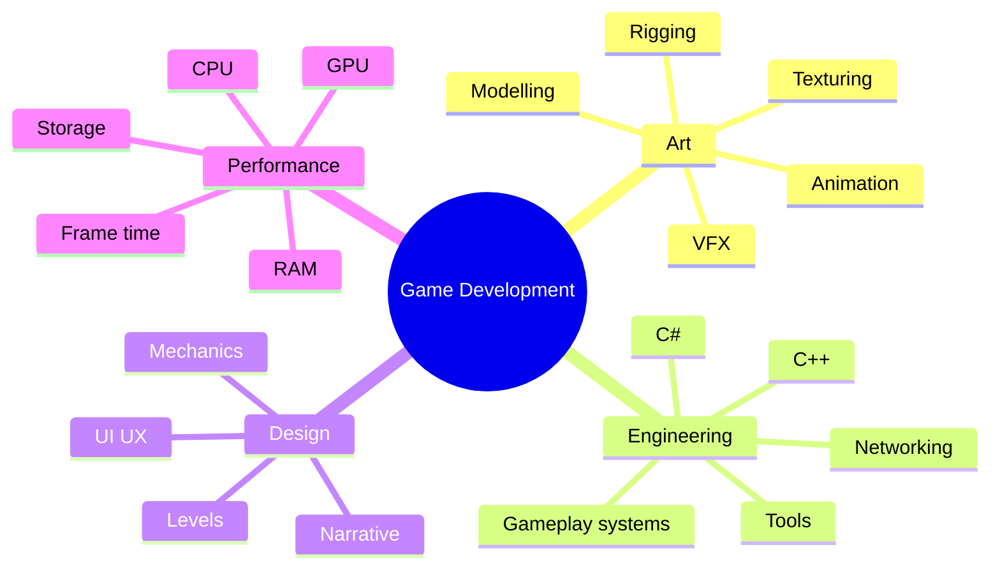
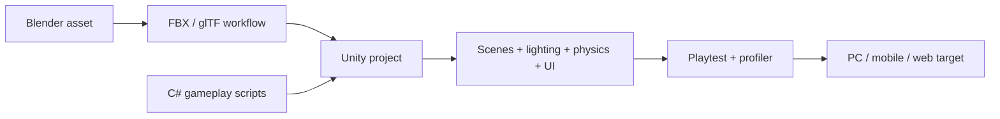
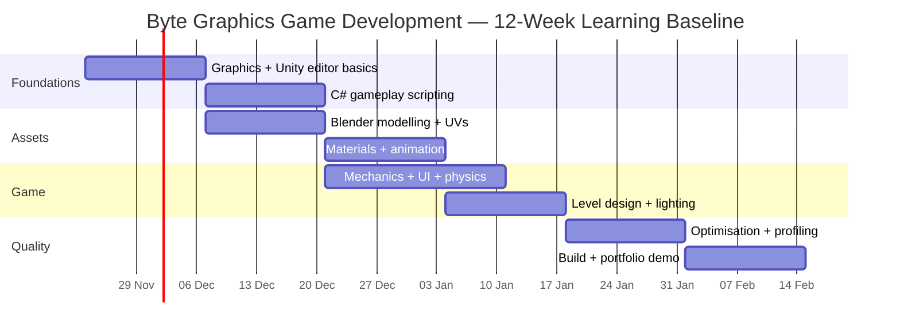

# Season 02 — Gaming, Game Development & Graphics Workstations

[← Season 01](./SEASON-01-GRAPHICS-FOUNDATIONS.md) · [Byte Graphics](./README.md) · [Season 03 →](./SEASON-03-KIU-CAMPUS-BLENDER-PROJECT.md)

## Part 01 · Why gaming belongs inside Byte Graphics

Games combine **computer graphics + software engineering + interaction + sound + storytelling**. A modern game may require 3D modelling, animation, physics, networking, UI, shaders, AI, level design, audio and optimisation.

## Part 02 · Unity and C#

Byte Graphics uses **Unity + C#** as one practical entry route into game development.

Unity 6 supports Windows, macOS and supported Ubuntu Linux configurations. Platform build support and tooling differ, so the target platform should be decided before production.

## Part 03 · Unreal Engine route

Unreal Engine is important for high-end real-time graphics, large 3D environments and virtual production. Epic's current guidance recommends **32 GB RAM and 8 GB or more graphics memory** for a comfortable Windows development baseline, with feature-specific requirements for systems such as Lumen and Nanite.

## Part 04 · Current PC gaming snapshot

**Steam snapshot checked 23 November 2026.** Live rankings change continuously.

Steam's current chart showed examples including:

1. Counter-Strike 2
2. Dota 2
3. PUBG: BATTLEGROUNDS
4. ROB RUN
5. Bongo Cat

Official live source: https://store.steampowered.com/charts/

This is a **platform snapshot**, not a claim that these are the five most-played games across every console, mobile platform and country.

## Part 05 · PC specifications: gaming vs game creation

### A sensible modern learning workstation

| Component | Entry learning | Strong 3D / game-dev target | Why it matters |
|---|---|---|---|
| CPU | Modern 6-core | 8–16 strong cores | Compilation, simulation, baking, multitasking |
| RAM | 16 GB | **32 GB** | Large scenes, Unreal/Unity editor, Blender, browser + tools |
| GPU | Dedicated 6–8 GB VRAM | **RTX/Radeon-class 8–16 GB VRAM** | Real-time viewport, rendering, Lumen/ray tracing, high textures |
| Storage | 512 GB SSD | **1–2 TB NVMe SSD** | Engines and projects become large quickly |
| Display | 1080p IPS | 1440p colour-accurate | Detail, workspace and colour judgment |
| Cooling | Adequate | Strong sustained cooling | Prevents long render/build throttling |

This is a **Byte Graphics recommendation**, not a universal requirement for every game.

### What official graphics tools tell us

- Blender currently recommends **32 GB RAM and 8 GB VRAM**.
- Unreal Engine currently recommends **32 GB RAM and 8 GB+ graphics RAM** for its standard Windows development guidance.
- Substance 3D Painter's current recommended Windows tier lists **32 GB RAM and 16 GB VRAM**.

Those figures explain why a serious graphics workstation can require substantially more GPU/RAM than a normal office laptop.

## Part 06 · Gaming laptop families to research

| Family | Positioning | What to compare before buying |
|---|---|---|
| **Alienware** | Premium gaming/performance | Exact GPU wattage, cooling, display, upgradeability |
| **Lenovo Legion** | Performance gaming | CPU/GPU configuration, panel, thermal design |
| **HP Victus** | Mainstream gaming/value | Exact GPU model/VRAM, RAM slots, screen quality |
| **ASUS ROG** | Gaming/performance | GPU power, cooling, panel and battery |
| **Acer Predator** | Gaming/performance | Thermals, screen, ports and SSD/RAM expansion |
| **MSI Gaming** | Broad gaming range | Model-specific cooling and GPU power |
| **Razer Blade** | Thin premium creator/gaming | Thermals, price, GPU power limits |

**Never compare only the brand name.** Two laptops called “Victus,” “Legion,” or “Alienware” can have very different CPUs, GPUs, VRAM, RAM, displays and cooling.

## Part 07 · Game-development learning roadmap

## Primary sources

- Steam Charts: https://store.steampowered.com/charts/
- Blender requirements: https://www.blender.org/download/requirements/
- Unity 6 documentation: https://docs.unity3d.com/6000.1/Documentation/Manual/GettingStartedInstallingUnity.html
- Unreal Engine requirements: https://dev.epicgames.com/documentation/unreal-engine/hardware-and-software-specifications-for-unreal-engine
- Substance 3D requirements: https://experienceleague.adobe.com/en/docs/substance-3d-painter/using/getting-started/system-requirements
