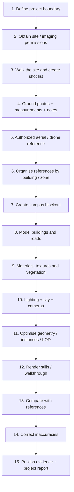
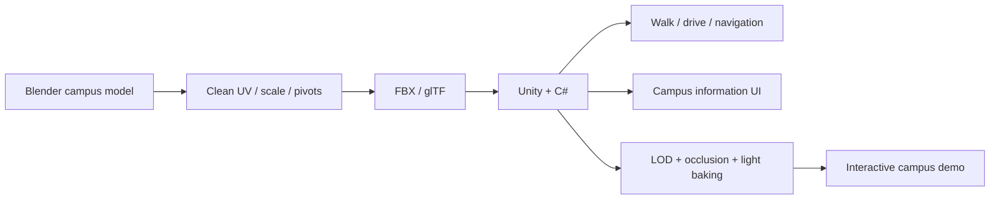

# Season 03 — KIU Main Campus Blender Reconstruction

[← Season 02](./SEASON-02-GAMING-AND-GAME-DEVELOPMENT.md) · [Byte Graphics](./README.md)

## Project statement

This season documents a creator-reported project to reconstruct **Kampala International University Main Campus** as a detailed 3D environment in Blender, beginning from the surrounding approach to the gate and continuing through observable campus spaces.

The creator reports using ground photography, systematic visual observation and DJI drone imagery before modelling the environment on a higher-performance graphics computer.

> **Evidence status:** the creator reports the project as completed. Model files, final renders, drone captures and public demonstration links are **not yet attached to this Knowledge Hub page**. They will be added only when supplied and approved for publication.

## Professional workflow



## Phase 01 · Research before touching Blender

### Define the boundary

A campus model can easily become too large. First decide whether the model covers:

- approach roads and neighbourhood context,
- gate and security area,
- major academic buildings,
- administration,
- walkways,
- parking,
- vegetation,
- sports/open spaces,
- selected interiors,
- or only exterior navigation.

### Build a reference register

| Reference type | Purpose |
|---|---|
| Wide ground photographs | Overall massing and relationships |
| Corner/elevation photographs | Wall proportions and architectural detail |
| Close texture photographs | Concrete, paint, paving, roof and signage |
| Measured/known dimensions | Scale anchors |
| Drone/aerial imagery | Building placement, roads, roofs and spatial relationships |
| Sketches/notes | Hidden corners, level changes and observations |

Only capture and publish imagery where you have the required permission. Avoid unnecessary identifiable personal data in reference photography.

## Phase 02 · Study the campus as geometry

Do not begin with windows, signs and small decorations.


### Accuracy hierarchy

1. Campus layout
2. Building footprint
3. Building height and floor count
4. Roof form
5. Door/window rhythm
6. Materials
7. Signage
8. Small props

If the first four are wrong, detailed textures will not make the environment feel correct.

## Phase 03 · Blender project organisation

Suggested scene structure:

```text
KIU_MAIN_CAMPUS/
├── 00_REFERENCE
├── 01_TERRAIN
├── 02_ROADS_WALKWAYS
├── 03_BUILDINGS
│   ├── BLOCK_A
│   ├── BLOCK_B
│   └── ADMIN
├── 04_GATE_SECURITY
├── 05_VEGETATION
├── 06_PROPS
├── 07_LIGHTING
├── 08_CAMERAS
└── 09_EXPORT_RENDER
```

Use consistent naming, collections, real-world units and reusable assets.

## Phase 04 · Modelling strategy

### Blockout first
Use primitive boxes and planes to validate the campus layout.

### Modular construction
Repeat doors, windows, pillars, paving sections and lights rather than modelling every copy separately.

### Non-destructive workflow
Use modifiers where appropriate and preserve editable source geometry.

### Optimisation
- Instance repeated objects.
- Reduce hidden geometry.
- Use appropriate texture sizes.
- Use LOD or simplified distant assets for interactive versions.
- Keep vegetation efficient.
- Separate high-quality render assets from real-time/game assets where necessary.

## Phase 05 · Materials and textures

For each important surface, document:

- base colour,
- roughness,
- normal/bump detail,
- metallic value where relevant,
- scale,
- weathering,
- repetition/tiling.

A good campus material library should include concrete, painted plaster, glass, metal, asphalt, paving, soil, grass, roof materials and signage.

## Phase 06 · Camera matching

When recreating a photographed building, match:

1. approximate camera height,
2. focal length / field of view,
3. horizon,
4. perspective convergence,
5. camera position,
6. lighting direction.

Then overlay or compare the Blender render with the reference and correct major differences.

## Phase 07 · Lighting and presentation

Prepare at least:

- neutral daytime overview,
- entrance/gate hero shot,
- one elevated overview,
- one pedestrian eye-level walkthrough,
- one evening/night test,
- one wireframe/model breakdown,
- one reference-vs-render comparison.

## Phase 08 · Optional game-engine extension



This can turn a static graphics project into a **virtual-campus navigation, education or digital-twin research project**.

## Phase 09 · Evidence package to publish later

When the creator supplies the files/links, this page should add:

- 8–15 final renders,
- 3–5 reference-to-render comparisons,
- short walkthrough video,
- Blender version,
- approximate scene statistics,
- hardware used,
- render engine,
- project duration,
- source/reference permissions,
- downloadable low-resolution demo where appropriate,
- Unity interactive build link if created.

## Project review rubric

| Area | Weight |
|---|---:|
| Layout and architectural accuracy | 25% |
| Modelling quality | 20% |
| Materials and textures | 15% |
| Lighting and rendering | 15% |
| Optimisation / scene organisation | 10% |
| Camera/presentation | 10% |
| Documentation and evidence | 5% |

## Publication integrity

This documentation should never imply that KIU commissioned, approved or officially operates the model unless written authorization is available. It is presented as an independent creator/academic graphics project.
