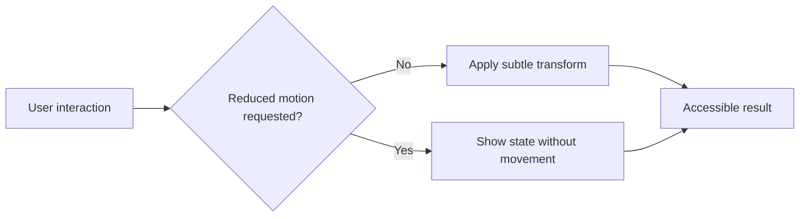

# 🎬 CSS Animation: Build Motion That Respects Users

> **Code Therapist Technical Notes** · Published **7 November 2026** · **Beginner → Intermediate**  
> Category: Design, Animation & Graphics · Reading time: ~5 min

## What you will build

A subtle hover animation that honors users who request reduced motion. Animations should make interfaces clearer, not create distractions.

### How CSS animations work

CSS can animate between keyframes with `@keyframes` and properties such as `animation-duration`, `animation-timing-function`, and `animation-iteration-count`. Movement should be restrained and must not be the only way important information is communicated.



## Try it: a gentle card lift

```html
<article class="feature-card">
  <h2>Explore Developer Academy</h2>
  <p>Discover practical lessons and code examples.</p>
  <a href="https://github.com/codetherapistpita-oss">Visit projects</a>
</article>
```

```css
.feature-card {
  border: 1px solid #cbd5e1;
  border-radius: 16px;
  padding: 24px;
  background: #fff;
  transition: transform 180ms ease, box-shadow 180ms ease;
}
.feature-card:hover, .feature-card:focus-within {
  transform: translateY(-4px);
  box-shadow: 0 14px 28px rgba(20,35,60,.12);
}
@media (prefers-reduced-motion: reduce) {
  .feature-card { transition: none; }
  .feature-card:hover, .feature-card:focus-within { transform: none; }
}
```

## Design checklist

| Check | Why it matters |
|---|---|
| Motion is optional | Users can request reduced motion |
| Focus state visible | Keyboard users must understand location |
| Contrast remains sufficient | Content stays readable throughout |
| Meaning isn't animation-only | Important status is visible in text |
| Test on mobile | Hover isn't available on many touch screens |

## Test the result

Use keyboard navigation, a touch device, and the operating system's **Reduce Motion** accessibility setting. The content must work even when motion is absent.

## References

- [MDN — Using CSS animations](https://developer.mozilla.org/en-US/docs/Web/CSS/Guides/Animations/Using)
- [MDN — prefers-reduced-motion](https://developer.mozilla.org/en-US/docs/Web/CSS/@media/prefers-reduced-motion)

---

[← CSS Animation resources](./README.md) · [← Knowledge Hub](../../../README.md) · [Portfolio](https://codetherapist.netlify.app/)
