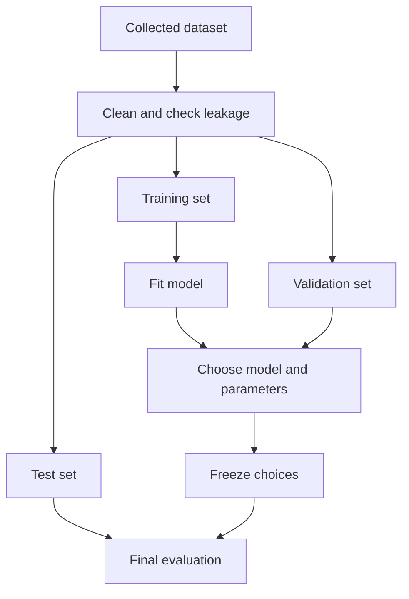

# 🧠 Machine Learning: Train, Validate, Test

> **Code Therapist ML Notes** · **7 November 2026** · Beginner  
> Source: Google Machine Learning Crash Course.

## Why splitting the dataset matters

A model can memorize examples and still perform poorly on new data. Separating examples helps estimate whether it generalizes beyond the data used to train it.

## The three roles

| Dataset | Main purpose | Common mistake |
|---|---|---|
| Training | Fit model parameters | Testing on these same samples |
| Validation | Compare settings during development | Reusing it until decisions overfit |
| Test | Final held-out evaluation | Tuning repeatedly against test outcomes |

A **70/15/15 split** is a teaching example, not a universal rule. Dataset size, time dependencies, group leakage and the intended deployment setting determine the right strategy.

## Avoid data leakage

- Do not allow records representing the same person or event to leak between groups where that would overstate performance.
- Fit preprocessing steps on training data where appropriate, then apply learned transformations to validation and test data.
- For chronological forecasting, consider time-aware partitions rather than random splitting.
- Compare test conditions with the environment the model will actually face.

## Quick exercise

You have 1,000 labeled records. A **hypothetical** 70/15/15 split yields 700 training, 150 validation and 150 test records. Then ask: do those sets truly represent future data?

## References

- [Google ML Crash Course — Dividing datasets](https://developers.google.com/machine-learning/crash-course/overfitting/dividing-datasets)
- [Google ML Crash Course — Overfitting](https://developers.google.com/machine-learning/crash-course/overfitting/overfitting)

---

[← Model Evaluation](./README.md) · [← Knowledge Hub](../../../README.md)
