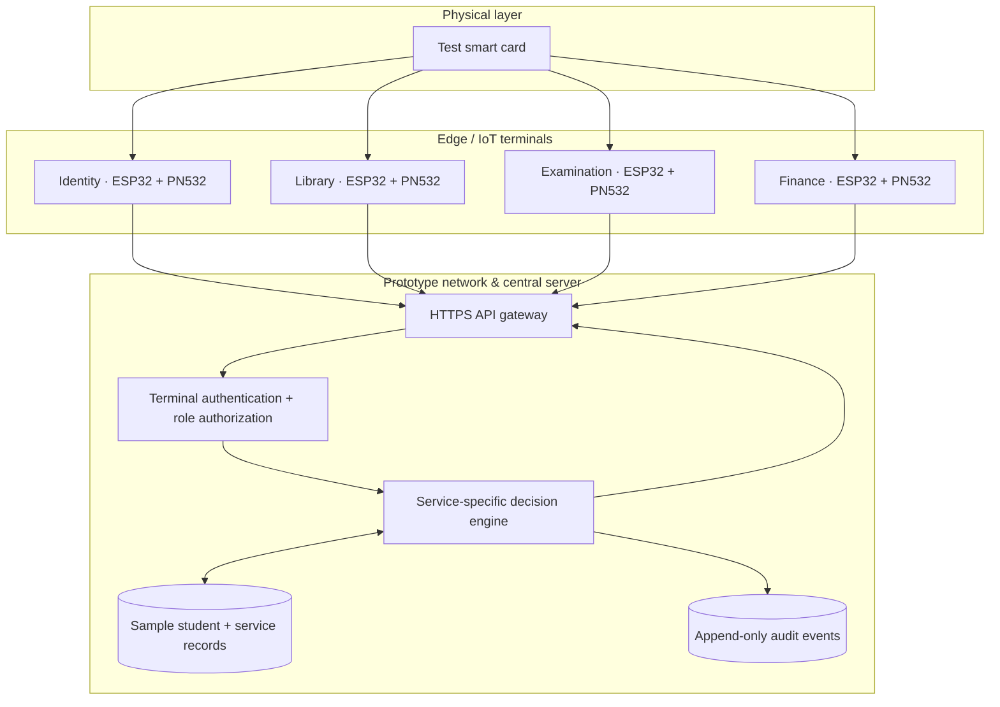
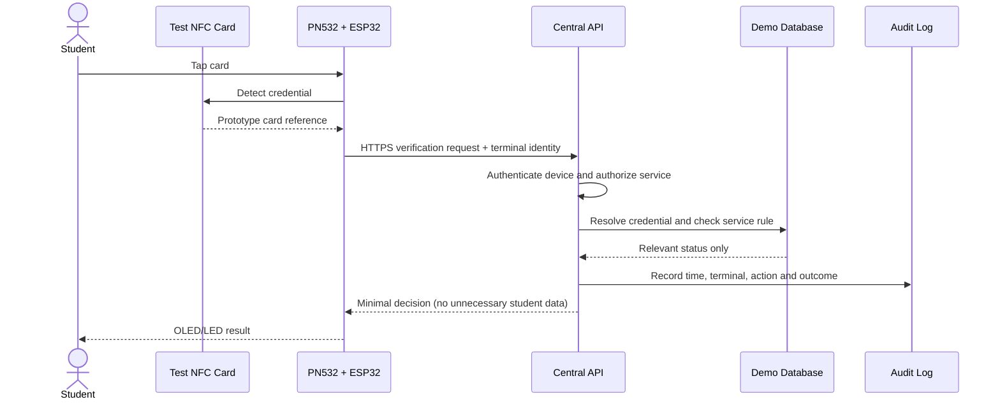
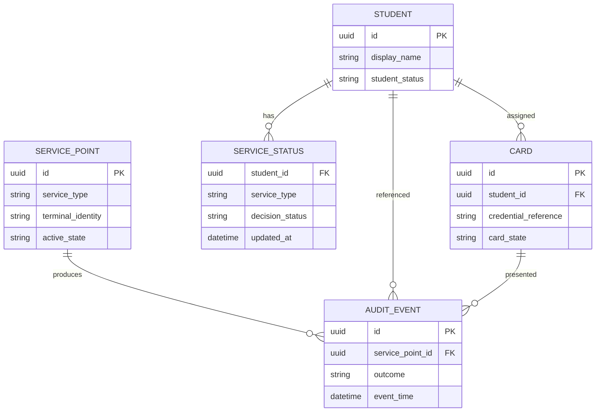

# 🏗️ KIU OneCard — System Architecture & Data Flow

[← Project homepage](./README.md) · [Service terminals](./SERVICE-TERMINALS.md) · [Security plan](./SECURITY-AND-TESTING.md)

## 1. Five-layer architecture

| Layer | Components | Responsibility |
|---|---|---|
| **1 · Card** | RFID/NFC card or test tag | Presents a prototype credential |
| **2 · Edge device** | PN532 + ESP32 + OLED + LEDs/buzzer | Reads credential, makes authenticated service request, displays outcome |
| **3 · Connectivity** | Authorized Wi-Fi / local LAN, HTTPS | Provides protected communication |
| **4 · Application** | Central API + service modules + database | Resolves identity, enforces permissions, returns minimal decision |
| **5 · Observability** | Event log, audit interface, test dashboard | Records outcome and supports diagnostics |



## 2. Scan-to-response sequence



## 3. Central data design (conceptual)



*Only sanitized sample records belong in any public demo. A real system requires retention rules, encryption, appropriate institution policies, and reviewed schema design.*

## 4. Example interface contract (illustrative, not deployed)

Proposed request:

```http
POST /api/v1/terminal/verify
Content-Type: application/json
Authorization: Bearer <DEVICE_CREDENTIAL>

{
  "card_reference": "TEST-CARD-0007",
  "service": "library",
  "request_id": "demo-req-0042"
}
```

Example response:

```json
{
  "request_id": "demo-req-0042",
  "decision": "ELIGIBLE",
  "message": "Library access approved",
  "timestamp": "2026-11-09T10:00:00Z"
}
```

These examples use **fictional identifiers**. In a deployed system, the API must derive permitted service from the authenticated terminal identity, not blindly trust an arbitrary `service` field. Include request freshness, rate limiting and audit correlation. Do not place shared secrets in a public firmware repository.

## 5. Security distinction: NFC UID is not proof of identity

A **UID-only** demo can be used to illustrate reading and lookup, but cannot reliably resist copying or impersonation. A real deployment needs cryptographically authenticated credentials, secure enrollment, revocation, and anti-replay controls. The physical card should not contain finance balances, grades, or extensive personal information.

## 6. Failure handling

| Failure | Desired behavior |
|---|---|
| Unknown card | DENIED / request assistance; do not disclose identity |
| Lost or blocked card | REVOKED; no service authorization |
| Network unavailable | FAIL CLOSED for access decisions; show temporary service issue |
| API timeout | Retry within bounded limits, prevent duplicate writes |
| Terminal not authenticated | Reject request; audit attempt |
| Database unavailable | No false “CLEARED” result; surface service unavailable |

## 7. Interface references

- [ESP32 security and TLS](https://docs.espressif.com/projects/esp-idf/en/stable/esp32/security/security.html)
- [Adafruit PN532 SPI/I²C interface library](https://github.com/adafruit/Adafruit-PN532)
- [OWASP API object-level authorization](https://api-security.owasp.org/editions/2023/en/0xa1-broken-object-level-authorization/)

[← Project homepage](./README.md)
