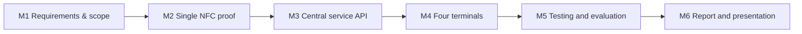
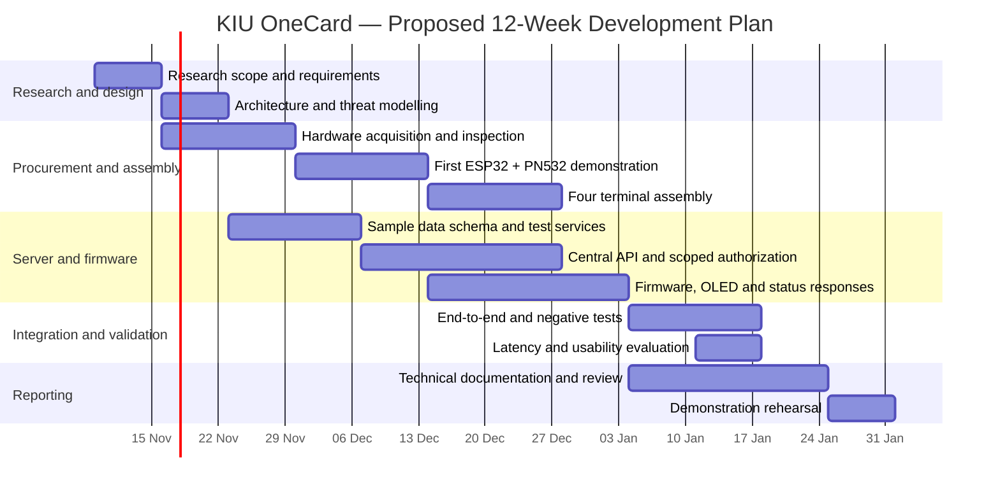
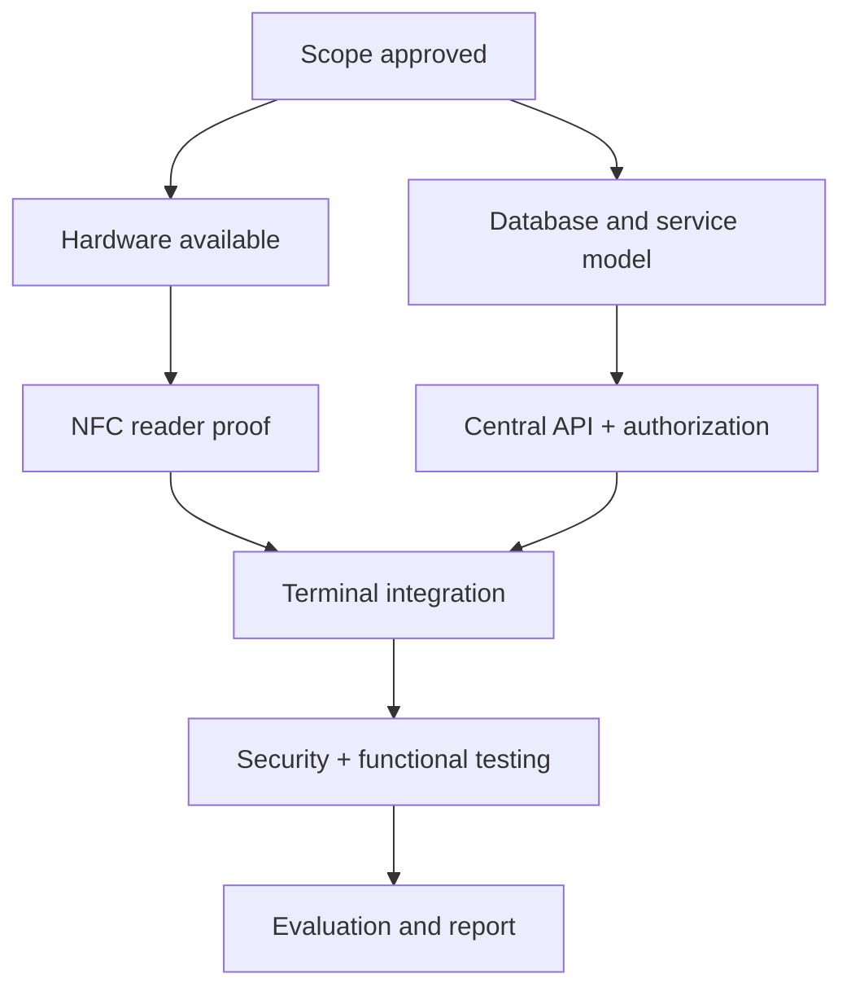

# 08 · Project Roadmap, Gantt Chart & Milestone Gates

[← Project home](./README.md) · [Project charter](./PROJECT-CHARTER.md) · [Requirements](./REQUIREMENTS-AND-TRACEABILITY.md) · [Demo checklist](./OPERATIONS-AND-DEMO.md)

> [!IMPORTANT]
> **PROPOSED BASELINE — NOT AN APPROVED KIU TIMETABLE.** The 12-week plan below illustrates a possible work sequence from **9 November 2026 through 31 January 2027**. The supervisor and team must confirm dates, ownership, academic deadlines, procurement lead times and actual completion. The timeline must not be mistaken for observed progress.

## 8.1 Delivery strategy

The project is designed to reach a **minimum end-to-end proof first**, then extend the same controlled interaction across the remaining service terminals.

## 8.2 Gantt chart · 12 weeks

## 8.3 Weekly plan and required evidence

| Week | Proposed dates | Deliverable | Quality gate |
| :---: | :--- | :--- | :--- |
| **W01** | 09–15 Nov 2026 | Scope, actors, use cases | Reviewed requirements baseline |
| **W02** | 16–22 Nov 2026 | Architecture, risks, connectivity design | Supervisor feedback and revised diagrams |
| **W03** | 23–29 Nov 2026 | Hardware procurement and synthetic schema | Hardware inspection and repeatable demo fixtures |
| **W04** | 30 Nov–06 Dec 2026 | Single-card reading proof | NFC demonstration recorded |
| **W05** | 07–13 Dec 2026 | API and terminal authentication | Authorized request / denied request tests |
| **W06** | 14–20 Dec 2026 | Four-terminal assembly | Assembly and power checks |
| **W07** | 21–27 Dec 2026 | Firmware-to-API integration | Service-specific response evidence |
| **W08** | 28 Dec–03 Jan | Blocked/unknown cards, network errors | Negative test report |
| **W09** | 04–10 Jan 2027 | System regression and permissions | Completed test log |
| **W10** | 11–17 Jan 2027 | Timing and operator usability | Measurement and feedback records |
| **W11** | 18–24 Jan 2027 | Review technical report and presentation | Revisions and known-limitations statement |
| **W12** | 25–31 Jan 2027 | Final rehearsal and demonstration | Recorded academic prototype showcase |

**The dates are a suggested planning sequence, not proof of project progress or confirmed examination deadlines.** Some tasks overlap by design.

## 8.4 Milestone acceptance matrix

| Milestone | Required evidence | Approval state |
| :--- | :--- | :--- |
| **M1 · Scope baseline** | Reviewed project charter and [requirements matrix](./REQUIREMENTS-AND-TRACEABILITY.md) | Pending |
| **M2 · NFC proof** | Single ESP32/PN532 test card read with correct safe feedback | Pending |
| **M3 · Authenticated API** | Valid terminal accepted; unauthorized terminal rejected | Pending |
| **M4 · Four terminals** | Identification, library, exam and finance simulated decisions | Pending |
| **M5 · Evaluation** | T01–T12 test results, latency summaries and limitations | Pending |
| **M6 · Academic demonstration** | Report, approved evidence and presentation | Pending |

**Pending** means not evidenced in the published documentation; it does not necessarily mean no offline work has occurred.

## 8.5 Dependencies and risks

| Risk | Possible impact | Proposed response |
| :--- | :--- | :--- |
| PN532/ESP32 interface mismatch | NFC verification proof delayed | Confirm voltage and SPI/I²C mode against exact boards |
| Hardware procurement delay | Assembly starts late | Prototype first with one verified reader/controller |
| Insecure UID-only demo | False confidence in card authentication | State limitations; research cryptographic credentials |
| Weak or unstable test Wi-Fi | Terminal responses delayed or unavailable | Local isolated network, bounded retries and fail-closed errors |
| Expanded scope | Four-terminal baseline delayed | Defer gates, biometrics and non-core modules |
| Academic timetable or supervision changes | Review dates shift | Re-baseline dates with supervisor and team |
| Missing evidence | No defensible completion statement | Keep test logs and review artifacts at every gate |

## 8.6 Progress reporting standard

For future updates, record **planned start, actual start, completion percentage, owner, evidence link, issue/blocker and actual finish** in a project tracker. Do not mark tasks complete based only on a Gantt bar, and do not treat the estimated UGX 800,000 hardware quotation as a verified purchase ledger.

---

[← Back to project](./README.md) · [Demo & handover](./OPERATIONS-AND-DEMO.md) · [Security & evaluation](./SECURITY-AND-TESTING.md)
