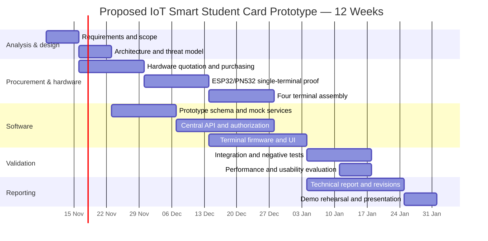
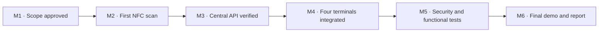

# 📅 KIU OneCard — Proposed 12-Week Gantt Chart & Milestones

[← Project homepage](./README.md) · [Security testing](./SECURITY-AND-TESTING.md)

> [!IMPORTANT]
> **Illustrative planning baseline, not an approved institutional schedule.** Starting **9 November 2026** and running for 12 weeks is a practical proposal for task sequencing. The team and supervisor must confirm deadlines and actual progress. No tasks are marked complete in this example.

## Development roadmap

## Weekly deliverables

| Week | Dates (planning) | Primary work | Evidence / acceptance gate |
|---|---|---|---|
| **W01** | 09–15 Nov | Confirm requirements; stakeholders and boundary | Approved scope draft |
| **W02** | 16–22 Nov | Architecture, terminal roles, risk analysis | Reviewed diagrams / threat model |
| **W03** | 23–29 Nov | Hardware purchasing; demo DB design | Receipts and safe mock schema |
| **W04** | 30 Nov–06 Dec | First ESP32 + PN532 card read; sample services | One working card-read prototype |
| **W05** | 07–13 Dec | Central API, role authorization | Authenticated API demonstration |
| **W06** | 14–20 Dec | Four terminal build, OLED/buzzer controls | Four assembled prototypes |
| **W07** | 21–27 Dec | Firmware/service integration | End-to-end terminal responses |
| **W08** | 28 Dec–03 Jan | Permissions, blocked card and error cases | Negative security tests |
| **W09** | 04–10 Jan | Complete integration and regression tests | Recorded test run |
| **W10** | 11–17 Jan | Latency, reliability, user walkthrough | Evaluation worksheet |
| **W11** | 18–24 Jan | Final documentation and demo preparations | Reviewed report and slides |
| **W12** | 25–31 Jan | Rehearsal, corrections and demonstration | Prototype presentation |

The weekly dates above reflect **proposed work allocation**, not verified university submission or examination dates.

## Responsibility matrix — for team discussion

| Workstream | Suggested collaborative assignment | Approval |
|---|---|---|
| Prototype requirements and final report | All group members | Supervisor |
| Hardware wiring and device tests | Two members with shared reviews | Team |
| Backend API and data model | One lead, one reviewer | Team |
| Terminal workflows and interface | One lead, one reviewer | Team |
| Security and scenario testing | Everyone rotates through tests | Team |
| Procurement and receipts | Group-appointed custodian | Group |

The team has not confirmed individual workstream owners. Assign names only after agreement.

## Milestone gates

## Risks and scheduling controls

| Risk | Effect | Mitigation |
|---|---|---|
| Supplier delay | Hardware build slips | Confirm suppliers early; validate with one device first |
| PN532 board compatibility | NFC reads fail | Test I²C/SPI mode, power and libraries with exact hardware |
| Network reliability | Terminals fail to respond | Separate local test LAN and retry/fail-closed tests |
| Scope expansion | Core four terminals not finished | Defer gates, hostels and biometrics unless essential |
| Privacy/authorization | Unsafe prototype | Synthetic data, least privilege and secure API |
| Exam timetable conflict | Team availability reduced | Supervisor-approved milestone adjustments |

**Progress tracking:** This Gantt is a baseline, not a live project-management feed. Update it with actual start/end dates, completion evidence, blockers and owner approvals.

[← Project homepage](./README.md)
