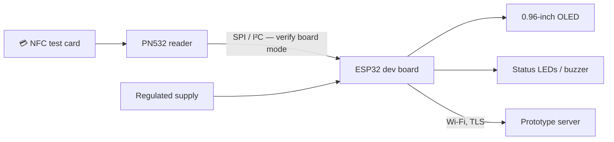

# 🧰 KIU OneCard — Hardware, Wiring & Budget

[← Project homepage](./README.md) · [Architecture](./ARCHITECTURE.md) · [Gantt](./GANTT-CHART.md)

## Hardware chain

**Implementation note:** Verify the specific module's pins, board power requirements and switch configuration before connecting hardware. Do not infer safe voltage from a generic internet wiring diagram; ESP32 I/O is not universally 5V tolerant. Test one reader/controller pair before building four terminals.

## Estimated bill of materials — October 2026 proposal

| # | Item | Qty | Estimated unit UGX | Estimated total UGX |
|---|---|---:|---:|---:|
| 1 | ESP32 Wi-Fi/Bluetooth development board | 4 | 35,000 | 140,000 |
| 2 | PN532 RFID/NFC reader | 4 | 37,500 | 150,000 |
| 3 | RFID/NFC test cards | 20 | 3,000 | 60,000 |
| 4 | 0.96-inch OLED display | 4 | 15,000 | 60,000 |
| 5 | Fingerprint modules (optional evaluation) | 2 | 45,000 | 90,000 |
| 6 | Breadboards | 4 | 10,000 | 40,000 |
| 7 | Jumper-wire sets | 4 | 8,000 | 32,000 |
| 8 | 5V regulated power adapters | 4 | 10,000 | 40,000 |
| 9 | USB data/power cables | 4 | 5,000 | 20,000 |
| 10 | Enclosures/casings | 4 | 14,000 | 56,000 |
| 11 | LEDs and buzzer packs | 4 | 5,000 | 20,000 |
| 12 | Buttons, resistors and small parts | 1 | 12,000 | 12,000 |
| 13 | Perfboards / prototype PCBs | 4 | 7,000 | 28,000 |
| 14 | Pin headers, terminal blocks, connectors | 1 | 20,000 | 20,000 |
| 15 | Soldering consumables | 1 | 20,000 | 20,000 |
| 16 | Labels, sleeves and testing consumables | 1 | 12,000 | 12,000 |
| | **Estimated prototype total** | | | **800,000** |

> **Budget provenance:** Values are reproduced from the team's October 2026 project funding quotation, not real-time supplier quotes. Does not include full-scale university implementation, software labor or production integration. Obtain fresh quotations before purchase.

## Assembly plan

1. Test one ESP32 board with USB power and serial output.
2. Confirm PN532 interface mode and connect it using the **manufacturer-specific** circuit diagram.
3. Read a test NFC card in a controlled setup; record only the test credential.
4. Add OLED and status LED/buzzer, confirm power draw and pin assignments.
5. Connect the ESP32 to an isolated test network and a local prototype API.
6. Secure communication and perform negative authorization tests.
7. Repeat for the other three terminals and label their intended roles.
8. Move to suitable enclosures only after stable power, thermal and reliability tests.

## Vendor and technical references

- [Espressif official documentation](https://docs.espressif.com/projects/esp-idf/en/stable/esp32/)
- [Adafruit PN532 technical guide](https://learn.adafruit.com/adafruit-pn532-rfid-nfc)
- [Adafruit PN532 library](https://github.com/adafruit/Adafruit-PN532)

[← Project homepage](./README.md)
