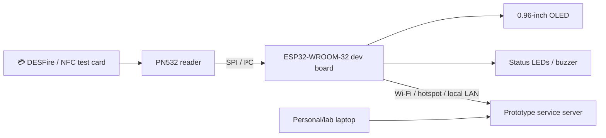

# 🧰 KIU OneCard — Hardware, Wiring & Updated Prototype Budget

[← Project homepage](./README.md) · [Architecture](./ARCHITECTURE.md) · [Gantt](./GANTT-CHART.md)

> [!IMPORTANT]
> **Updated 23 November 2026.** This replaces the earlier October UGX 800,000 four-terminal planning quotation. The current purchasing baseline is a **three-terminal academic prototype** using personal/lab computers and existing laboratory tools where available. Prices are supplier benchmarks, not purchase receipts.

## Hardware chain

## Why ESP32-WROOM-32

The prototype requires Wi-Fi networking, local hotspot/LAN operation, sufficient GPIO for PN532 + display + feedback devices, and broad development-library support. A standard **ESP32-WROOM-32 development board** is therefore the baseline rather than an industrial IoT gateway.

## Updated three-terminal bill of materials

| # | Item | Qty | Current benchmark unit UGX | Planned total UGX |
|---|---|---:|---:|---:|
| 1 | ESP32 ESP-32 WROOM development board | 3 | 60,000 | 180,000 |
| 2 | PN532 NFC/RFID reader module | 3 | 30,000 | 90,000 |
| 3 | MIFARE DESFire EV3 2K PVC cards | 5 | 20,000 | 100,000 |
| 4 | 0.96-inch OLED display | 3 | 25,000 | 75,000 |
| 5 | MB102 solderless breadboard | 3 | 15,000 | 45,000 |
| 6 | Mixed jumper-wire allowance | 1 | 25,000 | 25,000 |
| 7 | USB data/power cables | 3 | 10,000 | 30,000 |
| 8 | Active buzzers | 3 | 4,000 | 12,000 |
| 9 | LEDs | 6 | 1,000 | 6,000 |
| 10 | Resistors / small connectors allowance | 1 | 10,000 | 10,000 |
| | **Estimated demonstrable three-terminal total** | | | **573,000** |
| | **10% contingency** | | | **57,300** |
| | **Recommended procurement ceiling** | | | **630,300** |

### Core hardware only
If displays, breadboards, cables and small components are already available in the laboratory, the **core purchase** is:

**3 ESP32 + 3 PN532 + 5 DESFire EV3 cards = UGX 370,000.**

## Prototype terminal allocation

| Terminal | Hardware |
|---|---|
| Library / Service Terminal A | ESP32 + PN532 + OLED + feedback |
| Finance or Examination / Terminal B | ESP32 + PN532 + OLED + feedback |
| Gate/Identification or rotating service demo / Terminal C | ESP32 + PN532 + OLED + feedback |

The academic four-service concept remains valid, but the physical prototype can demonstrate it using **three configurable terminals** instead of buying four complete sets immediately.

## Card strategy

- **Final secure academic prototype:** MIFARE DESFire EV3 2K PVC cards.
- **Cheap bench tests:** low-cost 13.56 MHz cards/tags may be used only to prove reader communication.
- Do not present UID-only testing as strong authentication.

## Supplier benchmarks checked 23 November 2026

- Neriko Electronics — ESP32-WROOM-32: **UGX 60,000**
- Neriko Electronics — PN532 V3: **UGX 30,000**
- Neriko Electronics — 0.96-inch OLED: **UGX 25,000**
- Neriko Electronics — MB102 breadboard: **UGX 15,000**
- Neriko Electronics — jumper wires / USB / buzzer / LEDs: current local catalogue benchmarks
- Bbiri Centre — MIFARE DESFire EV3 2K: **UGX 20,000**

Sources:
- https://nerikoelectronics.com/
- https://www.bbiri-centre.com/product-page/mifare-desfire-ev3-2k-rfid-card

## Assembly plan

1. Verify one ESP32 board over USB serial.
2. Verify one PN532 board, its supply requirements and interface mode.
3. Read a development credential and document the exact card technology.
4. Add OLED, LED and buzzer feedback.
5. Connect to an isolated hotspot/local LAN and prototype API.
6. Test online and bounded offline behavior.
7. Repeat the verified wiring for the other two terminals.
8. Add enclosures only after stable functional testing.

## Procurement rule

Before paying, confirm the **exact board revision, card chip, stock status and final quotation** with the supplier. Do not substitute a generic RFID card for DESFire or a different ESP32 family solely because a listing is cheaper.

[← Project homepage](./README.md)
