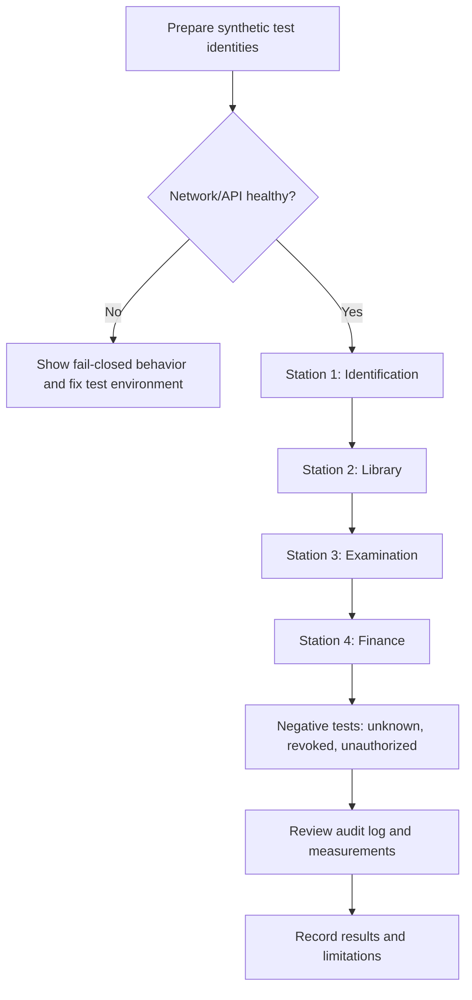

# 07 · Prototype Demonstration & Operational Guide

[← Project home](./README.md) · [Service terminals](./SERVICE-TERMINALS.md) · [Testing](./SECURITY-AND-TESTING.md)

> **Planning document only.** This walkthrough describes a prospective controlled demonstration. It is **not evidence that hardware or software has already been built or tested**.

## 7.1 Demo environment

| Item | Expected setup |
| :--- | :--- |
| Devices | Four labeled ESP32 + PN532 prototype terminals |
| Credentials | Synthetic NFC test cards; at least one active, blocked and unknown |
| Network | Authorized isolated test Wi-Fi with no connection to KIU production systems |
| API | Prototype authorization and service-decision endpoints |
| Data | Synthetic student, card and service-status records |
| Observability | Audit-event screen or sanitized event export |
| Operator | One presenter and one recorder for test evidence |

## 7.2 Demonstration stations

## 7.3 Step-by-step scripted walkthrough

| Step | Operator action | Expected evidence |
| :--- | :--- | :--- |
| 1 | Power terminals and confirm server readiness | Device identifiers and health |
| 2 | Tap an active demo card at ID station | Verification outcome |
| 3 | Tap the same card at library station | Library-specific eligibility |
| 4 | Tap at examination station | Session eligibility decision |
| 5 | Tap at finance station | Simulated clearance decision |
| 6 | Revoke a sample card through the authorized admin flow | Subsequent denied decision |
| 7 | Disconnect a terminal from Wi-Fi | Service unavailable, never false approval |
| 8 | Attempt wrong terminal scope | Server rejects the request |
| 9 | Inspect audit events | All relevant test decisions correlated |
| 10 | Record latency, errors and operator observations | Completed evaluation sheet |

## 7.4 Demonstration outcome template

| Field | Example entry |
| :--- | :--- |
| Test identifier | T01, T02, ... |
| Date/time | To be completed during testing |
| Terminal ID | Synthetic lab identifier |
| Card ID | Synthetic card identifier |
| Expected decision | ELIGIBLE / DENIED / PENDING |
| Actual decision | To be observed |
| Latency (ms) | To be measured |
| Pass / fail | Pending |
| Notes and issue ID | Pending |

**Do not fill this template with fabricated successful results.** Use actual observations and exclude personal student identifiers from public logs.

## 7.5 Handover checklist

- [ ] Updated architecture and approved scope.
- [ ] Reproducible firmware and backend build instructions.
- [ ] Sanitized example database and test fixtures.
- [ ] Test results with defects and corrective actions.
- [ ] Hardware wiring diagrams for the *specific* PN532/ESP32 models.
- [ ] Power, network and device-revocation procedure.
- [ ] Risk and privacy limitations statement.
- [ ] Supervisor-reviewed report and final presentation.

## 7.6 Known limitations

A UID-only NFC demonstration is not secure cardholder authentication. The prototype does not prove regulatory compliance, payment security, high availability, system-level performance at university scale, or permission to connect to actual campus systems.

---

[Project charter](./PROJECT-CHARTER.md) · [Gantt & milestones](./GANTT-CHART.md) · [Project home](./README.md)
