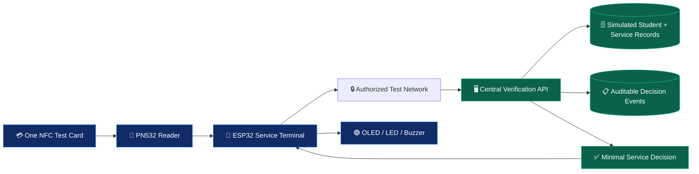
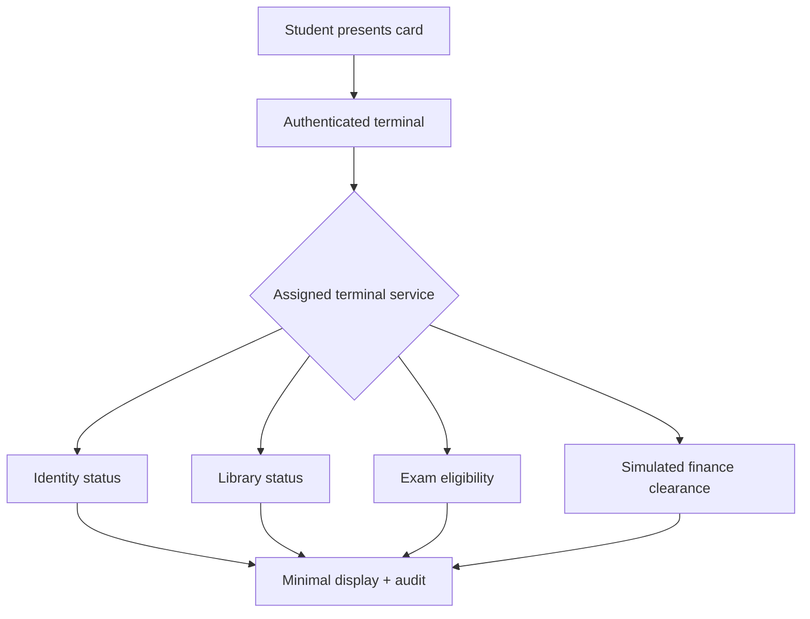
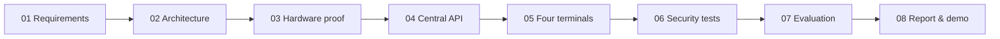

# 🎓 KIU OneCard
### IoT-Based Smart Student Card for Integrated University Services

**One Student · One Smart Card · Four Prototype Service Points**

**Kampala International University · School of Mathematics and Computing**  
**Bachelor of Science in Computer Science · Weekend Session · Year 3, Semester 2**

[Start with the Project Charter](./PROJECT-CHARTER.md) · [Explore Architecture](./ARCHITECTURE.md) · [View Gantt Chart](./GANTT-CHART.md)

---

> [!IMPORTANT]
> **Academic concept and proposed prototype, not an official KIU-operated service.** No live university databases, examination records, payment systems or gates are connected or claimed to be authorized. Design diagrams and test scenarios are *proposals*, not completed experimental evidence.

## Executive summary

This project investigates a **centralized, NFC-enabled student smart card** that can be presented at different service points while a protected central API makes **service-specific decisions**. A proposed ESP32 terminal with a PN532 reader sends a credential reference over a protected test network; the API authenticates the terminal, evaluates simulated student eligibility, returns a minimal response and records an audit event.

The first demonstration targets **Identification, Library, Examination and Finance**. The research evaluates functional correctness, permissions, resilience and user experience; broader campus use would require institutional approval and stronger credential assurance.

## At a glance

| Dimension | Project baseline |
| :--- | :--- |
| **Study title** | Design and Implementation of an IoT-Based Smart Student Card for Integrated University Services |
| **Case study** | Kampala International University (KIU) |
| **Core concept** | One student card across four simulated service terminals |
| **Edge hardware** | ESP32 + PN532 NFC reader + OLED / feedback components |
| **Central services** | Prototype API, sample database, scoped service rules and audit events |
| **Estimated hardware budget** | **UGX 800,000** — historical October 2026 prototype quotation, not live pricing |
| **Delivery planning** | 12-week illustrative baseline starting 9 November 2026, subject to approval |
| **Implementation status** | Not represented as assembled, deployed or validated |

## 01 · Documentation index

The project is organized as a research and engineering dossier. Each section links to the next stage of work.

| No. | Document | Purpose |
| :---: | :--- | :--- |
| **01** | **[Project Charter](./PROJECT-CHARTER.md)** | Research problem, objectives, boundaries, team and success criteria |
| **02** | **[Requirements & Traceability](./REQUIREMENTS-AND-TRACEABILITY.md)** | Numbered functional/nonfunctional requirements, modules and proposed evidence |
| **03** | **[System Architecture](./ARCHITECTURE.md)** | Hardware, central API, scan sequence, data model and failure conditions |
| **04** | **[Four Service Terminals](./SERVICE-TERMINALS.md)** | Identification, Library, Examination and Finance use cases |
| **05** | **[Hardware & Budget](./HARDWARE-AND-BUDGET.md)** | Parts inventory, safe assembly approach and estimated UGX 800,000 bill |
| **06** | **[Security & Testing](./SECURITY-AND-TESTING.md)** | Threats, privacy boundaries, negative tests and evaluation metrics |
| **07** | **[Demo & Operational Guide](./OPERATIONS-AND-DEMO.md)** | Demonstration script, expected outputs, results log and handover checklist |
| **08** | **[Gantt Chart & Milestones](./GANTT-CHART.md)** | Proposed 12-week workstreams, acceptance gates and dependencies |

## 02 · System overview

**Key safeguard:** A card's UID alone does not provide secure authentication against cloning. Actual deployments require cryptographic card authentication, revocation, privacy safeguards and an approved institutional integration.

## 03 · Four student service experiences

| Service point | Question answered | Example display result |
| :--- | :--- | :--- |
| 🪪 **Identification** | Is this a recognized active synthetic student? | VERIFIED / INACTIVE |
| 📚 **Library** | Is this demo profile eligible for a library action? | ELIGIBLE / REVIEW |
| 📝 **Examination** | Is the simulated student eligible for the selected session? | ELIGIBLE / NOT REGISTERED |
| 💳 **Finance** | Is this account marked clear in the *mock* dataset? | CLEARED / PENDING |

[Explore detailed terminal workflows →](./SERVICE-TERMINALS.md)

## 04 · Planned development lifecycle

[View dated project Gantt and weekly deliverables →](./GANTT-CHART.md)

## 05 · Academic team

| Team member | Academic role |
| :--- | :--- |
| **MUSINGUZI STANLEY** | Group member |
| **GYAGENDA PETER KATABALWA** | Group member |
| **MWANGUSHA JOSEPH** | Group member |
| **Eng. Pembe Fahad** | Supervisor listed in the updated topic submission |

The public listing uses the updated topic-submission version. An earlier project funding document named a different third person; **that discrepancy remains to be reconciled by the team**, rather than silently changed. Signatures and registration numbers are not reproduced in this public knowledge page.

## 06 · Research status and publication ethics

- **Documented:** problem framing, proposed system, component list, use cases, risks, test plan, budget baseline and a provisional project schedule.
- **Not claimed:** working hardware, approved campus access, completed code, tested results, actual student verification, or official KIU deployment.
- **Data boundary:** synthetic demonstration records only. No real student, examination or finance data is published.
- **Future possibilities:** authorized campus gates, attendance, hostel/meal and other service modules remain outside the approved four-terminal prototype boundary.

## Technical references

- [Espressif ESP32 security guidance](https://docs.espressif.com/projects/esp-idf/en/stable/esp32/security/security.html)
- [Adafruit PN532 library](https://github.com/adafruit/Adafruit-PN532)
- [OWASP API Security Top 10](https://api-security.owasp.org/editions/2023/en/0x11-t10/)

---

**Published by [Code Therapist](https://github.com/codetherapistpita-oss)** · [Full Knowledge Hub](../README.md) · [Portfolio](https://codetherapist.netlify.app/)

*Technical documentation prepared from the academic concept, team notes and previous project funding quotation. This page is an independent research presentation, not an official Kampala International University publication.*
