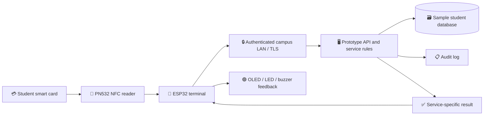

# 🎓 KIU OneCard — IoT Smart Student Card

### One Student · One Smart Card · Multiple University Services

**Design and Implementation of an IoT-Based Smart Student Card for Integrated University Services: A Case Study of Kampala International University**

**Project:** Academic prototype & technical design · **Publication:** 8 November 2026  
**Programme:** BSc Computer Science — Kampala International University (KIU), School of Mathematics and Computing

> [!IMPORTANT]
> **This is an independent student research prototype and case study, not an official live KIU system.** No production KIU student records, payment systems, or access gates are connected or authorized by this publication. Test data is simulated. The proposed timeline is a planning example until the group and supervisor approve actual dates.

## 👥 Project team

| Role | Team member |
|---|---|
| Group member | **MUSINGUZI STANLEY** |
| Group member | **GYAGENDA PETER KATABALWA** |
| Group member | **MWANGUSHA JOSEPH** |
| Supervisor (as listed on submission) | **Eng. Pembe Fahad** |

The public team list follows the updated topic submission dated **4 October 2026**. An earlier hardware funding document uses a different third-member name; the group should reconcile that record before formal submission. Registration numbers and signatures are intentionally not reproduced in this public technical page.

## 📘 Explore the documentation

| Document | What you'll learn |
|---|---|
| 🏗️ **[Architecture & workflow](./ARCHITECTURE.md)** | Hardware, API, central server, tap sequence, roles and data flow |
| 🏛️ **[Service terminals](./SERVICE-TERMINALS.md)** | Library, examination, finance, identity, and later gate/clearance expansion |
| 🔐 **[Security, privacy & test plan](./SECURITY-AND-TESTING.md)** | Authorization, card cloning risks, network failures, test cases and evaluation metrics |
| 🧰 **[Hardware & prototype budget](./HARDWARE-AND-BUDGET.md)** | ESP32, PN532, displays, wiring and the UGX 800,000 estimated quotation |
| 📅 **[Gantt chart & milestones](./GANTT-CHART.md)** | 12-week proposed implementation plan and acceptance gates |

## 🚀 What the system does

A student presents one RFID/NFC-enabled card at an authorized terminal. The terminal requests only the data necessary for its specific university service and displays a minimal result, for example **VERIFIED**, **ELIGIBLE**, **CLEARED**, **PENDING** or **ACTION REQUIRED**. The prototype also records an audit event.

## Four service points in the first prototype

| Terminal | Demonstration | Restricted result |
|---|---|---|
| 🪪 Student identity | Is this an active student identity? | Verified / inactive |
| 📚 Library | Is the account eligible for the requested service? | Eligible / review |
| 📝 Examination | Is the identity registered and eligible for this session? | Eligible / denied / manual check |
| 💳 Finance | Is the *simulated* account marked clear? | Cleared / pending |

**Proposed later extensions:** gate access, hostel/meal services, attendance, academic clearance, lab access and optional mobile app. These are **not part of the four-terminal acceptance scope**.

## 🎯 Project objectives

- Demonstrate one card identity across multiple IoT-enabled university service points.
- Reduce dependence on separate cards and repetitive paper checks in a controlled test environment.
- Enforce server-side per-service permissions and minimal data disclosure.
- Record accountable events and handle invalid, blocked or lost cards.
- Measure prototype verification latency, success rate, usability and reliability.
- Preserve a possible path to future university integrations **only with institutional approval**.

## Prototype status

**Documentation and feasibility design** are prepared; hardware assembly, live terminal operation, software deployment and experimental results are **not claimed as completed** here.

### Learn more

[Code Therapist Knowledge Hub](../README.md) · [Developer profile](https://github.com/codetherapistpita-oss) · [Portfolio](https://codetherapist.netlify.app/)

### Technical sources

- [Espressif ESP32 Security Overview](https://docs.espressif.com/projects/esp-idf/en/stable/esp32/security/security.html)
- [Adafruit PN532 library and interface examples](https://github.com/adafruit/Adafruit-PN532)
- [OWASP API Security Top 10 (2023)](https://api-security.owasp.org/editions/2023/en/0x11-t10/)

*This public article is an independently written technical synthesis informed by the team's prior project proposal, updated topic submission and October hardware quotation. It is not a claim of approval by KIU.*
