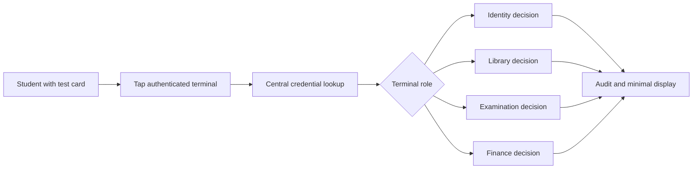

# 02 · Requirements & Traceability Matrix

[← Project home](./README.md) · [Project charter](./PROJECT-CHARTER.md) · [Test plan](./SECURITY-AND-TESTING.md)

> **Baseline:** Proposed requirements synthesized from the research concept and existing GitHub documentation. IDs below are an **editorial tracking system**, not claimed original SRS identifiers. The team and supervisor must review/approve them.

## 2.1 Functional requirements

| ID | Requirement | Priority | Demonstration evidence |
| :--- | :--- | :--- | :--- |
| FR-01 | Recognize a supported NFC test card and obtain its demo reference | Must | Reader serial log and display |
| FR-02 | Authenticate the specific terminal to the central API | Must | Accepted valid device, rejected unknown device |
| FR-03 | Resolve card status (active / blocked / unknown) using sample records | Must | Positive and negative card runs |
| FR-04 | Return an identity verification decision to the identity terminal | Must | ID terminal demonstration |
| FR-05 | Return only library service eligibility to the library terminal | Must | Library scenario and scope denial |
| FR-06 | Return session-specific examination eligibility to the exam terminal | Must | Registered and not-registered tests |
| FR-07 | Return simulated financial clearance status to the finance terminal | Must | Cleared/pending mock profiles |
| FR-08 | Record each decision with terminal, event time and outcome | Must | Sanitized audit records |
| FR-09 | Revoke a demo credential and deny its subsequent use | Must | Revocation test across terminals |
| FR-10 | Present understandable status/errors on OLED and indicator hardware | Must | Operator walkthrough |
| FR-11 | Support authorized enrollment/management of synthetic profiles | Should | Controlled administrative demo |
| FR-12 | Provide offline cache/reconciliation only after a reviewed policy | Future | Design only; not a promised feature |

## 2.2 Non-functional requirements

| ID | Attribute | Proposed acceptance approach |
| :--- | :--- | :--- |
| NFR-01 | Confidentiality | TLS with certificate validation; no unnecessary profile data on device displays |
| NFR-02 | Authorization | Server determines the service scope from authenticated terminal identity |
| NFR-03 | Availability & resilience | Controlled timeout and safe error state during network loss |
| NFR-04 | Auditability | Decision, time, terminal and correlation ID available for test review |
| NFR-05 | Data minimization | Synthetic profiles with only fields required by a service |
| NFR-06 | Performance | Repeated scan measurements; publish median and 95th percentile, not an invented target result |
| NFR-07 | Maintainability | Modular terminal configuration, documented interfaces and versioned test cases |
| NFR-08 | Accessibility & usability | Simple readable text, lights not used as the sole status cue |
| NFR-09 | Security hardening | No shared credentials in public source or insecure bypass of certificate checks |

## 2.3 Requirement-to-module traceability

| Module | Requirements | Planned verification |
| :--- | :--- | :--- |
| NFC + ESP32 device | FR-01, FR-02, FR-10 | T01, T08, T11 |
| Credential lifecycle | FR-03, FR-09, FR-11 | T05, T06 |
| Identity service | FR-04 | T01 |
| Library service | FR-05 | T02, T07 |
| Examination service | FR-06 | T04 |
| Finance status service | FR-07 | T03 |
| Security and audit service | FR-08, NFR-01–09 | T07–T12 and performance evaluation |

Test IDs refer to [Security & Testing](./SECURITY-AND-TESTING.md). This traceability matrix should be revisited at each milestone.

## 2.4 Use-case summary

### Acceptance gate

Each **Must** requirement needs demonstration evidence and a reproducible test result before calling the prototype complete. Requirements may be changed only by documenting the decision and its effect on the budget and Gantt chart.

---

[Hardware & budget](./HARDWARE-AND-BUDGET.md) · [Gantt chart](./GANTT-CHART.md) · [Project home](./README.md)
