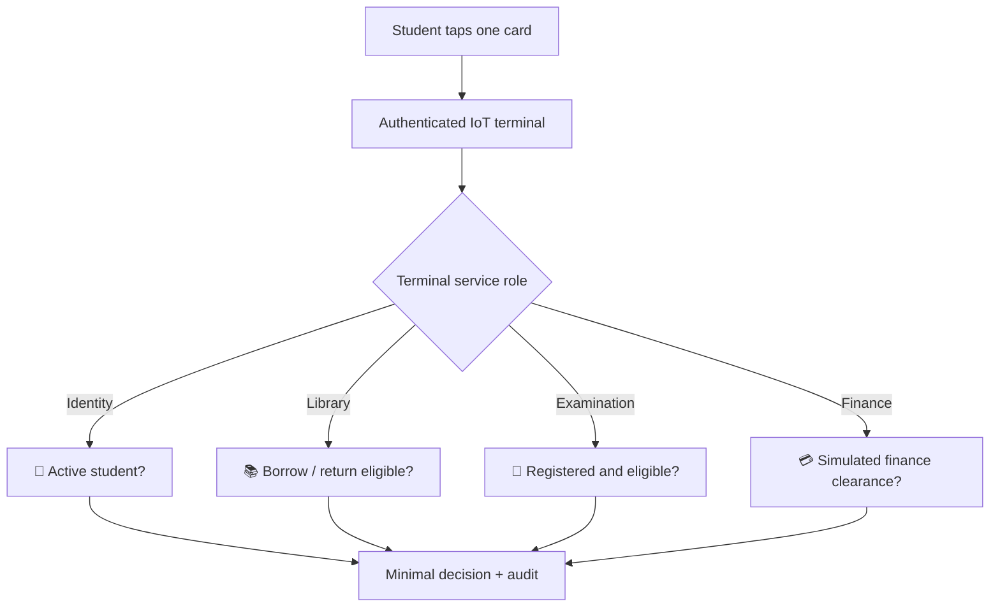
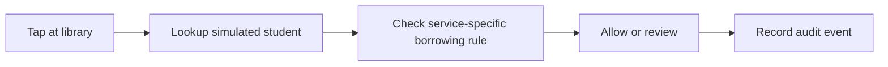

# 🏛️ KIU OneCard — Service Terminal Modules

[← Project homepage](./README.md) · [Architecture](./ARCHITECTURE.md)

## One card, four different authorized decisions

## Terminal 01 — Student identification / green-card reference

**Task:** determine whether the demo credential resolves to an active sample student profile. **Display:** `VERIFIED`, `INACTIVE` or `REVIEW`. The prototype should not expose sensitive profile details on a public-facing display.

## Terminal 02 — Library

**Task:** demonstrate identity confirmation and borrowing/return eligibility. **Inputs:** test card reference, terminal identity, test loan status. **Display:** `ELIGIBLE` / `REVIEW ACCOUNT`.

For a live university integration, actual loan transactions would require a tested library system interface and approved access.

## Terminal 03 — Examination

**Task:** check a fictional student's session registration and exam eligibility. **Display:** `ELIGIBLE`, `NOT REGISTERED` or `MANUAL REVIEW`. **Optional:** fingerprint sensor for a separate supervised high-risk demo only, with consent and an appropriate data-protection design.

Do not treat a card tap alone as proof that the cardholder is the rightful student.

## Terminal 04 — Finance

**Task:** query simulated clearance status for the relevant service. **Display:** `CLEARED` / `PENDING` / `ACTION REQUIRED`.

> [!CAUTION]
> The prototype must not process real payments, expose student balances, or claim to connect to banks or KIU finance data. A future integration would require formal permission, documented API authorization and regulatory review.

## Expandable modules — outside primary demonstration

| Proposed terminal | Future purpose | Status |
|---|---|---|
| 🚪 Gate / campus entry | Authorized access based on approved university policy | **Future only** |
| ✅ General clearance | Cross-department clearance checkpoints | **Future only** |
| 🧪 Laboratory | Permission-controlled lab access | **Future only** |
| 🏠 Hostel / meals | Approved service entitlement | **Future only** |
| 🕘 Attendance | Class or activity check-in | **Future only** |

### Design standard for any new module

Each terminal needs a unique device identity, an assigned service role, an explicit allow/deny decision policy, minimal display content, audit logging and a failure behavior. Administrators should be able to revoke compromised terminals and cards.

[← Project homepage](./README.md)
