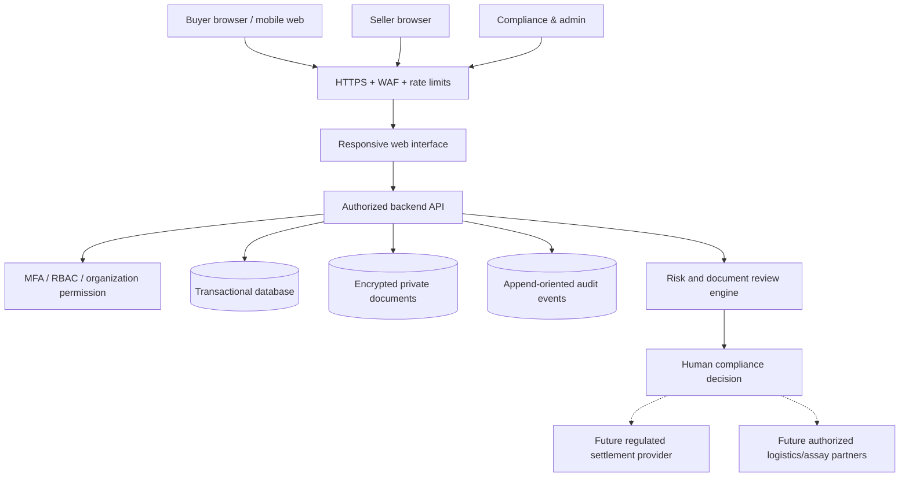
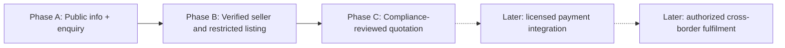

# 03 · Proposed Web Application Architecture

[← Project home](./README.md) · [Business workflows](./WORKFLOWS.md) · [Compliance](./COMPLIANCE-AND-TRUST.md)

> **Design proposal only.** No specific software stack, development contract, production server or payment integration has been approved by the project leads.

## Architecture goals

Mobile-responsive, secure, accessible, audit-ready and configurable by jurisdiction. The initial build should be an **enquiry-and-verification** platform. Transaction settlement, precious-metal custody and customs/shipping are **separate licensed workflows**; the web application must not claim legal authority merely because it stores a document.

## Proposed stack (options subject to Peter's technical approval)

| Layer | Candidate options | Why |
|---|---|---|
| Responsive frontend | React + TypeScript or another approved framework | Reusable, tested interfaces for desktop and mobile |
| Backend | Node.js/TypeScript or PHP/Python service | Enforce roles, company approvals, status and validations server-side |
| Primary data | PostgreSQL or MySQL | Structured transactions, referential constraints, audit references |
| Document storage | Private encrypted object storage | Confidential business/KYC/assay files with time-limited access |
| Identity | Managed authentication + MFA | Role-based, organization-scoped access and secure session management |
| Operations | Containerized service, logging, monitoring, backups | Reliability and traceable incident response |
| Payments | None in research MVP | Conditional future provider, after licences, contracts and security review |

## Secure system diagram

**Design boundary:** all compliance checks run on the server and are verified by human reviewers. Client-visible badges and approvals cannot authorize a transaction.

## Suggested relational entities

| Entity | Major attributes |
|---|---|
| `organizations` | legal name, country, registration identifier, status |
| `users` | identity reference, org, role, MFA state |
| `beneficial_owners` | controlled private identity references and review outcome |
| `licenses` | issuer, legal type, identifier, validity, verified-at, reviewer |
| `gold_listings` | seller ID, form, mass, stated purity, country of origin, visibility state |
| `assays` | laboratory, document hash, sample ID, date, verification and mismatch notes |
| `provenance_records` | source, custody chain, legal supporting evidence |
| `enquiries` | buyer ID, listing ID, submitted time, consent and status |
| `quotes` | terms, issue/expiry date, version, approval state |
| `compliance_cases` | buyer/seller checks, jurisdiction, red flags, decision, assigned reviewer |
| `audit_events` | actor, object, changed fields, timestamp, previous/current status |
| `disputes` | case evidence, staff notes and resolution state |

Sensitive documents must be protected with encryption, scoped permissions, access auditing and lawful retention. Avoid storing raw payment-card data.

## Security and privacy controls

- MFA for staff and sellers; least-privilege access and company isolation.
- Independent application authorization; safe ID checks and no public KYC URLs.
- Signed upload paths, malware scanning, allowed file types, maximum sizes and document expiry alerts.
- Immutable or append-oriented approval history with reviewer identity and timestamp.
- Transaction-state machine and idempotency checks on every future settlement request.
- Explicit consent and purpose limitations for identity data; data subject rights and deletion/retention review.
- Prevent direct buyer-to-unverified-seller payment instructions or changing bank details without out-of-band re-verification.
- Penetration testing and legal review before any actual financial service or cross-border operation.

## Delivery boundaries

No specific payment brand, investment functionality, automated title transfer or escrow mechanism is promised.

**[← Project](./README.md)** · [Roadmap](./ROADMAP.md)
