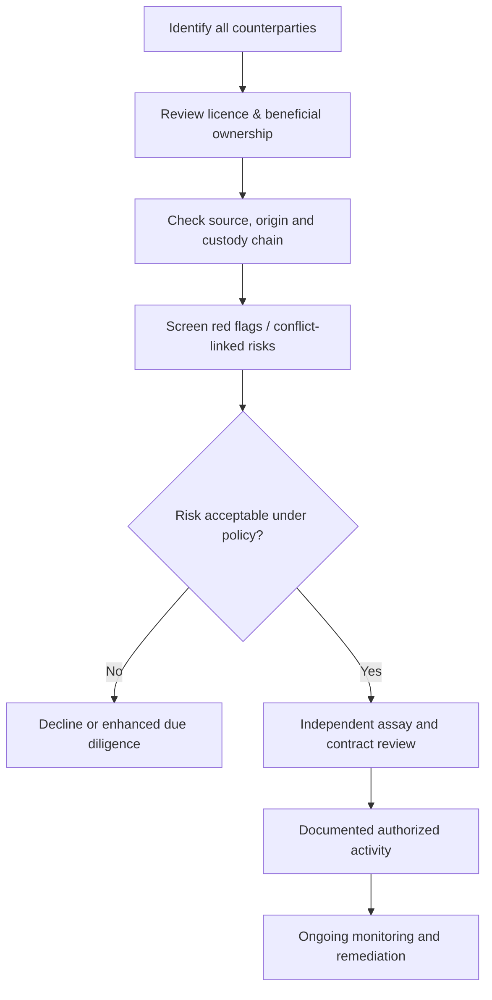

# 04 · Gold Marketplace Trust, Regulatory and Responsible-Sourcing Design

[← Project home](./README.md) · [User workflows](./WORKFLOWS.md)

> **Regulatory research, not legal advice.** Requirements vary by whether the operator is a licensed dealer, broker, technology marketplace, exporter, importer, transporter, refiner or custodian, and by each jurisdiction. The project must obtain specialist Ugandan and cross-border legal advice **before** trading, receiving funds or offering shipping.

## Uganda legal and operating checks

| Topic | Research finding / design implication | Public source |
|---|---|---|
| **Mineral dealer's licence** | Uganda's trade guidance describes a Mineral Dealer’s Licence and applicable requirements for lawful mineral trading. The platform must determine who actually sells/owns the metal and whether intermediary activities also require authorization. | [Uganda Trade Portal](https://ugandatrades.go.ug/objective/120?embed=true&includeSearch=true) |
| **Export permits** | Uganda's Mining and Minerals Act 2022 provides that mineral exports require an export permit. Do not advertise global deliveries absent transaction-specific approvals. | [Mining and Minerals Act 2022](https://www.ugeiti.org/wp-content/uploads/2023/03/Mining-and-Minerals-Act-2022.pdf) |
| **Official licensing procedure** | DGSM's mining cadastre FAQ documents dealer and import/export requirements. Always confirm the applicable **current** instrument, forms and fees before launch. | [Uganda Mining Cadastre FAQ](https://dgsmportal.minerals.go.ug/site/CustomHtml.aspx?PageID=d7ef5107-4c62-4f57-9483-ac7fcdfc96d4&guidAsset=4d4b0319-663c-4ad7-96fb-efceaa99bedd) |
| **FIA registration** | On **13 February 2026**, Uganda's Financial Intelligence Authority reiterated that dealers in precious metals and stones must register as accountable persons. | [FIA notice](https://fia.go.ug/fia-registration-requirement-for-dealers-in-precious-stones-and-metals/) |
| **KYC / AML / CFT** | FIA guidance calls for risk-based due diligence, identity/beneficial-owner checks, ongoing monitoring and appropriate reporting/record controls for applicable accountable persons. | [FIA due diligence guidelines](https://fia.go.ug/aml-cft-customer-due-diligence-guidelines-for-dnfbps/) |
| **Responsible sourcing** | OECD guidance helps buyers and companies assess conflict/abuse risk and trace high-risk mineral supply chains. | [OECD guidance](https://www.oecd.org/en/publications/oecd-due-diligence-guidance-for-responsible-supply-chains-of-minerals-from-conflict-affected-and-high-risk-areas_9789264252479-en.html) |

## What “verified” should mean

A **verified seller** badge must show its scope, reviewer and review date. It should never imply the operator has established absolute ownership, that every gold bar is authentic, that the mine is ethical, or that payment and delivery are guaranteed.

| Proposed status | Exact public meaning |
|---|---|
| **Business reviewed** | Organization details reviewed against accepted evidence on a particular date |
| **Licence checked** | A named authorization checked with appropriate issuer records; show scope and expiry |
| **Assay document reviewed** | Submitted assay report reviewed; **not** an unconditional purity guarantee |
| **Origin documentation reviewed** | Specified provenance documentation reviewed; risk of gaps remains |
| **Transaction approved** | Specific case passed required internal checks; distinct from final legal or customs authorization |

No badge should be shown if the actual review did not happen.

## Responsible sourcing due diligence

Key red flags can include unusual declared origins, provenance inconsistencies, sanctions exposure, concealed controlling persons, suspicious pricing, undocumented high-risk locations and evasive settlement requests. Review against current law and applicable reporting obligations.

## Country-by-country launch gate

For each new African jurisdiction, require a written matrix documenting: legal entity/foreign operation, licences, dealing or brokering permissions, KYC/AML obligations, consumer protection, tax, export/import restrictions, customs, buyer identity, FX/payment restrictions, secure logistics, transport insurance and dispute venue. **Do not assume one Uganda licence works across Africa.**

## Safeguards before enabling transactions

1. Legal opinion on the proposed marketplace role and seller/buyer licensing.
2. Confirmed regulator and issuer verification procedure.
3. Written AML, sanctions and beneficial-owner onboarding policy.
4. Contracted independent assay / verification process.
5. Documented payment settlement provider and fund ownership rules.
6. Provenance/risk review, supported source documentation and title transfer terms.
7. Secure logistics, export/import customs and insurance where relevant.
8. Responsible dispute process and verified customer-support identity.

## Consumer warning model

> “Listings and indicative pricing are invitations to enquire, not guarantees of physical stock or final transaction terms. Legal ownership, licensing, gold quality, source, shipment and payment are subject to independent checks. We do not accept payments outside an approved documented process.”

## Official reading list

- [Uganda Financial Intelligence Authority](https://fia.go.ug/)
- [Uganda mining cadastre portal](https://dgsmportal.minerals.go.ug/)
- [Uganda Trade Portal](https://ugandatrades.go.ug/objective/120?embed=true&includeSearch=true)
- [Uganda Mining and Minerals Act 2022](https://www.ugeiti.org/wp-content/uploads/2023/03/Mining-and-Minerals-Act-2022.pdf)
- [OECD due diligence for minerals](https://www.oecd.org/en/publications/oecd-due-diligence-guidance-for-responsible-supply-chains-of-minerals-from-conflict-affected-and-high-risk-areas_9789264252479-en.html)

**[← Project home](./README.md)**
