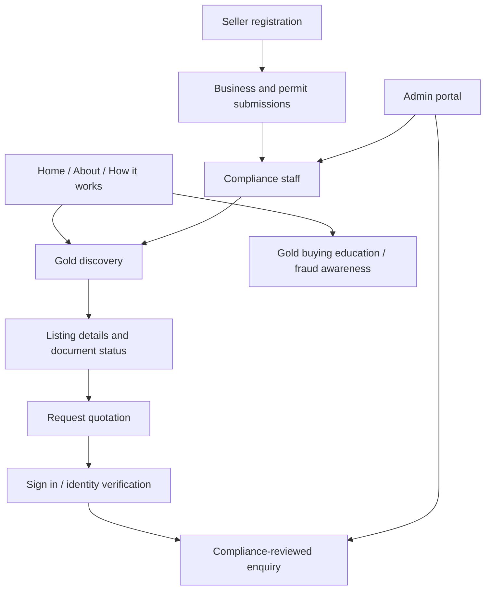

# 01 · Africa Gold Marketplace — Product Brief

[← Project home](./README.md) · [Trust model](./COMPLIANCE-AND-TRUST.md)

## 1. Project identity and leadership

**Working project name:** Africa Gold Marketplace (pending approval). **Idea Lead:** Ryan. **Lead Application Developer:** Peter (Gyagenda Peter Katabalwa). **Primary geographic concept:** Uganda, with later country-by-country expansion across Africa.

The user-supplied brief identifies a platform where interested buyers can reach out to explore buying gold. **No registered business name, corporate ownership split, stock inventory, budget, seller agreements or regulatory licences have yet been supplied.** These must remain open decisions, not invented facts.

## 2. Problem and opportunity

Gold buyers require reliable channels to identify counterparties, understand quality/quantity and documentation, and avoid fraud. Sellers need a credible method to present verified company information and handle serious enquiries. Cross-border mineral transactions add complex licensing, provenance, payment, taxes, customs and logistics requirements.

**Proposed solution:** a web-first, professional **verified-enquiry marketplace** with identity checks, metal details, document review and controlled transaction escalation. Later expansion can include more jurisdictions only after local legal advice, licensing and operational partnerships.

## 3. Stakeholder groups

| Stakeholder | Primary goals |
|---|---|
| Buyer | Search, compare specifications, request documents and a quotation |
| Seller / mineral dealer | Register company, submit licensing and product details, handle eligible enquiries |
| Compliance reviewer | Review identity, beneficial ownership, sanctions/AML risk, source of metal, expiry and permissions |
| Assay/inspection partner | Independently assess purity, weight and sample details under an authorized process |
| Marketplace administrator | Moderate listings, control permissions, review incident/audit logs |
| Legal/logistics/settlement partner | Review contracts, import/export steps, permitted settlement and insured delivery |

## 4. Product features — MVP and future

| Feature | Phase | Notes |
|---|---|---|
| Responsive landing page, gold education, buyer FAQs | MVP | Clear disclosures; no investment guarantees |
| Gold categories (e.g. bars, refined gold) | MVP | Category taxonomy only, not actual product availability |
| Seller application form | MVP | Seller unpublished until screened |
| Identity and beneficial-owner document workflow | MVP | Access controlled, country-specific legal basis |
| Listing details: fineness, mass, assay, origin, date | MVP | Must distinguish submitted claims from independently verified evidence |
| Buyer enquiry / request for quotation | MVP | No automatic binding order |
| Case and verification dashboard | MVP | Permissioned staff actions, document versioning |
| Messaging and quotation status | MVP | Audit trails, anti-spam controls |
| Verified payment / escrow provider integration | Later, conditional | Only licensed/contracted providers after compliance review |
| Cross-border licences, customs, transport, insurance | Later, conditional | Per-country legal and operational approvals |
| Mobile application | Later | Prioritize secure responsive web first |
| Price reference feed | Later, conditional | Licensed market data and clear indicative/non-binding pricing |

## 5. Proposed information architecture

## 6. Early UX layout — public-safe concepts

1. **Hero:** “Explore verified pathways to buying gold in Africa,” with an enquiry CTA, not a “Buy now” button.
2. **How it works:** Discover → Check documentation → Enquire → Human review → Authorized transaction.
3. **Seller detail:** legal business identity, permitted jurisdiction, last checked date and verification scope.
4. **Gold specification:** form, weight, fineness, assay lab, sample date, reference identifiers with restricted sensitive details.
5. **Trust section:** licensing, sourcing, AML controls, fraud reporting and exact meaning of any “reviewed” label.
6. **Responsive layout:** gold highlights against charcoal/navy/white with high-contrast text and restrained animation.

## 7. Initial business model ideas — not approved revenue assumptions

Optional listing/subscription fees for screened legal dealers, administrative quotation services (where permitted), or commercial partner referral arrangements **only after legal and financial review**. Fees must never incentivize bypassing source-of-gold checks or encourage undisclosed commissions.

## 8. Open decisions

Registered trading entity; ownership and partnership agreement; trademark and product name; exact gold categories; target buyer/seller profiles; seller onboarding authority; country-by-country licence coverage; proof-of-funds and payment process; hosting jurisdiction; compliance officer; independent assay partners; insurance and shipping partners; financial model; staffing and budget.

**[← Project Overview](./README.md)** · [Architecture](./ARCHITECTURE.md)
