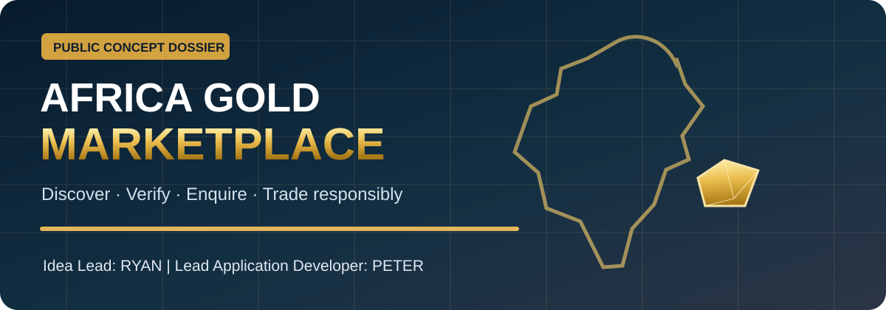
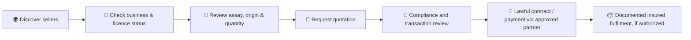

# 🪙 Africa Gold Marketplace
### A proposed verified gold discovery and buyer–seller engagement web platform

**Starting focus: Uganda · Long-term ambition: lawful cross-border access across Africa**

[Overview](./PROJECT-BRIEF.md) · [Buyer and Seller Journeys](./WORKFLOWS.md) · [Architecture](./ARCHITECTURE.md) · [Trust and Compliance](./COMPLIANCE-AND-TRUST.md) · [Development Roadmap](./ROADMAP.md)

> [!IMPORTANT]
> **Public concept documentation, not a live gold exchange or an offer to sell investment assets.** The product name “Africa Gold Marketplace” is a **working descriptive title**, pending agreement with the project principals, brand/legal clearance and applicable licensing. No verified seller, metal inventory, certificates, payment provider, price or delivery guarantee is represented as real. The project should not handle customer funds, custody gold or facilitate shipment before appropriate legal and operational reviews.

## 👥 Project leadership

| Responsibility | Person | Scope |
|---|---|---|
| **Idea Lead / Product Vision** | **Ryan** | Original concept leadership, target market and buyer/seller business requirements |
| **Lead Application Developer** | **Peter (Gyagenda Peter Katabalwa)** | Proposed software architecture, web application design, security and development execution |
| **Technical documentation showcase** | Code Therapist / ByteLab Uganda Ltd knowledge hub | Public technical concept research and presentation; **not proof of legal incorporation of a separate gold-trading business or a signed partnership** |

## Vision

Build a credible digital destination where **people in Uganda and, later, other African markets** can discover gold offerings from **independently screened, legally authorized counterparties**; understand what the gold actually is, review documents and assay evidence, make enquiries and progress through a **human-controlled lawful transaction workflow**.

Unlike a generic shopping-cart website, the early product should function as a **compliance-gated enquiry marketplace**: it does not publish unverified stock as “certified,” does not accept anonymous high-risk payments and does not automatically promise cross-border delivery.

### The customer experience, conceptually

## Project documentation

| Guide | What readers will find |
|---|---|
| **[01 · Concept & Product Brief](./PROJECT-BRIEF.md)** | Stakeholders, market problem, proposed features, buyer and seller profiles, MVP scope |
| **[02 · User Workflows](./WORKFLOWS.md)** | Buyer enquiry, seller onboarding, verification, quotations, order gates and dispute flow |
| **[03 · Technology Architecture](./ARCHITECTURE.md)** | Responsive frontend, APIs, structured data model, security, file verification and admin |
| **[04 · Regulatory Trust Model](./COMPLIANCE-AND-TRUST.md)** | Uganda permits, FIA registration, KYC, responsible sourcing, export controls and cross-border restrictions |
| **[05 · Proposed Roadmap](./ROADMAP.md)** | Phased concept-to-pilot schedule, dependencies, project deliverables and testing |

## Proposed website areas

| Public experience | Verified private experience |
|---|---|
| Home / market introduction | Seller business registration and vetting |
| Gold education and buyer FAQs | Identity/ownership and beneficial-owner verification |
| Search with indicative product categories | Restricted gold listings with document checks |
| Listing detail with clearly indicated evidence status | Assay/provenance review and expiry tracking |
| Request quotation / schedule consultation | Offer, KYC, compliance approval and audit trail |
| Contact and enquiry tracking | Staff review, sanctions screening and dispute management |

## Product safeguards

- No live payment gateway in the first research MVP; quotations are **not** binding checkout offers.
- No invented “verified gold,” government endorsements, certificates, licenses, gold prices, customs approvals or physical inventory.
- Work only with appropriately licensed businesses and specialists; perform independent metal assay and origin checks as required.
- Check trade requirements **country by country**. A Uganda permit does not authorize trading in all African countries.
- Sensitive identity data and documents must be encrypted, access-controlled and removed according to appropriate retention rules.
- Avoid using “guaranteed profit,” “risk-free gold” or investment-return promises.

## Current status

**Concept and public research dossier prepared 9 November 2026.** Development, incorporation, regulatory clearance, commercial agreements and custody/payments infrastructure have **not** been verified. The milestone dates in the roadmap are an **illustrative proposed sequence**, not a contract.

### Reference authorities

[Uganda Mining Cadastre](https://dgsmportal.minerals.go.ug/) · [Uganda Trade Portal](https://ugandatrades.go.ug/objective/120?embed=true&includeSearch=true) · [Uganda Financial Intelligence Authority](https://fia.go.ug/fia-registration-requirement-for-dealers-in-precious-stones-and-metals/) · [OECD Minerals Due Diligence](https://www.oecd.org/en/publications/oecd-due-diligence-guidance-for-responsible-supply-chains-of-minerals-from-conflict-affected-and-high-risk-areas_9789264252479-en.html)

---

**[← ByteLab Product R&D Library](../README.md)** · [Code Therapist GitHub](https://github.com/codetherapistpita-oss)

*Research and design concept; not legal, trade, investment or tax advice.*
