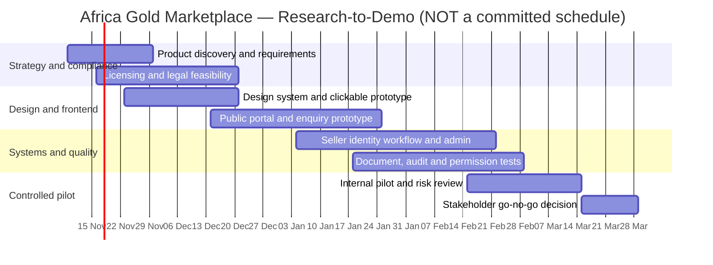
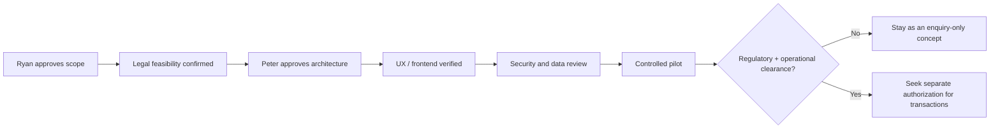

# 05 · Africa Gold Marketplace — Proposed Roadmap and Acceptance Gates

[← Project home](./README.md) · [Architecture](./ARCHITECTURE.md) · [Compliance model](./COMPLIANCE-AND-TRUST.md)

> [!IMPORTANT]
> **An illustrative 20-week planning sequence, not an approved schedule, project budget or commercial commitment.** Work is not claimed complete; dates, staffing and deliverables require sign-off from **Ryan (Idea Lead)** and **Peter (Lead Application Developer)**. Regulatory activities may take considerably longer than the technical prototype.

## Phased delivery plan

| Phase | Indicative timing | Outcome / acceptance evidence |
|---|---|---|
| **01 · Discovery** | Weeks 1–3 | Ryan's product vision, target buyers and sellers, legal role, country scope and requirements confirmed |
| **02 · Compliance feasibility** | Weeks 2–6 | Ugandan professional legal review, licensing matrix, KYC requirements and sourcing policy |
| **03 · UX / design system** | Weeks 3–6 | Responsive prototype, public disclosure templates and accessibility review |
| **04 · MVP frontend** | Weeks 6–11 | Home, education, search, listing details and enquiry forms using **fictional demo inventory** |
| **05 · Verification backend** | Weeks 8–15 | Seller screening queue, permissioned documents, case handling, audit and security tests |
| **06 · Internal pilot** | Weeks 14–18 | Controlled walkthrough with synthetic/test data; compliance and security evidence |
| **07 · Review and decision** | Weeks 18–20 | Go/no-go decision, gap assessment, ownership and funding approvals |

## Illustrative relative Gantt

Calendar dates are shown only to make a **relative illustrative plan** render in GitHub Mermaid. They are not actual booking dates, launch promises or confirmation that software work has started.

## Requirements-to-acceptance gates

### Completion evidence checklist

- [ ] Ryan and Peter agree product name, ownership, responsibilities, requirements and timeline.
- [ ] Independent Ugandan legal/compliance specialist documents permitted platform role.
- [ ] Target seller categories and proof requirements approved.
- [ ] Design mockups and mobile breakpoints reviewed.
- [ ] No demo listing misleadingly claims real gold, verified provenance or market price.
- [ ] API authorization, MFA, audit events, encrypted documents and backups tested.
- [ ] Independent security review performed on the prototype.
- [ ] Partner agreements, applicable licences and permits validated before any live sale.
- [ ] Operating model, support routes, dispute management and commercial viability approved.

## Decisions still required

Business legal entity and responsibilities; owner equity/commercial agreements; product brand and domain; budget; seller acquisition strategy; regional launch sequence; accepted gold forms and minimum quantities; payments; logistics; insurance; licensing; and marketing/legal disclaimers.

**[← Project overview](./README.md)**
