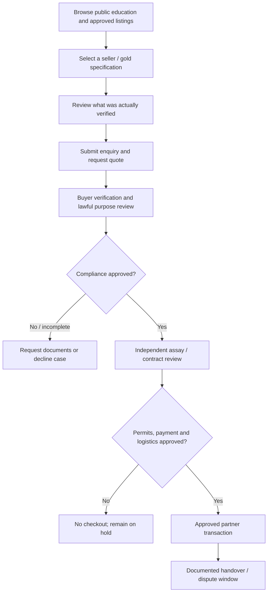
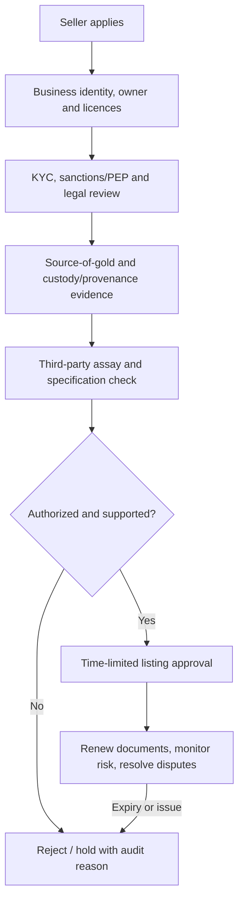
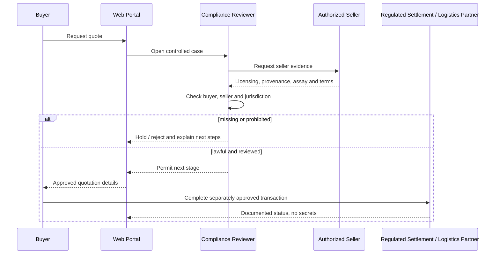

# 02 · Gold Marketplace User Journeys & Transaction Controls

[← Project home](./README.md) · [Architecture](./ARCHITECTURE.md) · [Compliance](./COMPLIANCE-AND-TRUST.md)

## A. Buyer journey

**Example:** A buyer in Kampala enquires about a hypothetical 100g listing. The portal **must not infer the gold exists**, is genuine or available. A trained reviewer checks counterparty documents, metal evidence, source, payment plan and transaction lawfulness before anything progresses.

## B. Seller onboarding and listing lifecycle

### Seller data to consider

Business legal name, registered jurisdiction, dealer/mining rights status, beneficial owners, authorization expiry, authorized signatory, contact details, gold form, quantity, purity, origin, location of custody, assay results and the chain of supporting documents. Never expose private identity documents publicly.

## C. Quote and deal status

| Stage | Meaning | Permitted action |
|---|---|---|
| Draft enquiry | A person expresses interest | No financial commitment |
| Buyer onboarding | Identity and purpose checked | Enquiry remains restricted |
| Seller document review | Evidence is under review | No “verified” public claim yet |
| Quotation | Terms proposed with validity period | Not a payment instruction by itself |
| Compliance hold | A risk or missing permit prevents progress | No settlement |
| Contract reviewed | Legal scope, quality and settlement conditions approved | Escalate to authorized partners |
| Authorized transaction | All necessary approvals explicitly recorded | Execute only through lawful approved process |
| Fulfilment / dispute | Assay acceptance, title transfer, insured delivery if applicable | Evidence and complaint handling |

## D. Human handoff and audit controls

## E. Fraud and dispute pathways

False assay certificates, spoofed dealer identities, stolen source documents, bait pricing, impersonated staff, attempted off-platform payments and origin inconsistencies must trigger documented investigation/holds. Support escalation to responsible law enforcement/regulators where legally required.

**Never advertise automatic escrow, guaranteed metal purity or worldwide shipment until licensed partners and procedures are actually established.**

[← Project home](./README.md)
