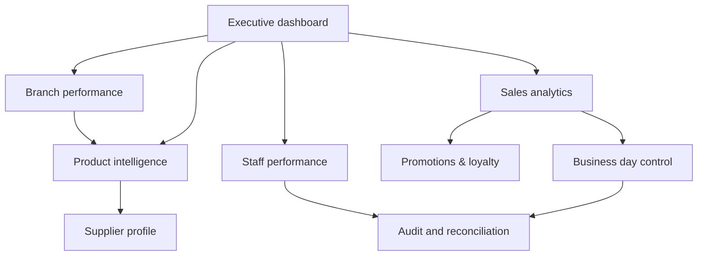
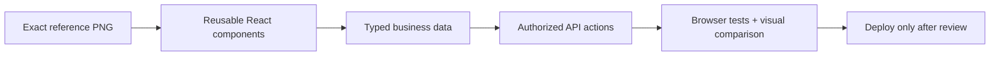

# 05 · Byte Buz Visual Design Showcase

[← Project home](./README.md) · [Twenty-screen map](./FEATURES-AND-SCREENS.md) · [Workflows](./WORKFLOWS-AND-CONTROLS.md)

> [!NOTE]
> **Owner-supplied concept screens, not production screenshots.** All prices, quantities, performance figures, identities, transaction references, stock counts, ratings, business dates and branch information shown in the mockups are **illustrative**. The original image files are not yet committed to this public repository; the sections below point to the exact filenames in the prepared upload bundle. Missing images will appear until binary assets are committed.

## Original Byte Buz visual identity

The approved identity uses a **blue cloud outline**, a cartoon shop attendant at a POS machine, ascending business bars, a red growth swoosh and the **Byte Buz** name. The overall product style is white-first dashboards with a deep-blue sidebar and carefully limited red for destructive actions, risk and high-priority controls.

## Find a screen

| Gallery section | Original screen | Underlying module |
| :--- | :--- | :--- |
| [01. Product details — Riham White Sugar 1kg](#screen-01) | `01-product-intelligence.png` | Inventory, stock valuation, price trends and barcode tools |
| [02. Supplier Profile — Mukwano Group](#screen-02) | `02-supplier-profile.png` | Supplier purchasing, lead time, outstanding balances and scorecards |
| [03. Promotions & Loyalty](#screen-03) | `03-promotions-loyalty.png` | Campaign management, redemption analytics, segmentation and discount rules |
| [04. Branch Performance](#screen-04) | `04-branch-performance.png` | Multi-branch sales ranking, alerts and transfer recommendations |
| [05. Business Day Control](#screen-05) | `05-business-day-control.png` | Opening floats, tills, closing variance and approval |
| [06. Sales Analytics](#screen-06) | `06-sales-analytics.png` | Sales trends, product contribution, heatmaps and key insights |
| [07. Staff Performance](#screen-07) | `07-staff-performance.png` | Employee sales, shifts, attendance and audit alerts |

## Original interface gallery

### Screen 01 · Product details — Riham White Sugar 1kg

**Information architecture:** Inventory, stock valuation, price trends and barcode tools. The supplied mockup shows a landscape administration dashboard with a branded left sidebar, contextual header, financial/statistical cards and operational actions.

### Screen 02 · Supplier Profile — Mukwano Group

**Information architecture:** Supplier purchasing, lead time, outstanding balances and scorecards. The supplied mockup shows a landscape administration dashboard with a branded left sidebar, contextual header, financial/statistical cards and operational actions.

### Screen 03 · Promotions & Loyalty

**Information architecture:** Campaign management, redemption analytics, segmentation and discount rules. The supplied mockup shows a landscape administration dashboard with a branded left sidebar, contextual header, financial/statistical cards and operational actions.

### Screen 04 · Branch Performance

**Information architecture:** Multi-branch sales ranking, alerts and transfer recommendations. The supplied mockup shows a landscape administration dashboard with a branded left sidebar, contextual header, financial/statistical cards and operational actions.

### Screen 05 · Business Day Control

**Information architecture:** Opening floats, tills, closing variance and approval. The supplied mockup shows a landscape administration dashboard with a branded left sidebar, contextual header, financial/statistical cards and operational actions.

### Screen 06 · Sales Analytics

**Information architecture:** Sales trends, product contribution, heatmaps and key insights. The supplied mockup shows a landscape administration dashboard with a branded left sidebar, contextual header, financial/statistical cards and operational actions.

### Screen 07 · Staff Performance

**Information architecture:** Employee sales, shifts, attendance and audit alerts. The supplied mockup shows a landscape administration dashboard with a branded left sidebar, contextual header, financial/statistical cards and operational actions.

## Screen relationships

## Visual communication standards

| Component | Design guidance |
| :--- | :--- |
| Sidebar | Consistent deep-blue navigation and active state |
| Main canvas | White/light-gray background, comfortable margins |
| Metric tiles | Clear labels, UGX format, period comparisons |
| Tables | Compact, searchable, permissions-aware, contextual status tags |
| Graphs | Labeled axes and legends; genuine back-end supplied data |
| Alerts | Red only for high-risk or destructive states; no red overload |
| Product media | Aspect-ratio-safe images with fallback and descriptions |
| Responsiveness | Desktop 1366px+; tablet adaptation and touch-ready POS |

### From approved mockup to functioning UI

Do not embed full-screen mockup images as the functioning interface; render accessible actual React controls, data charts and tables. Compare implementations against the references in a real browser.

## Original images — upload state

The complete original-image package is prepared separately for transfer. The image paths above are reserved in `assets/original/`, but the connected GitHub text editor cannot write arbitrary binary PNG files. **Until the originals are manually added to the repository, the placeholders will be broken images.** The asset manifest is published in [UPLOAD-GUIDE.md](./assets/UPLOAD-GUIDE.md).

---

[← Byte Buz project](./README.md) · [ByteLab R&D](../README.md)
