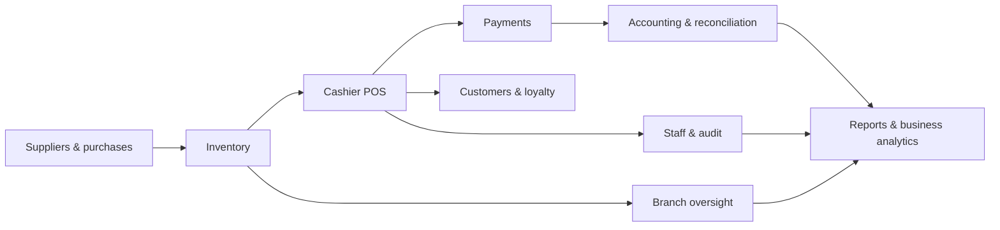

# 02 · Functional Modules & Twenty-Screen Map

[← Project home](./README.md) · [Visual gallery](./DESIGN-SHOWCASE.md) · [Workflows](./WORKFLOWS-AND-CONTROLS.md)

The table below preserves the **20 screen areas and routes** named in the original Byte Buz Master Prompt v1.0. It is a requirements map, **not a list of verified implemented pages**.

| ID | Route | Screen | Main planned information / actions |
| :---: | :--- | :--- | :--- |
| 01 | `/dashboard` | Executive dashboard | Sales, gross profit, transaction counts, payment mix, alerts |
| 02 | `/sales/pos` | Cashier POS | Barcode/SKU search, cart, discount, authorized payment, receipt |
| 03 | `/inventory` | Inventory | Products, images, reorder levels, movements, stock values |
| 04 | `/accounting` | Accounting | Revenue, COGS, expenses, reconciliation and net profit |
| 05 | `/customers` | Customer CRM | Consent, loyalty points, segment/retention information |
| 06 | `/staff/performance` | Staff performance | Sales per staff, attendance, flagged actions |
| 07 | `/sales/analytics` | Sales analytics | Time series, top categories, peak hours, heatmap |
| 08 | `/purchases` | Purchases and suppliers | Purchase orders, deliveries, supplier scorecards |
| 09 | `/reports` | Report center | Sales/profit/stock reports, authorized PDF/Excel/CSV exports |
| 10 | `/settings/users-roles` | Roles & permissions | User access, branches, integration and security settings |
| 11 | `/operations/business-day` | Business day control | Opening float, tills, count/expected variance, manager close |
| 12 | `/sales/returns` | Returns & refunds | Receipt lookup, return approval, refunds, credit notes |
| 13 | `/customers/credit` | Credit and debtors | Balances, aging, collection, risk status, payments |
| 14 | `/branches/performance` | Branch performance | Multi-branch rankings, alerts, transfer suggestions |
| 15 | `/accounting/reconciliation` | Payment reconciliation | Cash, MTN MoMo, Airtel Money, bank and unmatched transactions |
| 16 | `/customers/promotions` | Promotions & loyalty | Campaigns, discounts, segmentation and redemptions |
| 17 | `/suppliers/:supplierId` | Supplier profile | Purchase trends, deliveries, products and payment history |
| 18 | `/inventory/products/:productId` | Product intelligence | SKU, barcode, stock trends, margins, stock across branches |
| 19 | `/security/audit` | Audit & security | Events, price overrides, failed logins and approvals |
| 20 | `/settings/sync-backup` | Sync & backup | Apps Script, Sheets, mirror heartbeat, backups, restore approvals |

## Module dependency map

## Financial data standard

All amounts are displayed in **UGX**. Authoritative money calculations must occur on the backend using integers or decimal-safe types, with discounts, fees, refunds and reconciliations explicitly recorded. Illustrative numbers in screenshots are not financial statements.

## UI quality gate

Each page needs a working route, shared components, permission checks when applicable, appropriate empty/loading/error states, typed data, test coverage, and visual review against the actual reference. A picture that looks correct is not a functioning POS screen.

[← Project home](./README.md)
